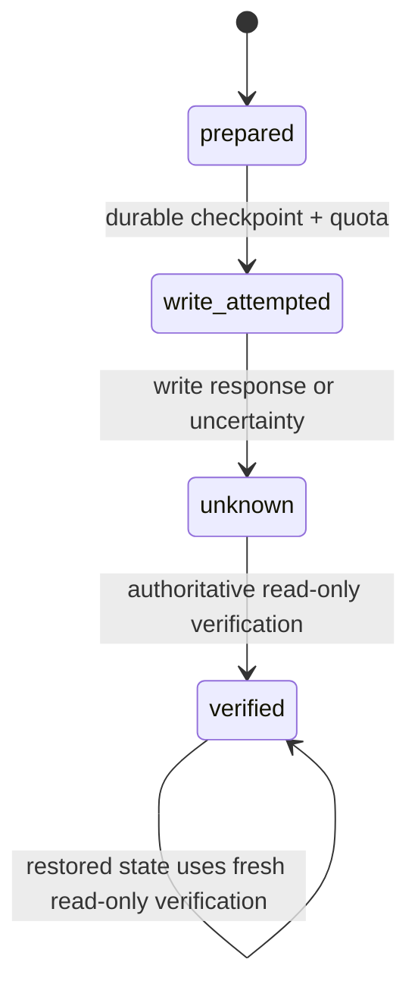

# الدماغ الحالي في Mohassan

هذه الوثيقة تصف الشفرة الموجودة في مساحة العمل يوم **21 نوفمبر 2026**. لا تعني أن كل قدرة مفعّلة في كل تشغيل، أو أن هذه النسخة منشورة. حالة التشغيل تؤخذ من المضيف والحساب والأدوات المتاحة، ويظل اسم نموذج مكتوب في الإعدادات مختلفًا عن نموذج يعمل فعلًا.

**التحقق الحالي للمصدر المصحّح:** نجح بناء الإنتاج و44 فحص واجهة و24/24 اختبار Playwright و32/32 حالة تقييم وظيفي محدودة. أنهى الفحص الشامل 6118 حالة ناجحة وحالة فشل متوقعة وتخطيين وإخفاقًا واحدًا من 6122 حالة: اختبار إدخال Windows الأصلي لم يحصل على تركيز نافذته وأعاد `FOCUS_DENIED` دون إدخال. تبقى النتيجة الشاملة غير ناجحة، ويبقى الإتمام الإيجابي للإدخال الأصلي غير متحقق في الجلسة الحالية. التفاصيل والتقارير الأصلية محفوظة أدناه.

يجمع [التدقيق المستقل النهائي](../artifacts/brain-development/2026-11-21/final-audit/2026-11-21T11-53-49.370Z-ea57227d/consolidated-verification.json) حدود قبول كل مكوّن، ويسجل صراحة `allRunsAccepted:false` بسبب الإخفاق الأصلي؛ [فحص المصدر النهائي](../artifacts/brain-development/2026-11-21/final-audit/2026-11-21T11-53-49.370Z-ea57227d/initial-source-freeze-audit.json) يثبت أن الفرق اللاحق الوحيد في وثيقة الشرح، دون تغيير ملفات التنفيذ أو الاختبارات.

## ما المقصود بالدماغ؟

«الدماغ» هنا اسم لمنظومة التطبيق التي تفهم الطلب ضمن نطاقها، وتحفظ سياقه، وتختار خدمة مناسبة، وتضبط الأدوات والصلاحيات، ثم تراجع الأدلة والنتيجة. تشمل المنظومة قواعد وبرامج حتمية، وذاكرة ومستندات، ومتصفحًا، وعقود تحقق. **ليست كل هذه الأجزاء نموذجًا عصبيًا، ولا يؤدي تطويرها إلى تغيير أوزان نموذج المحادثة تلقائيًا.**

في إعداد الخادم الافتراضي، لا يوجد مزوّد توليد محادثة عام مفعّل: تم إسقاط مفاتيح الذكاء الاصطناعي الخارجي وتعطيل بدائله. وجود أسماء نماذج افتراضية في الكود لا يشغّلها. يفحص المنسق وجود مزوّد فعلي أو مسار استدلال نشط قبل استخدام المحادثة المولدة. لذلك يستطيع الرد محليًا على حساب مدعوم، أو استرجاع موثق، أو أمر متصفح معروف، بينما قد يطلب تفاصيل أو يصرّح بعدم توفر قدرة أخرى. انظر [إعداد الخادم](../apps/server/src/config.ts)، و[تعطيل المنصات الخارجية](../apps/server/src/inference.ts)، و[اختبار وجود نموذج محادثة](../apps/server/src/command-chat.ts).

يوجد رد محلي لسؤال «ما الدماغ الحالي؟». يعرض حقائق يمررها المضيف: إصدار المنسق، وتهيئة التوليد، ووصول الحساب، وحالة الفحص المعروفة. لا يستنتج اسم نموذج نشط من قائمة أسماء، ولا يسمّي قدرة سليمة دون إيصال فحص مناسب. عبارة «المراحل مدعومة» لا تثبت مرور هذا الرد بعينه بكل مرحلة. [صيغة حقائق المضيف وعرضها](../apps/server/src/assistant/runtime-status.ts)، [موضع توصيلها بالمحادثة](../apps/server/src/command-chat.ts).

## قبل الجواب وأثناءه وبعده

| المرحلة | ما هو موصول فعليًا | حدود الاستنتاج |
| --- | --- | --- |
| قبل الجواب | سجل تشغيل مرتبط بالحساب والمحادثة؛ سياق سابق من رسائل المستخدم؛ تمييز طلب جديد أو متابعة أو جواب بطاقة؛ مصدر الطلب وحدوده؛ مسار وقدرات مطلوبة؛ شروط مهمة يعرف المضيف فحصها. | السياق السابق لا يمنح تعليمات الصفحة أو النموذج سلطة المستخدم. اختيار مسار لا ينفذ الأداة ولا يمنح إذنًا. |
| أثناء العمل | خدمات محلية للحساب والاسترجاع وحالة التطبيق، وبطاقات كتابة وتخطيط محدودة، ومتصفح وبحث، ومسارات اختيارية عند تهيئتها. يفحص المضيف الإلغاء وملكية التشغيل ومهلته والصلاحيات عند حدود التنفيذ. | كل طلب يستعمل الجزء الذي يحتاجه والمتاح له. طلب متعدد الأفعال قد ينجز جزءًا فقط؛ لا يعد الحساب دليلًا على إرسال أو حفظ أو جدولة. |
| عند إنهاء الرد | مراجعة شروط المهمة المعلنة وربط الرد بالأدلة، وتسجيل حالة التشغيل والرد، وتثبيت حالة ما بقي من العمل. يمكن تسجيل تجربة منقحة للتقييم اللاحق وفق إعداد المضيف. | المراجعة لا تصدّق كل عبارة في نص حر، ولا تحسم أثرًا خارجيًا مجهولًا. سجل تجربة ليس تدريبًا أو تعديل أوزان أو ترقية نموذج. الاختبارات المعزولة تعطل تسجيل التجارب. |

المداخل الأساسية هي [إنشاء السياق والمسار وعقد المهمة](../apps/server/src/command-chat.ts)، و[قرار التوجيه الخالي من الإدخال والإخراج](../apps/server/src/assistant/routing-decision.ts)، و[تعريف شروط المحادثة](../apps/server/src/assistant/chat-supervision.ts)، و[إنهاء التشغيل وتسجيل المراجعة](../apps/server/src/command-chat.ts)، و[تسجيل التجربة عند السماح](../apps/server/src/command-chat.ts).

**تحديث 2026-11-23:** أصبح لكل تشغيل سجلٌّ بأطوار مضبوطة الانتقال، وخطة مكتوبة يُتحقق منها قبل التنفيذ، وأدلة مصنفة بين المستقل وغير المستقل، وحكم نهائي يخفض الحالة ولا يرفعها. وصارت كل موافقة تمر ببوابة صلاحيات واحدة تربطها ببصمة تفاصيل الإجراء. والرسالة أثناء العمل أو الانتظار صارت تصحيحًا للمهمة. ويعرض كل ذلك سطح المحادثة من الخادم مباشرة. التفاصيل والحدود في [دورة الفهم والتنفيذ والتحقق](architecture/agent-execution.md).

في استرجاع الذاكرة المحلي، وجود تعارض مع طلب قيمة واحدة أو JSON يجعل النتيجة جزئية مع عرض القيم المتعارضة، بدل اختيار الأولى أو اعتبار صيغة أخرى إنجازًا للطلب. يفحص التعارض القيمة الحرفية الكاملة لكل خاصية، حتى إذا تضمن الطلب حقلًا عدديًا آخر. تبقى مقارنة الأقوال المحفوظة دون صيغة مفروضة ضمن سلوكها السابق؛ عرضها لا يحسم أيها صحيح في العالم. [اختبار المتحكم قبل الإصلاح وبعده](../tests/assistant-recall-conflict-format-audit.test.ts).

في مسار النموذج المهيّأ أيضًا، ظهور قيمة داخل سجل لا يكفي لقبولها: يعيد [فاحص جواب الذاكرة](../apps/server/src/assistant/memory-recall-evidence.ts) ربط الحقول والموضوع والتعارض من نفس القراءة المخزنة مؤقتًا، ثم يطابق الجواب بصيغته المحددة. ترث مفاتيح JSON العامة موضوع السؤال الحالي، وتبقى موضوعات المفاتيح الصريحة منفصلة؛ لا تجيب مدينة الورشة عن مدينة المنزل. يستطيع مفتاح إنجليزي مثل `city` مطابقة حقل عربي مثل «مدينة» عبر قاموس الحقول المشترك. لا يتغير نص السجل أو إيصاله، ولا تعني المطابقة إثبات صحة تصريح المستخدم خارج الذاكرة. [تدقيق النموذج](../tests/assistant-model-memory-recall-evidence-audit.test.ts)، [مصفوفة موضوعات مستقلة](../tests/assistant-json-recall-subject-matrix.test.ts).

يدعم الفاحص أيضًا عبارة عربية أولى محدودة تجمع كمية صحيحة ويوم تسليم يعود بالضمير إلى الموضوع نفسه، مثل «عدد أكياس دفعة بذور المشتل 12 وموعد تسليمها الثلاثاء». يبقى لكل حقل موقع قيمته الحرفية داخل العبارة المقتبسة الأولى؛ لا تؤخذ «الخميس» من أمر لاحق في الملاحظة، ولا تستعير الكمية يومَ دفعة أخرى. يمنع النفي والشرط والعدد التقريبي أو المقارن والمصدر المقصوص إثبات قيمة دقيقة بهذا المحلل. وتُفهم «أعد الرقم وحده» كصيغة عرض عند استرجاع رقم معرّف، لا كاسم موضوع جديد. [تدقيق مستقل للحالات الصحيحة والمخالفة](../tests/assistant-arabic-first-statement-recall-audit.test.ts)، [المحلل وربط الحقول](../apps/server/src/assistant/mind/recall-coverage.ts).

يُسجّل دليل الجواب بوقت تلقي قراءة الذاكرة الفعلية، قبل انتظار النموذج أو حفظ دفتر التشغيل. في استرجاع النموذج المنسّق واسترجاع تفضيل اللغة المحلي المغلق، يشترط المضيف دليلًا صالحًا عند نشر الرد؛ انتهاء صلاحيته لا يُعالج باختلاق وقت قراءة أحدث أو إعادة الكتابة. الاسترجاع المحلي العام لا يحمل دائمًا سياسة النشر الإلزامية نفسها؛ يعتمد إلزام مراجعته على عقده، ولا تتحول المراجعة الاستشارية إلى ضمان عام. تبقى الصيغ والحقول التي لا يستطيع الفاحص ربطها محجوبة أو جزئية، ومنها بعض الأسماء المستعارة غير المعروفة والجمل الأولى التي تجمع حقولًا لا يعرف فصلها؛ لا يعود المسار المنسّق إلى قبول مجرد مقطع نصي.

يفصل [محوّل الذاكرة](../apps/server/src/assistant/tools.ts) بين مقتطف العرض ودليل التحقق: يبقى العرض محدودًا بـ300 محرف لكل نتيجة، بينما يُمرر النص الأصلي الكامل كدليل إذا استوفى حد 4000 محرف وصحة النص. السجل الأطول أو غير الصالح يُستبعد كاملًا من الأدلة، وتظل القراءة واحدة بحد خمس نتائج. لا يقبل الاسترجاع المنسّق قيمة أو JSON من عبارة أولى قُصّت إلى حد الاقتباس؛ فقد يخفي القصّ شرطًا يغيّر معناها. تبقى مقتطفات العرض القديمة للقراءة غير المنسّقة ضمن نطاقها، ولا تُستعمل بدل إثبات جواب دقيق. [اختبار المجال والمحوّل والمتحكم الحقيقي](../tests/assistant-memory-evidence-boundary.test.ts).

## استرجاع تفضيل اللغة المحفوظ

يمكن الآن استرجاع تصريح اللغة المحفوظ بصيغ محددة مثل `From my memory, return my preferred language only.` و«من ذاكرتي، أعد لغتي المفضلة فقط.»، وكذلك سؤال «ما لغتي المفضلة؟» مع بادئة الذاكرة نفسها. يتعرف [المحلل المحدود](../apps/server/src/assistant/preferred-language-fact.ts) على تصريح ذاتي كامل بالعربية أو الإنجليزية، للغتين العربية والإنجليزية فقط، مثل `I prefer Arabic` و«أنني أفضل العربية». يحتفظ بالقيمة وموقعها داخل النص الأصلي دون ترجمة أو إعادة كتابة، ولا يقبل كلام عميل أو صفحة أو نصًا مقتبسًا بوصفه تفضيل المستخدم.

يضيف المضيف كلمات استرجاع ثابتة إلى استعلام القراءة نفسه، دون تخمين اللغة أو فتح قراءة إضافية. يطابق الفاحص الخاصية والذات ومصدر الذاكرة، ويعامل تسميتي اللغة نفسها بالعربية والإنجليزية كقولين متوافقين؛ اختلاف اللغة المفضلة بين السجلات يبقى تعارضًا جزئيًا. النص الذي قُصّ لطوله لا يتحول إلى تصريح مكتمل. [اختبارات الصيغة](../tests/assistant-preferred-language-fact.test.ts)، [اختبارات المتحكم الفعلي](../tests/assistant-language-preference-recall-audit.test.ts)، [تدقيق حدود المصدر والقصّ](../tests/assistant-preferred-language-source-boundary-audit.test.ts).

السؤال المدعوم دون تنسيق مفروض يمر بالمسار المحلي حتى مع تهيئة نموذج، ولا يحتاج توليدًا. أما الجواب المنسّق الذي يقترحه النموذج فيظل خاضعًا للفاحص المشترك ونفس القراءة المخزنة. يحتاج النشر دليلًا حديثًا من وقت القراءة الفعلية؛ لا يصبح التفضيل المحفوظ أمرًا لتغيير لغة الردود تلقائيًا، ولا تتغير إيصالات الحفظ أو مفاتيحها بهذا الاسترجاع.

## الأجزاء الافتراضية والتجارب الاختيارية

| الاسم | حقيقته وموقعه الحالي |
| --- | --- |
| المنسق A | القيمة الافتراضية في `CommandChatConfig`. تنفيذ المضيف بالقواعد والخدمات والأدوات. يشمل الحواجز المشتركة الجديدة؛ حرف A لا يعني غيابها. |
| المنسق B | خيار صريح يضيف تتبع الهدف وبعض تنبيهات التوقف أو التخمين في حلقة النموذج. ليس نموذج لغة آخر ولا ترقية افتراضية. [Goal Integrity](../apps/server/src/assistant/goal-integrity.ts)، [شرط التفعيل](../apps/server/src/command-chat.ts). |
| نموذج Ads الخاص | عامل محلي اختياري لمهام إعلانات محددة، مع فاحص ومجال استخدام محدود. توصيل الدردشة مشروط بتوفير العامل؛ إعداد المختبر مربوط بتجربة المنفذ خارج الإنتاج. لا يحل محل نموذج محادثة عام. توليد مسودة لا يثبت نشر حملة. [إعداد مختبر Ads](../apps/server/src/ads-lab.ts)، [التوصيل الفعلي](../apps/server/src/app.ts). |
| Mind | مسار محلي اختياري يبني إطارًا ويختار الحساب أو الاسترجاع أو البحث ثم تركيب الرد ونقده. تفعيله الافتراضي مشروط بالمختبر المحلي و`MOHASSAN_MIND=1` وخارج الإنتاج؛ استعماله في الدردشة يحتاج وصول الحساب المناسب. بعض خدماته، مثل الحساب، مشتركة مع الدردشة حتى إذا كان مسار Mind الكامل معطلًا. [الإعداد](../apps/server/src/config.ts)، [المسار](../apps/server/src/assistant/mind/index.ts)، [دخوله من المحادثة](../apps/server/src/command-chat.ts). |
| B0 | مصنّف توجيه محلي محدود. ينشئ التطبيق مراقبه خارج الإنتاج إذا وجد ملفه ولم يُعطّل صراحة وكان خارج Vitest؛ يكتب مقارنة تشخيصية ولا يغيّر تنفيذ المحادثة. هذه شروط الكود، ولا تثبت حالته في تشغيل فعلي لم يُفحص. السجل المحلي قد يتضمن نص طلب وسياقًا مقتطعًا، ولذلك ليس إحصاءً مجهّلًا. [شرط التحميل](../apps/server/src/app.ts)، [المراقب](../apps/server/src/assistant/router.ts). |
| نماذج slots | تجارب استخراج معلومات مثل التاريخ والمكان، مع محمل وفحوص وعامل مراقبة اختياري. مضيف الدردشة الحالي يعلن المراقب معطلًا، ولا يوجد توصيل افتراضي يمنح مخرجاته قرارًا أو سلطة. [عقد المراقب](../apps/server/src/assistant/slot-shadow.ts)، [حالة المضيف](../apps/server/src/command-chat.ts). |
| Brain Lab وCognitive Lab | مشغلات تطوير للمقارنة بحالات محلية مضبوطة. وجود تجربة أو وزن أو تقرير تحت `artifacts` لا يعني تفعيلها في المنتج. [Brain Lab](../scripts/brain-lab.ts)، [Cognitive Lab](../scripts/cognitive-lab.ts). |

هذه الوثيقة لا تقرر أن وزنًا محليًا موجود أو سليم أو نشط الآن؛ ذلك يحتاج فحص تشغيل مستقل. كما أن حقن نص في السياق ليس زيادة مثبتة في ذكاء النموذج.

أضيف جسر TypeScript مستقل للنموذج التجريبي ذي خمس علامات تاريخ ومكان، دون إعادة تدريب أو تفعيل. يحمّل حزمة مثبتة بالبصمات ومعرّف يقدمه المضيف، ويعيد فرضيات مواضع حرفية فقط. قارنت 25 حالة تطوير وUnicode بين PyTorch وTypeScript؛ بلغ أكبر فرق في logits نحو `0.000003276`. بقيت 104 مخرجات تشخيص واستدلال للجسر القديم مطابقة بايتًا. هذه أدلة توافق تنفيذ، لا قياسًا جديدًا لجودة النموذج. [العقد والحزمة وحدود المقارنة](../scripts/router/SLOT-DATE-PLACE-TS-BRIDGE.md).

## الفصل بين الخاص والعام

مصدر المعلومة منفصل عن العملية المطلوبة. يستطيع المستخدم أن يطلب **كتابة** رسالة لعملائه مع بقاء المصدر خاصًا؛ ملكية الموضوع لا تحول الكتابة إلى استرجاع ذاكرة. يميز [حارس المصدر](../apps/server/src/assistant/request-scope.ts) بين بحث عام، ومحادثة سابقة، وحالة محلية، ومحتوى يقدمه المستخدم (`supplied_content`)، ومرجع غير محلول. يحتفظ [محلل السياق](../apps/server/src/assistant/request-context.ts) بالنص الأصلي والمصدر والسياق الموثوق، ويطلب التوضيح عندما لا يوجد مرجع كافٍ.

البحث العام يحتاج تحققًا من المصدر ومن الاستعلام المقترح. عند الانتقال من طلب خاص إلى سؤال عام مستقل، لا يحق للاستعلام إضافة كلمات خاصة من الطلب السابق. الاستعلام الذي يصوغه النموذج يحتاج أيضًا مفردات ذات مصدر إيجابي مسموح: الطلب العام الحالي، أو سياق عام صريح، أو عناوين ومقتطفات نتائج بحث عام رصدها المضيف. مخرجات الذاكرة الخاصة ونص النموذج ومتن صفحة عشوائية لا تمنح هذه المفردات. [حارس منشأ الاستعلام](../apps/server/src/assistant/public-query-provenance.ts)، [تطبيقه في المضيف](../apps/server/src/command-chat.ts).

يشمل الفحص البحث المباشر وبعض روابط ومحركات البحث وحقول البحث العامة، مع إبقاء نماذج التطبيقات الخاصة ضمن قواعد الهدف الدقيق والموافقة. التعرف على مسارات ومعاملات البحث محدود بأشكال موثقة؛ ليس ضمانًا لمنع تسرب البيانات عبر كل رابط ممكن. المصدر والصلاحية وسياسة الشبكة تظل شروطًا مستقلة؛ توافر كلمات مسموحة وحده لا يثبت ملاءمة الاستعلام أو يجيز إرساله.

يمنع [حارس نطاق المتصفح](../apps/server/src/assistant/browser-request-scope.ts) أيضًا التنقل والإجراءات غير المطلوبة أثناء قراءة المحتوى الخاص أو تحويله، بما فيه قراءة نافذة الكمبيوتر، أو التعامل مع محتوى يقدمه المستخدم. لا يحوّل تصنيف خاطئ لعملية النص المقتبس على أنها حساب إذنًا إلى المتصفح. يستمد القرار من الطلب الحالي الأصلي وفهم المضيف المطابق له؛ لا تمنح مخرجات الذاكرة أو النموذج أو الصفحة استثناءً. يُفحص قبل تجهيز الموافقة وعند الإرسال، ولا تُقرأ صفحة قديمة تلقائيًا في هذه المهام. يبقى الأمر الخارجي الصريح المستقل، مثل قراءة ملاحظة أو عنوان نافذة ثم فتح عنوان محدد، خاضعًا لبقية حواجز المتصفح.

العبارة المنقولة «ملاحظتي تقول انتظر ثم افتح الرابط» أو مجرد ذكر المتصفح داخل وصف ملاحظة لا يصبحان أمرًا. التعرف على استثناء القراءة محدود بصيغ تربط موضوع القراءة نفسه بصفحة أو تبويب المتصفح؛ الصيغة غير المحسومة تبقى محجوبة. هذا فحص لصلاحية المهمة ضمن هذه المصادر، وليس فحصًا شاملًا لمحتوى كل عنوان أو منعًا عامًا لتسريب البيانات. [اختبارات المنسق](../tests/assistant-private-browser-scope-audit.test.ts)، [التدقيق المستقل للكلام المنقول](../tests/assistant-browser-reported-scope-audit.test.ts).

يوجد [حارس مستقل لنطاق أدوات العمل](../apps/server/src/assistant/work-request-scope.ts): قراءة محتوى خاص أو تحويل نص لا يجيزان قراءة مشاريع المالك أو إعداد تعديل برمجي أو تعديل Studio أو مهمة مهارة غير مطلوبة. يفحص الطلب الأصلي قبل هذه المنافذ، وقبل استئناف مهمة معلقة. يحتفظ بالطلبات الخارجية الصريحة التي يعرف ربطها، ومنها قراءة نافذة بصيغة مكتملة يتبعها طلب جرد صريح؛ الإعداد يبقى انتظارًا للمراجعة ولا يصبح تنفيذًا. الحارس محدود بمصادره وصيغه المعلنة، وليس إذنًا عامًا لكل عملية عمل. [تدقيق المتحكم](../tests/assistant-private-work-scope-audit.test.ts).

يتعرف تصنيف المصدر أيضًا على أمر إصلاح مشروع أو كود بصيغ خارجية محددة، مثل «أصلح مشروعي مرة أخرى». لا تجعل ملكية المشروع هذا الفعل بحثًا في الذاكرة، ولا تمنح عبارته بحثًا عامًا أو موافقة على التنفيذ. يستهلك التعرف الصيغة الكاملة؛ عبارة مثل «أصلح مشروعي هي عبارة موجودة في النص» تبقى كلامًا عن نص وتمنع إعداد تعديل غير مطلوب. [تدقيق التصنيف](../tests/assistant-current-code-action-scope-audit.test.ts)، [اختبار منع استدعاء الإعداد فعليًا](../tests/assistant-private-work-scope-audit.test.ts).

## دليل الجواب ودليل الأثر

يحفظ المشرف شروطًا يمكن للمضيف التحقق منها: جواب مدعوم، أو زيارة عنوان، أو صورة صفحة، أو أثر محدد. قول النموذج «تم» وسلسلة نجاح أداة عامة لا يكفيان لتأكيد أثر يحتاج قراءة مستقلة. توجد مهام محادثة مفتوحة لا يملك المضيف عقدًا دلاليًا كاملًا لفحصها؛ تظهر في المراجعة دون نطاق تحقق كامل. لذلك لا يصح تفسير كل حالة `completed` بأنها برهان آلي على صحة كل النص. [تعريف الأدلة ومراجعة الإتمام](../apps/server/src/assistant/task-supervisor.ts).

في التقاط الصفحة، يتحقق المضيف من مالك الجلسة والمحادثة والصفحة والمشاهدة النهائية وبصمة بايتات الصورة وترتيب أوقاتها. يحجز المتصفح الجلسة أثناء الالتقاط ويفحص الاستقرار قبل الصورة وبعدها. هذا **استقرار مقاس بعينات**، وليس التزامن الذري بين البكسلات وDOM؛ تغيرات الفيديو وcanvas وCSS أو تغيّر الصفحة ثم عودتها بين العينات قد لا تُرصد. بعض الصفحات الحساسة ترفض الالتقاط احترازيًا إذا غيّرت طبقة الإخفاء مشاهدات الصفحة. [تنفيذ الالتقاط وحدوده](../packages/browser/src/agent-browser.ts)، [تحقق المضيف](../apps/server/src/assistant/capture-evidence.ts).

## الحساب ثم الحفظ الدقيق في الذاكرة

المسار الحالي ضيق ومقصود: حساب محلي مدعوم، وطلب صريح من **كلام المستخدم الحالي الأصلي** بحفظ نتيجة ذلك الحساب. لا يجيز نص مقتبس أو صفحة أو ملاحظة نموذج عملية حفظ. لا يوسع هذا المسار أداة `memory_save` العامة. [إثبات صياغة الطلب](../apps/server/src/assistant/memory-save-authorization.ts)، [توصيل المسار قبل التوليد العام](../apps/server/src/command-chat.ts).

1. يشتق المضيف إيصالًا من الحساب الجاري والمحادثة والتشغيل ونص الطلب، ومن وقت الطلب الموثوق في قاعدة البيانات. يكون المرجع وقت إنشاء التشغيل، أو وقت رسالة التوضيح الدقيقة إذا أعاد المستخدم كتابة طلب كامل قبل أي إجراء. يعيد الحساب بنفس المرجع حتى لا تتحرك نتيجة «اليوم» بين المحاولات. مفتاح العملية مرتبط بهذه الهوية وبصمة الطلب والنتيجة.
2. لا يقبل الحساب بادئة مفهومة مع ذيل مجهول. يتتبع استهلاك النص الأصلي، ويعامل الاقتباس كنص، ويحافظ على دلالة Unicode. العبارات غير المدعومة ترفض أو تبقى جزئية. الأسس المكتوبة أعلى السطر لا تُسطح إلى عدد آخر، و`m²` الصحيح يبقى وحدة مساحة. [الحساب والاستهلاك](../apps/server/src/assistant/mind/compute.ts)، [حفظ مواضع المصدر](../apps/server/src/assistant/mind/computation-consumption.ts).
3. يحدد الإيصال الحمولة التفسيرية الدقيقة، مثل `2 + 3 = 5`. إذا طلب المستخدم «النتيجة فقط» فقد يكون العرض النهائي `5` مع بقاء الحمولة المحفوظة تفسيرية. لا يؤخذ الرقم من رد النموذج أو من إيصال مخزن غير متحقق. [اشتقاق الإيصال وإعادة فحصه](../apps/server/src/assistant/computation-memory-receipt.ts).
4. يلزم حساب مسموح، وحصة صريحة صحيحة، وعدم تغيير التنقيح للحمولة، ومنفذا الكتابة الدقيقة **والقراءة المستقلة**، وفحوص الإلغاء والنشاط. تثبت حالة `write_attempted` وتُحجز الحصة في معاملة التشغيل قبل أي كتابة. [منسق الحفظ](../apps/server/src/assistant/computation-memory-flow.ts).
5. تجري الكتابة داخل معاملة الذاكرة مع فحص سلطة التشغيل في المعاملة نفسها قبل التغيير وقبل الالتزام. يشمل الفحص المالك والمحادثة والتشغيل والعامل ورمز المهلة والحساب النشط والطلب والإيصال والحصة. لا ينفذ فحصًا خارجيًا متداخلًا بدل هذا الحاجز. [حاجز التنفيذ](../apps/server/src/command-chat.ts)، [ربط الحمولة والحالة](../apps/server/src/command-chat.ts)، [المعاملة الدقيقة](../packages/memory/src/index.ts).
6. يعاد الاستعلام بمفتاح العملية في معاملة قراءة فقط ذات لقطة مستقرة. تفحص القراءة المالك والبايتات والبصمات وهوية السجل وإصداره وحالته وصلاحيته ودليله الأصلي، ووقت الرصد. إيصال الالتزام وحده يثبت هوية كتابة، ولا يثبت بقاء المعلومة فعالة. [القراءة المستقلة](../packages/memory/src/index.ts)، [التحقق عند حد المضيف](../apps/server/src/assistant/computation-memory-flow.ts).
7. يعلن المضيف مسبقًا شرطي **صحة الحساب** و**حفظ الحمولة الدقيقة**. لا تصبح النتيجة مكتملة إلا مع العقد الحالي الصحيح والدليلين. تظل الكتابة غير المحسومة ظاهرة كجزء معلق، حتى مع طلب جواب قصير. [شرطا المهمة](../apps/server/src/assistant/chat-supervision.ts)، [تركيب الرد وقرار الإتمام](../apps/server/src/assistant/computation-memory-completion.ts).



الحالة المستعادة `write_attempted` أو `unknown` أو `verified` تقود إلى القراءة فقط؛ لا تعيد الكتابة أو تنشئ مفتاحًا بديلًا. فقدان رد الكتابة بعد الالتزام يمكن حسمه بالقراءة. الغياب أو عدم الصلاحية لا يجيزان إعادة الإنشاء. يحتفظ جدول العمليات بهوية وبصمة وعدد بايتات، دون نسخة ثانية من المحتوى المحذوف، لمنع تكرار إنشاء السجل بنفس المفتاح. [تفاصيل تخزين الذاكرة](MEMORY-EXACT-WRITES.md).

**بعد الانقطاع:** يعلّم استرداد المهل التشغيل بأنه منقطع ويوقفه؛ لا يوجد إكمال تلقائي عند إعادة تشغيل الخادم. يستطيع المستخدم الآن أن يسأل «هل حفظت النتيجة؟» أو `Did you save the result?` في المحادثة نفسها. ينشئ ذلك تشغيل تحقق جديدًا للقراءة فقط، مرتبطًا بمحاولة الحفظ السابقة مباشرة، أو بمؤشر مسطّح من تحقق سابق إلى المحاولة الأصلية. يعيد تحميل سجلها الدقيق ولا يبحث عن ملاحظة مشابهة أو يتجاوز مهمة غير مرتبطة بينهما. المهمة المعلقة لا تُستأنف بهذا السؤال. [منسق التحقق](../apps/server/src/assistant/memory-verification.ts)، [اختبارات المتحكم](../tests/assistant-memory-verification-chat.test.ts).

الإجابة الإيجابية تحتاج قراءة حديثة تؤكد أن السجل ما زال فعالًا. الغياب أو الإلغاء أو الحذف أو الانتهاء أو خطأ القراءة يبقى جزئيًا؛ لا يعيد التحقق الكتابة أو محتوى النتيجة القديمة، ولا ينشئ صلاحية جديدة من إيصال قديم. تعاد مراجعة الحساب ومهلة التشغيل الحالي قبل القراءة وبعدها. يمنع الحساب غير النشط إنشاء تشغيل جديد؛ وإذا سُحب وصوله أثناء العمل، ينتهي تشغيله دون نشر جواب متأخر أو تعديل تشغيل أحدث. [اختبارات دورة الحساب](../tests/assistant-account-lifecycle.test.ts).

تعاد مراجعة دليل الحفظ الدقيق وسؤال حالته داخل معاملة نشر الرد، بعد أي انتظار لحفظ حالة التشغيل. إذا انتهت صلاحية القراءة، يصبح الرد جزئيًا وتُستبدل عبارة التأكيد بنص يوضح تعذر إعادة تأكيد النشاط عند الإنهاء، دون عرض الحمولة القديمة أو تكرار الكتابة. يطبق المضيف هذا الشرط على المسارات الأربعة المحددة دون تغيير بصمات العقود التاريخية أو جعل كل مراجعة محادثة عامة ملزمة. [تدقيق الوقت في عمليات مستقلة](../tests/assistant-memory-publication-freshness-audit.test.ts) يحاكي تأخرًا يزيد خمس دقائق مع بقاء الحساب والمهلة صالحين، ويشمل حالات حديثة مقابلة؛ لا يثبت التزامن الذري مع أي تغيير بعد النشر.

## حفظ الملاحظة الحرفية

يوجد مسار محلي منفصل لتفضيل لغة بصيغة مغلقة، مثل `Remember that I prefer Arabic.`، ولملاحظة يقدمها المستخدم بصيغة `Remember exactly this note: ...` أو «احفظ في ذاكرتي النص التالي: ...». يحفظ حمولة النص الأصلي، دون ترجمة أو إعادة صياغة. علامات الاقتباس المتوازنة جزء من صيغة الإدخال؛ ما داخلها بيانات، حتى إذا احتوى أوامر. لا يجعل المحتوى تعليمات لأداة، ولا يعطيه درجة صدق أعلى من تصريح يدوي للمستخدم. [استخراج الحمولة وحدودها](../apps/server/src/assistant/user-fact-memory-receipt.ts).

يلتقط المضيف بصمة النص قبل قص الفراغات أو تنقيح الاعتمادات، ويرسل مربع المحادثة النص الفعلي. إذا تغير النص قبل بناء الإيصال، أو احتوت الحمولة فراغات طرفية غير مقبولة في المجال، يرفض الحفظ الحرفي بدل الوعد بنسخة أخرى. لا يستنتج حمولة من «تذكره» أو «احفظ ما في الملف». الطلب الغامض، أو تسلسل الأفعال الخارجي، أو مادة الاعتماد الصريحة لا يصبح عملية حفظ بهذا المسار.

عند غياب نموذج المحادثة، يقبل المسار أيضًا تصريحًا حاليًا بسيطًا مثل `Remember that my home city is Bristol.` أو «تذكر أن مدينتي المفضلة هي مسقط». يحفظ جسم التصريح الأصلي حرفيًا، مع إبقاء النقطة الأخيرة إن وجدت. الصيغة المحلية محدودة بقيمة حرفية واحدة؛ لا تحل الضمائر والمراجع أو تفسر شرطًا أو أمرًا إضافيًا. للملاحظات الأطول الصيغة الحرفية الصريحة أعلاه. [ماسح التصريح وحدوده](../apps/server/src/assistant/current-memory-declaration.ts)، [اختبارات الحفظ ثم الاسترجاع الحقيقي](../tests/assistant-current-memory-declaration-chat.test.ts).

إيصال هذا التصريح مستقل عن إيصالات التفضيلات والملاحظات السابقة، التي بقي تسلسلها ومفاتيحها كما هما. وجود نموذج محادثة مهيّأ يبقي التصريح الجديد ضمن مسار التوافق القديم؛ أما محاولة الحفظ الدقيقة الموجودة فتظل قراءة فقط عند استعادتها، حتى لو أضيف النموذج لاحقًا. الحفظ يثبت تصريح المستخدم واستمراره في الذاكرة، ولا يثبت صحته في العالم.

يستعمل [منسق الملاحظة](../apps/server/src/assistant/user-fact-memory-flow.ts) [نواة الحفظ المشتركة](../apps/server/src/assistant/exact-memory-persistence.ts)، مع نوع إيصال وحالة ومفتاح عملية مستقلين عن الحساب. يبقى فحص الحساب والحصة والإلغاء ومهلة التشغيل داخل معاملة الكتابة نفسها. النجاح يحتاج قراءة مستقلة حديثة وشرط حفظ الحمولة الدقيق الحالي؛ الرد ثابت ولا يعيد محتوى الملاحظة. لا يقبل مسار «هل حفظت النتيجة؟» إيصال الملاحظة بدل إيصال الحساب. [حد الإتمام](../apps/server/src/assistant/user-fact-memory-completion.ts)، [اختبارات المنسق](../tests/assistant-user-fact-memory-chat.test.ts)، [اختبارات الإيصالات المخالفة](../tests/assistant-user-fact-memory-completion.test.ts).

تبقى بعض التصريحات الكاملة، مثل «تذكر أن اجتماع الفريق كل أحد الساعة العاشرة»، متاحة لمسار النموذج وأداة الحفظ القديمة عند تهيئتهما. [حارس التوافق](../apps/server/src/assistant/legacy-memory-statement.ts) يطابق تصريحًا حاليًا مكتملًا ومصدره الأصلي، ثم يظل إذن الحفظ القديم شرطًا مستقلًا مع الحصة والتنقيح والحواجز. هذا المسار يثبت إقرار المحول فقط، وقد يعيد النموذج صياغة الحمولة؛ لا يملك إيصال الحفظ الحرفي أو ضمانه. فشل الصيغة الحرفية، أو تغير بايتاتها، أو غياب منافذها الدقيقة لا ينتقل إلى هذا المسار القديم.

للملاحظة سؤال تحقق مستقل: «هل حفظت الملاحظة؟» أو `Did you save the note?`. يختار [منسق حالة الملاحظة](../apps/server/src/assistant/user-fact-memory-verification.ts) محاولة ملاحظة حرفية محددة في المحادثة نفسها، أو مؤشر تحقق مسطّحًا إلى أصلها، ويعيد قراءة العملية مباشرة. لا يقبل إيصال حساب أو إقرار حفظ قديم بديلًا، ولا يتجاوز مهمة أحدث غير مرتبطة بحثًا عن ملاحظة أقدم. الحذف أو الانتهاء أو الغياب أو القراءة غير المحسومة لا يعيد الكتابة أو يعرض محتوى الملاحظة القديمة. تشمل [اختبارات المتحكم](../tests/assistant-user-fact-memory-verification-chat.test.ts) التحقق المتكرر، والالتزام المتأخر للمفتاح الأصلي، والإلغاء وسحب الحساب، وصيانة بطاقات المهمة المعلقة.

## وقت التوضيح ومصدره

يحفظ التوضيح الكامل مؤشرًا إلى رسالة المستخدم الدقيقة وبصمتها؛ الوقت يعاد تحميله من سجل الرسالة، ولا يؤخذ من ملاحظة نموذج أو من الإيصال المراد التحقق منه. يطابق المضيف الحساب والمحادثة وهوية الرسالة ودورها ونصها وبصمتها وترتيب وقتها. الغياب أو التلاعب يمنع الإدخال والإخراج قبل الأدوات. يحفظ تحقق لاحق وقت إنشاء التشغيل الأصلي ووقت تقييمه منفصلين عند اختلافهما، فلا يعيد حساب نتيجة تاريخية بتاريخ جديد. [حارس المصدر الزمني](../apps/server/src/assistant/effective-request-source.ts)، [اختبارات عبور منتصف الليل والتلاعب](../tests/assistant-clarification-time-audit.test.ts).

يمكن قبول توضيح ثانٍ ضمن حد المحاولات، لكن استبدال العقد يتطلب مسارًا لم ينفذ إجراءً ولا يحمل حدث رفض أو أثرًا مجهولًا. يثبت نص المستخدم الجديد ومصدره وعقده داخل معاملة واحدة؛ رفض التغيير يعيد المعاملة كاملة، بما فيها الرسالة ورمز التشغيل.

## قراءة نص النافذة دون نموذج محادثة

عند غياب نموذج المحادثة، يستطيع مسار محلي الإجابة عن صيغ محددة لقراءة النافذة المشاركة، مثل «ما عنوان نافذة الكمبيوتر الحالية؟». يعلن المضيف شرط القراءة قبل استدعاء الأداة، ويفحص الحساب والإذن والإلغاء ومهلة التشغيل قبل القراءة وبعدها. لا يتحول الطلب إلى بحث عام أو قراءة ذاكرة أو إدخال على الجهاز. غياب إذن المشاركة يفتح طلب إعداد قراءة محلية. [التخطيط والعرض الحرفي](../apps/server/src/assistant/local-computer-read.ts)، [حد الإتمام](../apps/server/src/assistant/local-computer-read-completion.ts).

يمكن لطلب العنوان الصريح أن يكتمل من عنوان غير فارغ أعادته الأداة فعلًا. أما سؤال «ماذا يظهر على كمبيوتري؟» فيعرض عنوانًا وعناصر نصية متاحة، ويبقى جزئيًا؛ القائمة مصفاة ومحدودة ولا تمثل كل النافذة. تُعرض القيم كبيانات مقتبسة مع إظهار محارف التحكم، فلا تصبح أسماء العناصر أوامر أو روابط نشطة. لا يستهلك هذا المسار صورة JPEG المعادة ولا يفسر بكسلاتها؛ نقل إطار الصورة في محول Windows يظل كما كان. [اختبارات المتحكم](../tests/assistant-local-computer-read-chat.test.ts).

طلب عنوان تطبيق أو سطح محدد، مثل Notepad أو Terminal، يبقى جزئيًا لأن بيانات النافذة المشتركة لا تثبت هوية التطبيق المطلوب. حتى وجود اسمه في عنوان النافذة لا يمنح هذا الإثبات.

يحتوي إثبات النص على بصمات وربط الطلب والتشغيل وأوقات استدعاء المضيف وتلقي النتيجة، دون نسخة إضافية من نصوص الشاشة أو وقت التقاط مختلق. يتطلب الإتمام عقد العنوان الحالي المطابق. تعاد مراجعة الدليل الملزم داخل معاملة إنهاء الرد بعد أي انتظار للحفظ؛ إذا انتهت صلاحيته، تبقى النتيجة جزئية مع توضيح أن العنوان يعود إلى القراءة السابقة. هذا فحص عند حد الإنهاء، ولا يثبت بقاء النافذة نفسها بعد النشر أو تزامن النص والبكسلات.

## ادعاء تنفيذ الأفعال في جواب النموذج

يحفظ [حارس الأفعال](../apps/server/src/assistant/action-completion.ts) عقدًا محدودًا من تعليمات المستخدم الخارجية الأصلية ودفتر أحداث يكتبه المضيف فقط. يسجّل البدء قبل استدعاء أداة الذاكرة أو إدخال الكمبيوتر، والإقرار بعد عودة المحول وفحص التشغيل، والرفض أو عدم حسم النتيجة دون حذفها. رفض المستخدم إدخال الكمبيوتر يبقى نافذًا في التشغيل نفسه. النص المقتبس والترجمة والمشهد القصصي لا يتحولان إلى متطلبات تنفيذ من محتواهما.

عند وجود فعل مطلوب بلا إقرار مطابق، يستبدل المضيف ادعاء النموذج بنص ثابت يوضح ما بقي معلقًا. لا تصحح عبارة «تم» أثرًا مجهولًا. يمكن تصحيح محاولة رُفضت قبل التنفيذ بمحاولة لاحقة مسموحة ومطابقة وذات إقرار، مع بقاء الرفض في السجل. يظل الأثر المجهول مانعًا لإعادة المحاولة. لا تجعل الكتابة في حقل أو الضغط على Enter أو نجاح HTTP رسالةً موثقة التسليم. [اختبارات الأفعال عبر المنسق الحقيقي](../tests/assistant-action-completion-chat.test.ts).

إقرار محول الحفظ القديم يثبت عودة المحول، ولا يرقى إلى إثبات الحفظ المستقل الخاص بمسار الحساب والحفظ الدقيق. إقرار إدخال الكمبيوتر يخص الإدخال المرسل للجهاز، ولا يثبت نجاح عملية تجارية وراءه. الحارس محدود بالتعليمات التي يعرف تحليلها، وليس فحصًا دلاليًا لكل جملة في جواب حر بعد قراءة أو إقرار صحيح. ويمكن للمضيف الحفاظ على قيمة استرجاع ذاكرة تحققت حرفيًا من المصدر وبصمة الجواب، رغم اقتراح تعديل مرفوض لم يُنفذ.

## العمل الجزئي وحدود إعادة المحاولة

طلب «احسب ثم أرسل» لا يثبت الإرسال بمجرد نجاح الحساب. يفصل [محلل الأفعال المركبة](../apps/server/src/assistant/compound-request.ts) الأفعال الخارجية عن النصوص المقتبسة. يعيد [مغلف الحساب](../apps/server/src/assistant/local-computation.ts) النتيجة المدعومة وحالة جزئية لما لم ينفذ؛ ومع نموذج متاح قد يكمل المضيف العمل على الهدف الأصلي ضمن الصلاحيات. الحفظ الدقيق أعلاه استثناء موصول ومتحقق منه، وليس إذنًا عامًا لكل ذيل فعل.

الكاتب المحلي ينتج قوالب محدودة ويستخدم حقولًا منظمة مرتبطة ببطاقة السؤال الحالية. يحافظ على جسم النص متعدد الأسطر، ولا يعامل كلمة «أرسل» داخل الجسم كأمر إرسال. إذا طُلب إنشاء رسالة وإرسالها، لا يعد وجود المسودة دليلًا على وصولها؛ تبقى الخطوة المعلقة صريحة. [خدمة الكتابة](../apps/server/src/assistant/writer.ts)، [اختبارات الحقول والمحتوى](../tests/assistant-writer.test.ts).

تمنع ميزانية التقدم الدوران غير المحدود: الإعدادات الافتراضية هي 40 قرارًا لكل نافذة، و60 طوال التشغيل، ومحاولتا متابعة مقبولتان على الأكثر؛ تحذير بعد 3 خطوات ركود، وتوقف للسؤال بعد 5، وحد 6 إخفاقات. قبول بطاقة «إعادة المحاولة» الحالية يُستهلك مرة واحدة ولا يصفر العدد الكلي ولا دفتر الأدلة ولا الموافقات ولا الأثر المجهول. الأثر المعلق أو المجهول يفرض المصالحة بدل إعادة التنفيذ. هذه أعداد قرارات حلقة المضيف، وليست عدد رموز النموذج أو كل طلب شبكة. [السياسة](../apps/server/src/assistant/progress-recovery.ts)، [المراجعة داخل الحلقة](../apps/server/src/command-chat.ts).

## إصلاحات خرجت من المراجعة المستقلة

| الخلل الذي كُشف | الحد الذي أصبح مفحوصًا |
| --- | --- |
| إسقاط «النتيجة فقط» إذا وردت بعد أمر الحفظ | قراءة تنسيق العرض من الطلب الخارجي الكامل مع تطابق دليل الحساب والحمولة التفسيرية. [الكود](../apps/server/src/assistant/computation-memory-receipt.ts)، [اختبار الإيصال](../tests/assistant-computation-memory-receipt.test.ts). |
| قبول إثبات الحفظ تحت عقد ناقص أو غير متعلق بالهدف الكامل | تطابق هوية وبصمة عقد المضيف الحالي ووجود الشرطين الإلزاميين قبل الإتمام. [الكود](../apps/server/src/assistant/computation-memory-completion.ts)، [اختبارات العقود المخالفة](../tests/assistant-computation-memory-completion.test.ts). |
| بقاء `CURRENT_TIMESTAMP` ثابتًا داخل معاملة طويلة، مما قد يخفي انقضاء مهلة العامل قبل الالتزام | استعمال ساعة قاعدة البيانات الجارية `clock_timestamp()` في حاجز المهلة. [الكود](../apps/server/src/command-chat.ts)، [اختبار انتهاء المهلة داخل المعاملة](../tests/assistant-computation-memory-chat.test.ts). |
| احتمال استمرار عامل بدأ قبل سحب وصول الحساب | إعادة فحص الحساب داخل معاملات الحاجز؛ ربط العضو النشط بقفل `FOR SHARE` لترتيب الكتابة وسحب الوصول. السحب الذي يسبق الحاجز يمنع الكتابة؛ السحب الذي ينتظر قفل كتابة قائمة يأتي بعدها في ترتيب المعاملات. [حاجز الحساب](../apps/server/src/command-chat.ts)، [التوصيل الفعلي للحساب](../apps/server/src/app.ts)، [اختبار السحب بعد التحضير](../tests/assistant-computation-memory-chat.test.ts). |
| الاعتماد على ترابط سجل التشغيل ضمنيًا | اشتراط `owner_id` و`conversation_id` صراحة عند قفل سجل التشغيل، إضافة إلى الرمز والعامل والمهلة. [الكود](../apps/server/src/command-chat.ts). |
| اختلاف تاريخ الحساب العادي عن حساب النتيجة المحفوظة بعد توضيح يعبر منتصف الليل | توحيد مرجع التقييم على وقت رسالة التوضيح الموثوقة، مع إبقاء وقت الإيصال التاريخي ثابتًا. تشمل الاختبارات تبدّل تاريخ تحويل منطقة زمنية عند الانتقال الشتوي في لندن. [الاختبار الفعلي](../tests/assistant-clarification-time-audit.test.ts). |
| مطابقة عنصر الكمبيوتر باسم مقصوص أو اختيار أول عنصر عند تكرار الاسم والنوع | حفظ الاسم الكامل ضمن حد المجال، وحساب غموض المشاهدة قبل سقف العناصر، واشتراط عنصر ظاهر مؤهل واحد في الشاشة الحديثة. يبقى رفض الغموض الأصلي حتى إذا اختفى أحد المتشابهين؛ الغموض رفض قبل الإرسال، وليس أثرًا مجهولًا. [المحول](../apps/server/src/assistant/tools.ts)، [اختبارات المنسق](../tests/assistant-computer-target-chat.test.ts). |

هذه حواجز محددة ثبتت باختبارات محلية؛ لا تتحول إلى ادعاء بأن كل إجراء في المنتج له إثبات كامل أو أن كل عطل تعافٍ أصبح محلولًا.

مطابقة اسم الكمبيوتر ونوعه ليست هوية دائمة للعنصر: استبدال عنصر بآخر مطابق، أو تغيّره ثم عودته بين المشاهدات، لا يملكان ضمان هوية من هذه البيانات وحدها. كذلك لا تستطيع خطوة قديمة بلا علامة غموض إثبات ما كان ظاهرًا في مشاهدتها الأصلية.

يربط محول Windows الأصلي الإدخال بهوية الجهاز وإذن المشاركة والنافذة التي شاهدها المضيف. تغيير أي منها يمنع الإدخال قبل الطابور؛ تحديث إطار الشاشة أو إعادة ترتيب عناصر النافذة نفسها لا يغيّر هذه الهوية. يُحفظ هذا الربط أيضًا مع طلب الموافقة المعلق. يلزم هذا المحول مشاهدة سابقة، بينما تبقى المنافذ القديمة المحقونة التي لا تعلن العقد ضمن حدودها القديمة. [اختبارات النطاق](../tests/assistant-computer-scope-audit.test.ts).

يفحص [حارس نطاق الكمبيوتر](../apps/server/src/assistant/computer-request-scope.ts) كلام المستخدم الحالي قبل القراءة أو إنشاء الموافقة أو الإدخال. الأوامر داخل الذاكرة أو الصفحة لا تنشئ نطاقًا. يطابق النص أو الزر أو المفتاح الصريح، ويمنع المعامل المختلف قبل إرسال الأداة؛ طلب القراءة وحده لا يبيح الإدخال. بعض أوامر الكمبيوتر العامة الصريحة تبقى ضمن نطاق مهمة محدود، دون ضمان آلي لدلالة كل خطوة. [اختبارات بقاء الملاحظة بيانات](../tests/assistant-literal-memory-source-audit.test.ts).

قبل قبول أمر Windows الأصلي وفي نهاية معاملة طابوره، يعيد المضيف فحص الحساب والتشغيل والمهلة ومصدر الطلب ومحاولة الإدخال الدقيقة المحفوظة. الإلغاء أو سحب الحساب الذي يسبق هذا الحاجز يمنع تثبيت الأمر؛ الاستثناء يعيد معاملة الأمر وتسلسله وتدقيقه كاملة. الأمر الذي ثبت قبل الإلغاء لا يُدّعى التراجع عنه. وبعد الإدراج ينتظر المحول نتيجة المرافق المسجلة؛ بقاء الأمر معلقًا ينتهي بأثر غير محسوم دون تكرار أو ادعاء تطبيقه. إثبات تطبيق الإدخال ليس إثباتًا مستقلًا لنجاح هدف التطبيق أو صحة محتوى الصورة. [اختبار سباق الإلغاء](../tests/assistant-computer-cancel-queue-audit.test.ts)، [اختبار الطابور دون مرافق](../tests/assistant-computer-native-completion-audit.test.ts).

قيمة صلاحيات الدور المستخدمة لتوجيه النموذج لا تمنح أداةً بعد انتظار طويل: يعيد المضيف فحص وصول المالك قبل استدعاء أدواته واستئناف الموافقة. ولطابور الإدخال الأصلي فحص مستقل داخل المعاملة نفسها؛ [يربطه التطبيق بصف المنح الفعلي](../apps/server/src/owner-tool-authorization.ts)، ويحتفظ بقفل `FOR SHARE` على صف المالك الأساسي أو عضوية المالك الإضافي حتى الالتزام. يبقى فحص نشاط الحساب منفصلًا كي يستطيع العضو النشط استعمال محادثته وذاكرته. هذا ربط لقبول الأمر في الطابور على المسار الأصلي الذي يطبق الحاجز؛ لا يجعل منافذ العمل أو القراءة الأخرى ذرية، ولا يلغي أمرًا ثبت قبل سحب الصلاحية أو يثبت تطبيقه لاحقًا على الجهاز. [اختبار تغير الدور أثناء النموذج](../tests/assistant-live-owner-access-audit.test.ts)، [تدقيق الدور عند الطابور](../tests/assistant-native-queue-owner-access-audit.test.ts).

## ما الذي قيس فعلًا؟

| الدليل المحفوظ | مجاله وحدوده |
| --- | --- |
| [بيانات تقييم التوجيه: 132 حالة](../tests/fixtures/brain-assessment/development-v1.json) و[وصفها](../tests/fixtures/brain-assessment/README.md)؛ [تقرير حارس المصدر](../artifacts/brain-assessment/development-v1-20261121-source-guard.json) | بيانات تطوير مرئية من تأليف وكيل، تشمل العربية ولهجات والإنجليزية. تقسيم 88/44 ليس اختبارًا مغلقًا ولا تحكيمًا بشريًا مستقلًا. يقيس مساعدين وقواعد وسياقًا ومصنفًا اختياريًا، ولا ينفذ المهمة كاملة. التقرير مؤرخ بمرحلته ولا يثبت صحة المصدر الأحدث. |
| [تقييم المنسق الفعلي: 32 مهمة](../tests/fixtures/controller-assessment/development-v1.json)، [حدوده](../tests/fixtures/controller-assessment/README.md)، [التقرير الحالي 11:34 UTC](../artifacts/brain-development/2026-11-21/controller-assessment/2026-11-21T11-34-01.479Z-da5af547/report.json) و[ربطه بالمصدر](../artifacts/brain-development/2026-11-21/controller-assessment/2026-11-21T11-34-01.479Z-da5af547/binding.json) | أُعيدت الحالات الـ32 نفسها دون تعديل على المصدر `229e…72dd0`: نجحت 32/32 و41/41 دورًا في الجواب والحالة؛ 30 حالة دون نموذج وحالتان بقرارات ثابتة محلية. النهايات 13 مكتملة و9 جزئية و10 محجوبة؛ النجاح يشمل الجزئية والحجب الصحيحين. لم يرصد التقرير إتمامًا زائفًا أو تسريبًا للعلامات الخاصة أو استعلامات وآثارًا غير متوقعة وفق شروطه. بقيت ملفات المصدر الـ1129 والحزم الأربع ثابتة. حالتا الصورة مصطنعتان، ولا يوجد متصفح حقيقي في هذا التقييم. لا تغطي الحالات الـ32 كل قدرة أضيفت لاحقًا لمجرد إعادة تشغيلها. |
| [التقاط Chromium الحقيقي الإيجابي](../artifacts/controller-assessment/2026-11-21T06-41-33-200Z-f716240f-35be-483a-8c0a-aabe44c4404b.json) و[حالة 404 الجزئية](../artifacts/controller-assessment/2026-11-21T06-41-33-205Z-4fee48e4-5bbe-4a73-afaf-627a9a6278a0.json) | حالتان منفصلتان بمتصفح معزول وموقع محلي. صور التقييم الافتراضية الأخرى مصطنعة وموسومة كذلك، ولا تحسب كتغطية متصفح حقيقي. |
| [تقرير الواجهة 11:10 UTC](../artifacts/brain-development/2026-11-21/ui/2026-11-21T11-10-35.383Z/report.json)؛ [استرجاع اللغة](../artifacts/brain-development/2026-11-21/ui/2026-11-21T11-10-35.383Z/language-preference-recall.png)، [صورة الهاتف](../artifacts/brain-development/2026-11-21/ui/2026-11-21T11-10-35.383Z/local-brain-mobile.png) | 44 فحصًا في بيئة مؤقتة دون نموذج، تشمل التوضيح المتوقع والحساب والحفظ والملاحظة الحرفية متعددة الأسطر، والتحقق بعد الحذف، وبايتات الإدخال ومسودة طويلة وحدود الإرسال والتمرير على الهاتف. تشمل حفظ مدينتين وتفضيل اللغة، واسترجاعه بالصيغ الأربع وإعادة التحميل؛ طابقت 22 قراءة للسجلات ثلاثة معرّفات ملاحظات وثلاثة أدلة أصلية، بسجل وإصدار واحد لكل ملاحظة ودون تغيير البايتات. لم ترصد أخطاء صفحة، وكانت استجابات HTTP المحلية الـ163 ناجحة. |
| [تقرير Playwright الكامل 11:13 UTC](../artifacts/brain-development/2026-11-21/e2e/2026-11-21T11-10-34.200Z/report.json) و[فحص ثبات المصدر](../artifacts/brain-development/2026-11-21/e2e/2026-11-21T11-10-34.200Z/source-check.json) | نجحت 24/24 حالة، دون تخطّ أو إخفاق أو إعادة ناجحة. طابقت ملفات المصدر الـ1129 بيان اللقطة، وبقي سجل git الخاص بها نظيفًا. تشترك مع الواجهة والبناء في بصمة `229e572103846e76af1c72b7c252c59045ca19c1de817ecbdc761a7b02772dd0`؛ تشمل التركيز والاستيراد المتأخر وإعادة الاتصال وتسجيل الدخول والمراجعة. بقيت [الحزم الأربع المثبتة](../artifacts/brain-development/2026-11-21/e2e/2026-11-21T11-10-34.200Z/artifact-pin-check.json) كما هي، وتأكد [إخلاء منافذ البيئة المؤقتة](../artifacts/brain-development/2026-11-21/e2e/2026-11-21T11-10-34.200Z/ports-after.json). الاعتماديات الخارجية مشتركة. |
| [بناء الإنتاج بـWebpack، 11:10 UTC](../artifacts/brain-development/2026-11-21/build/2026-11-21T11-10-12.364Z-73e3d30c/report.json) | نجحت الترجمة وفحوص TypeScript وتوليد الصفحات الثلاث بـ`NODE_ENV=production`، دون نشر. بصمة المصدر `229e572103846e76af1c72b7c252c59045ca19c1de817ecbdc761a7b02772dd0`؛ تضم اللقطة 1129 ملفًا وإصلاح دليل الذاكرة الكامل، وبقيت الحزم الأربع المثبتة كما هي. تغيّر ملف `next-env.d.ts` المولّد فقط وفق قالب متحقق يبدل مساري أنواع التطوير بمساري أنواع البناء؛ التقرير يسجل هذا التغير صراحة ولا يدعي ثبات كل بايتات المصدر. الاعتماديات مشتركة. |
| [الفحص الشامل للمصدر المصحّح، 11:09–11:49 UTC](../artifacts/brain-development/2026-11-21/vitest/2026-11-21T11-09-29-789Z/report.json) و[بيان المصدر ونتيجة المشغّل](../artifacts/brain-development/2026-11-21/vitest/2026-11-21T11-09-29-789Z/source-manifest.json) | شمل الملفات الـ296 كلها: 295 ملفًا ناجحًا وملفًا ذا إخفاق واحد. الحالات: 6118 نجاحًا عاديًا، وفشل متوقع واحد، وتخطيان، وإخفاق أصلي واحد، من 6122. خرج المشغّل بالرمز 1 وسجّل `failed`؛ بقيت بايتات المصدر والملفات المرصودة والحزم الأربع كما هي. يحسب JSON الفشل المتوقع ضمن `numPassedTests=6119`؛ هذا لا يعني 6119 نجاحًا عاديًا. فشل اختبار Windows الأصلي وحده عند رفض تركيز نافذته، ولم يتغير مساره البرمجي عن اللقطات السابقة. |
| [اختبارات الحساب والحفظ عبر المنسق الحقيقي](../tests/assistant-computation-memory-chat.test.ts)، [التدفق](../tests/assistant-computation-memory-flow.test.ts)، [حد الإتمام](../tests/assistant-computation-memory-completion.test.ts)، [مجال الذاكرة](../packages/memory/src/exact-write.test.ts) | تثبت حدودًا محلية بقاعدة PGlite مؤقتة: البايتات والملكية، نجاح الالتزام مع فقد الرد، قراءة معطلة أو مخالفة، غياب القدرات، الإلغاء، سحب الحساب، وانتهاء المهلة داخل المعاملة. ملفات الاختبارات قابلة لإعادة التشغيل؛ وجودها وحده ليس نتيجة فحص كامل محفوظة. |

تقرير Playwright السابق ذو 23 حالة يخص لقطة `08:31:29` وبصمتها `e3d1cd54fd2ca3fe1d9d2485508d6c75c13d48405b930ba4b93e94fb10fe5e3e`. أما فحوص الواجهة الثلاثة والعشرون فتخص لقطة `08:57:08` وبصمتها `58d1f584c8af6490dbb1617c245aacdd4fb24e61fc8b5566efd5d196e9074c0a`. أنهى [تشغيل Playwright لهذه اللقطة الأحدث](../artifacts/brain-development/2026-11-21/e2e/2026-11-21T08-57-16.585Z/report.json) 22 حالة ناجحة وإخفاقًا واحدًا في تركيز لوحة المفاتيح بمكتبة المهارات عند إعادة الاتصال؛ تُحفظ النتيجة الأصلية ولا تُستبدل بتشغيل ناجح لاحق.

أُصلح السبب: تجديد تفاصيل المهارة عند إعادة الاتصال كان ينقل التركيز إلى عنوانها رغم استمرار المستخدم في حقل آخر. لا تطلب الواجهة التركيز الآن إلا من اختيار صريح، وتلغي الطلب إذا تابع المستخدم التنقل. الاستيراد المتأخر يحفظ المهارة ويحدّث القائمة دون تغيير تبويب أو اختيار أحدث. فحص الإصلاح الأول 24/24 يخص لقطة `09:25:45` وبصمتها `a459932582833a3264f4022da186dc87dc84079e03bc64d6e00ff5d8cfff9df2`؛ [تفاصيل التحقق](../artifacts/brain-development/2026-11-21/focus-fix/2026-11-21T09-28-12Z-full24-final/verification-summary.json). أما فحوص الواجهة وPlaywright المحفوظة لمرحلة 09:44 فتخص معًا لقطة `09:44:14` وبصمتها `fedc1e08e955799a2292e6ea76db88a97e23ecd8e48e00f22c96783b036cc239`. تشمل إصلاح التعارض المحلي، وتسبق إصلاحات النشر والعمل وربط جواب النموذج اللاحقة؛ لا تمتد نتيجتها تلقائيًا إلى مصدر أحدث.

أنهى [فحص Vitest الشامل للّقطة 09:39](../artifacts/brain-development/2026-11-21/vitest/2026-11-21T09-39-27-209Z/report.json) **5610 حالات ناجحة، وحالة فشل متوقعة، وتخطيين، دون إخفاق غير متوقع** من 5613 حالة في 274 ملفًا. بصمة المصدر `83352b7dfce99d3d69d81eae087a5940e682725e6ef6765f1f212d37bb78d407`؛ لم تتغير الملفات المرصودة أو الحزم الأربع المشتركة المثبتة أثناء الفحص. تتضمن اللقطة قارئ النافذة المحلي والجسر التجريبي والتصريحات البسيطة وحارس المتصفح الأول، وتسبق إصلاحات الاسترجاع المنظّم وانتظار النشر ونطاق أدوات العمل وإعادة فحص الدور اللاحقة. تبقى [نتيجة 08:51 السابقة](../artifacts/brain-development/2026-11-21/vitest/2026-11-21T08-51-07-933Z/report.json)، ذات 5243 حالة، دليلًا لمرحلتها فقط. يحتوي الفحص الشامل اختبار Windows أصليًا قديمًا ينفذ إدخالًا داخل نافذة الاختبار المعزولة؛ اختبارات التدقيق الجديدة تستخدم محولات مصطنعة ولا تنفذ إدخالًا على سطح المكتب.

نتائج المرحلة الأحدث محفوظة أيضًا، بما فيها الإخفاقات: نجحت [فحوص الواجهة الـ35 على لقطة 10:24](../artifacts/brain-development/2026-11-21/ui/2026-11-21T10-24-33.283Z/report.json)، ثم أنهى [Playwright على المصدر نفسه](../artifacts/brain-development/2026-11-21/e2e/2026-11-21T10-24-32.447Z/report.json) 23 حالة ناجحة وإخفاقًا في بدء تسجيل الدخول. تطابق بصمتها بناء الإنتاج `33314b230aaa929239685de6b1cf0c6c236d0dd364951d905a635e6fbcc1e120`. أظهر التدقيق أن أمر المستخدم المباشر صُنّف مادةً منقولة؛ نجح [فحص الحالة المركّز بعد إصلاح التصنيف](../artifacts/brain-development/2026-11-21/browser-action-provenance-e2e/2026-11-21T10-45-28.511Z/verification-summary.json)، مع إبقاء الأوامر داخل كلام منقول محجوبة. هذا الفحص الواحد لا يحل محل تشغيل المجموعة الكاملة على المصدر النهائي.

أنهى [فحص Vitest للّقطة 10:09](../artifacts/brain-development/2026-11-21/vitest/2026-11-21T10-09-59-064Z/report.json) **5845 حالة ناجحة و8 إخفاقات وحالة فشل متوقعة وتخطيين** من 5856 حالة في 285 ملفًا. بصمة المصدر `cb52422f31233e9064a65cc58db9017910ac0b5db6aaa0f5572edbb084f8023a`؛ بقيت بايتات اللقطة والحزم الأربع المثبتة كما هي. تتعلق ستة إخفاقات بتصنيف أوامر تسجيل الدخول والعمل البرمجي، واثنان بصيغ عربية لاسترجاع قيمة وحقلين من الذاكرة. يُحتفظ بالتقرير الأصلي، وتُفحص الإصلاحات أولًا على الاختبارات الأصلية ثم على لقطة متكاملة جديدة؛ نتائج اللقطات السابقة الناجحة لا تجعل هذا التشغيل ناجحًا.

كشفت مراجعة منفذ الذاكرة لاحقًا أن دليله نفسه كان مقتطفًا من 300 محرف، وقد يخفي ذيلًا يغيّر المعنى. نجحت [واجهة اللقطة السابقة ذات 44 فحصًا](../artifacts/brain-development/2026-11-21/ui/2026-11-21T11-00-08.582Z/report.json) و[Playwright ذي 24 حالة](../artifacts/brain-development/2026-11-21/e2e/2026-11-21T11-00-07.275Z/report.json) وبناؤها، لكن ذلك لا يغطي هذا الخلل؛ بصمتها `9d5a30ca48de8ab681f419a88a584d4774a2ba7588d1eb3a925822a15a5db65a`. أُوقف فحصها الشامل لصالح مصدر مصحّح، وحُفظت [السجلات الجزئية وسبب الاستبدال](../artifacts/brain-development/2026-11-21/vitest/2026-11-21T10-59-46-501Z-superseded/supersession.json) دون ادعاء نتيجة كاملة. أُصلح كل من اقتطاع الدليل في المنفذ واستعمال عبارة مقصوصة لإثبات جواب منسّق، وتبقى اختبارات الحدود في الملف المشار إليه أعلاه.

تطابقت اللقطات الثلاث المصحّحة للاختبارات والواجهة والبناء على بصمة `229e572103846e76af1c72b7c252c59045ca19c1de817ecbdc761a7b02772dd0`. تحقق [تدقيق تجميد المصدر المستقل](../artifacts/brain-development/2026-11-21/final-audit/2026-11-21T11-11-02.651Z-21463b4b/initial-source-freeze-audit.json) من قوائم الملفات وبايتاتها وأوضاعها والحزم الأربع وروابط الحزم المحلية، وسجّل استثناء البناء المولّد صراحة. هذا تدقيق ثبات ومصدر، ولا يمثل وحده نتيجة الاختبارات الشاملة التي تكتمل على نحو منفصل.

حُفظ [التكرار الأصلي لاختبار Windows](../artifacts/brain-development/2026-11-21/windows-native-rerun/2026-11-21T11-41-19.738Z-c5bf7ff6/native-report.json) و[المحاولة ذات شرط التنشيط التفاعلي](../artifacts/brain-development/2026-11-21/windows-native-interactive-rerun/2026-11-21T11-43-47.868Z-e9b3e811/native-report.json) منفصلين عن الفحص الشامل. أعادا `foregroundReady:false` و`FOCUS_DENIED` للماوس والكتابة، بصفر نقر ونص مكتوب فارغ؛ نجح التقاط JPEG وعناصر UIA، وكان سطح المكتب صالحًا. لم تُعفَ الحالة ولم تُخفف حواجز الإنتاج. لم تعد محاولة أداة تنشيط النافذة بمشاهدة نجاح، ثم أكد جرد النوافذ إغلاق نافذة الاختبار؛ لا تُحتسب هذه المحاولة إثباتًا للإدخال. تثبت [مقارنة المصادر والتشخيص المستقل](../artifacts/brain-development/2026-11-21/final-audit/2026-11-21T11-36-48.390Z-4fee4390/native-rerun-diagnostic-audit.json) ثبات ملفات الاختبار والسكريبت وC# عبر اللقطات السابقة والحالية. قيمة `screenChangedDenied:false` هنا لاحقة لفشل التركيز، وليست دليلًا على تجاوز حارس الصورة.

الفشل المتوقع الوحيد يخص [التمييز بين مكان مجرد وخدمة مجردة في نموذج Ads](../tests/ads-model-chat.test.ts)، ولا يمثل قدرة أُصلحت. التخطيان يخصان حزمة النموذج الاختيارية القديمة ذات 13 علامة وحالة PowerShell المعلّب غير المنطبقة على المضيف؛ نجحت اختبارات الجسر الجديد ذي خمس علامات، بما فيها مراجع PyTorch المجمدة. يؤكد [تدقيق الفحص الشامل](../artifacts/brain-development/2026-11-21/final-audit/2026-11-21T11-52-16.213Z-2122dc0f/full-vitest-result-audit.json) الحالات والأعداد وأسباب التخطي من المصدر والتقرير الأصلي، دون تحويلها إلى نجاح عادي.

تقارير المنسق غير قابلة للكتابة فوق ملف قائم، وتحتفظ ببصمات قائمة معلنة ومحدودة من المصدر والبيانات قبل التشغيل وبعده. تغير المصدر يبطل قابلية إعادة إنتاج التقرير. تطابق البصمات المرصودة لا يثبت تحميلًا ذريًا لكل الاعتماديات، ولذلك تستخدم لقطة مصدر متسقة للفحص القابل للتكرار. تقييم المنسق السلوكي ذو 32 مهمة لا يستعمل ملفات البيئة أو بيانات المالك أو نموذجًا محمّلًا من أوزان؛ تستخدم اختبارات الجسور المنفصلة حزم الأوزان التجريبية المثبتة المذكورة أعلاه، ويقرأ تدقيق بصماتها بايتات تلك الحزم. المقاييس تعتمد شروطًا معلنة وأجوبة عددية دقيقة حيث أمكن؛ لا يوجد نموذج يحكم على نفسه.

هذه مجموعات تطوير مؤلفة ومكشوفة، ولا تستخدم لتدريب الأوزان. ليست دليل تعميم أو مقياس IQ أو إثبات تحسن «عشرة أضعاف». نجاح حالة متوقعة الحجب أو الجزئية يُحسب نجاحًا للسلوك المطلوب، ولا يجعل هدف المستخدم مكتملًا. أزمنة الاختبار المحلية لا تشمل مزود توليد أو شبكة حقيقية ولا تصلح وحدها لمضاعفات أداء. ولا تمنح أي نتيجة هنا ترقية تلقائية لـAds أو B0 أو slots أو تفعيل نموذج غير موصول.

## خطة الزيادة التالية ومعيارها

قبل توسيع القدرة، تُضاف حالات مستقلة التأليف إلى مجموعة التقييم المرئية، ثم يُقاس المصدر الحالي عليها قبل التغيير وبعده بتقريرين ثابتين. تُفصل المهام المكتملة الصحيحة عن الحجب والجزئية الصحيحين، وتُحصى ادعاءات الإتمام الزائفة والآثار غير المطلوبة والاستعلامات الخاصة والأزمنة. يبقى [تقرير 06:40 السابق](../artifacts/controller-assessment/2026-11-21T06-40-46-019Z-3abe4fcd-5122-4d1b-93a6-e40f0b948d85.json) دليلًا لمرحلته. أعيدت الحالات الـ32 على المصدر المصحّح كما في الجدول أعلاه، لكن الصيغ والقدرات الجديدة تحتاج حالات جديدة وخط أساس لها؛ لا يثبت تكرار نجاح المجموعة القديمة زيادةً في القدرة. زيادة نجاح مساعد التوجيه وحده لا تعني زيادة نجاح المهمة.

| الزيادة المحددة | شرط قبولها | ما يُقاس |
| --- | --- | --- |
| توسيع صيغ الطلب والحقول من الأمثلة غير المدعومة فعليًا في [محلل التفضيل](../apps/server/src/assistant/preferred-language-fact.ts) و[ربط الحقول](../apps/server/src/assistant/mind/recall-coverage.ts) | قيم صحيحة لصيغ عربية وإنجليزية إضافية، مع بقاء رفض الموضوع الآخر والاقتباس والشرط والتعارض، وعدم تحويل «اليوم» الزمني إلى حقل مطلوب. | زيادة المهام المكتملة الصحيحة في الفئات الجديدة، دون زيادة الإتمام الزائف أو خلط الموضوعات. |
| تعميم عقد نوعي للدليل الكامل والمقتطف عبر [منافذ القراءة](../apps/server/src/assistant/tools.ts) و[فاحص الاسترجاع](../apps/server/src/assistant/memory-recall-evidence.ts) | مصدر بياناته المضيف، وحدود الحجم والقصّ والتطبيع ظاهرة من المصدر إلى المحوّل ثم المنسق؛ النص الكامل محفوظ أو المقتطف معلّم أو مستبعد. إصلاح الذاكرة الأصلي الحالي لا يثبت ذلك لكل محوّل آخر. | صفر حالات مرصودة لقبول مقتطف كدليل كامل في تدقيق الحدود، مع ثبات سقف القراءة والحجم. |
| توسيع حداثة النشر الإلزامية لكل استرجاع خاص منسّق دون نموذج في [المنسق](../apps/server/src/command-chat.ts) | الدليل المنتهي مع حساب ومهلة صالحين ينتج جوابًا جزئيًا عند النشر؛ الحالة الحديثة تبقى صحيحة، دون وقت مختلق أو كتابة أو إعادة أثر. تبقى المحادثة الاستشارية العامة ضمن سياستها. | صفر إتمام دقيق بدليل منتهٍ في اختبارات الساعة المستقلة، مع قراءة واحدة وعدم زيادة الكتابة؛ يُسجّل زمن p95 دون مضاعف سرعة مفترض. |
| بوابات ترقية للنماذج الخاصة ومراقبي الظل في [التوجيه](../apps/server/src/assistant/router.ts) و[جسر العلامات](../apps/server/src/assistant/slot-date-place-tagger.ts) | مصدر وأوزان مثبتة، وفئات تقييم منفصلة عن التدريب مع فحص التسرب؛ تفوق معلن على القواعد في التوجيه والمواضع والمهام الفعلية عند توازن دقة وامتناع محدد، دون كسر حدود المصدر والأثر. مطابقة التنفيذ بين PyTorch وTypeScript لا تكفي للترقية. | الدقة والاسترجاع والتغطية ومعايرة الثقة ونجاح المهام حسب الفئة وزمن p95. تبقى المخرجات استشارية حتى تحقق بوابات معلنة، دون تفعيل تلقائي. |

## إعادة الفحص

من جذر المشروع، وبعد وجود الاعتماديات والحزم التجريبية المذكورة، ينشئ الأمر التالي لقطة مصدر جديدة ويشغّل المجموعة الشاملة فيها. لا يثبت المشغّل اعتماديات ولا يقرأ ملفات البيئة، ويحفظ تقريرًا وبيان مصدر جديدين بدل الكتابة فوق نتيجة سابقة. يستبعد المصدر الخاص تحت `.data` وملفات البيئة؛ الاعتماديات الخارجية وبيئة Python مشتركة ومعلنة، والحزم الأربع مثبتة بالبصمات قبل التشغيل وبعده. [مشغّل اللقطة وحدودها](../scripts/snapshot-brain-tests.mjs).

```powershell
node scripts/snapshot-brain-tests.mjs --run `
  --share-artifact artifacts/router `
  --share-artifact artifacts/ads-training/service-vocab.json `
  --share-artifact artifacts/brain-slot-date-place-typescript-v1/typescript-export-v1-20261121-a `
  --share-artifact artifacts/brain-slot-date-place-typescript-v1/peer-review-audit-20261121-a.json
```

تُقرأ النتيجة من `testRun.status` والتقرير الكامل، مع فصل الإخفاق المتوقع والتخطي عن النجاح العادي. لا تعني كلمة `consistent` وحدها نجاح الاختبارات؛ تصف ثبات المصدر. كما أن خروج عملية أوقفت عمدًا برمز فشل لا يمثل عدد اختبارات أخفقت أو تقريرًا مكتملًا. تبقى نتائج المصدر السابق وتفسيرات استبداله محفوظة بجانب النتيجة الأحدث.
