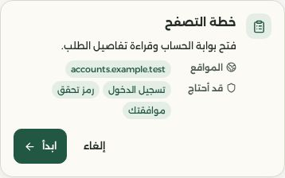
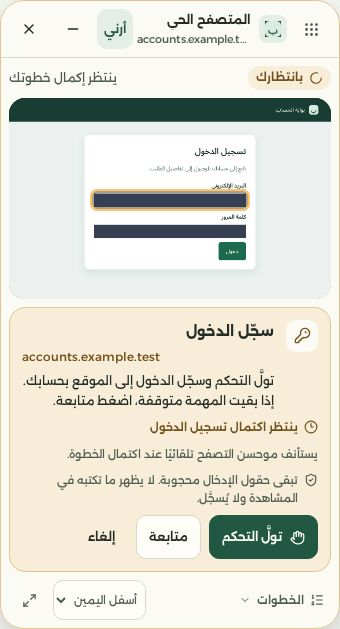
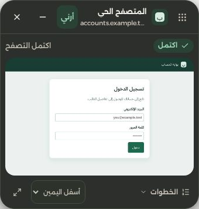

# Browser experience for Android and iPhone

The Android and iPhone layouts follow the web components for the task brief, corner view, expanded view, and hand-over. The screenshots below come from Chromium rendering those components with an isolated browser fixture. Sizes are CSS pixels on the web, density-independent pixels on Android, and points on iPhone.

## Layout

| Element | Size and placement |
| --- | --- |
| Corner view | Small width 340. Medium width 548. In either size, cap width at the safe viewport width minus 24 on phones or 32 on larger viewports. Place in the saved corner with a minimum inset of 12 on phones or 16 on larger viewports. The first position is bottom-left. Keep the panel within the safe area when the keyboard opens and allow internal scrolling. |
| Window and frame | Window radius 24, 1 px border. Frame and coach radius 16. The frame keeps an 8:5 aspect ratio and fills the panel content width. Clip the image at the frame edge. |
| Header and buttons | Header uses 8 vertical and 12 horizontal padding, with 8 horizontal padding at 400 or less. Favicon plate 28 × 28, image 16 × 16, section icon plate 32 × 32. Phone buttons are 44 high and compact icon surfaces are 40 × 40. Give compact actions at least a 44 × 44 hit area on iPhone and 48 × 48 on Android without overlapping adjacent controls. Above 480 with a fine pointer, web controls are 36 high and compact icons 32 × 32. |
| Content and coach | Window content uses 12 padding and gap, both 8 at 400 or less. Coach uses 12 padding, 8 gap, and a 6 gap between status or privacy copy and icon. Control groups wrap and use an 8 gap. |
| Timeline and pill | The closed timeline has a single label and chevron. Expanded steps have a minimum row height of 25 and use the last six structured events. The corner pill uses intrinsic width, a 999 radius, and zero frame requests. |
| Task brief | Cap the width at 548. Use 16 padding, 12 gap, and radius 16. Align the action row toward the trailing edge. |
| Expanded view | Center a modal at the smaller of 1040 or the available width after insets. Cap height after insets, keep the aspect ratio, and scroll the modal content if needed. Use 16 content padding. From 860 viewport width, give the coach a side column of 34% with a 265 minimum. The close button receives initial focus and dismissal restores focus to «أرني». |
| Desktop mini window | The shared web component fills Electron’s always-on-top mini window. Native window sizes are 340 × 340 small, 560 × 500 medium, 320 × 64 pill, and up to 1120 × 860 expanded. The work area reserves a 12 px inset and caps the bounds on smaller displays. |

Arabic is the first reading direction. Mirror the layout in RTL and LTR, keep domains isolated LTR, and keep the browser frame's coordinate system physical from the left and top. The area highlighted on the image is the server's normalized element box multiplied by the frame width and height.

## Tokens

Use Alexandria Variable for Arabic and its Latin subset for domains and Latin text. Arabic fallback is Tahoma, Arial, then sans serif. Latin fallback is the system sans serif. Body type is 12 with weight 450 and line height 1.65. Metadata is 11, status chips are 11 with weight 650, coach headings are 14/700, and the modal title is 16/650. Spacing inputs are 4, 8, 12, 16, 20, and 24. Core radii are 8 for the favicon, 10 for controls, 16 for cards and frames, 24 for windows, and 999 for pills.

| Color | Light | Dark |
| --- | --- | --- |
| Main text | `#242c27` | `#f3f0e7` |
| Secondary text | `#4f5c52` | `#c8c3b6` |
| Opaque surface | `#fcfaf4` | `#242723` |
| Glass surface | `#fcfaf4` at 96% | `#242723` at 96% |
| Raised surface | `#fffdf8` | `#2d322b` |
| Subtle surface | `#f0eee6` | `#333930` |
| Frame line | `#d9d8cd` | `#464d43` |
| Accent, text over accent, accent hover | `#215743`, `#fffdf8`, `#174735` | `#9bd5b7`, `#10261a`, `#b2e4ca` |
| Accent surface | `#e5eee6` | `#2a4235` |
| Waiting text, ring, surface, border | `#72501c`, `#ba8328`, `#f7edd8`, `#dfc690` | `#f3ce8d`, `#edb457`, `#3d3220`, `#755b32` |
| Target outline | `#ffc46a` with 2 px outline and offset | Same value |
| Error text | `#952f29` | `#ffa699` |
| Focus outline | `#176045` | `#9bd5b7` |
| Frame background, frame text | `#1c2b23`, `#f8f8f0` | `#111913`, `#f8f8f0` |
| Modal backdrop | `#0e1713` at 68% | Same value |

Follow the system appearance for light and dark. Use backdrop blur 18 on the panel, brief, and modal, and 5 on the modal scrim. Use the opaque surface and scrim when blur is unavailable. Light panel elevation is `0 20px 64px rgb(26 36 29 / 19%), 0 3px 12px rgb(26 36 29 / 8%)`. Light modal elevation is `0 28px 96px rgb(15 24 19 / 32%), 0 4px 14px rgb(15 24 19 / 14%)`. Dark panel elevation is `0 20px 64px rgb(0 0 0 / 46%), 0 3px 12px rgb(0 0 0 / 30%)`. Dark modal elevation is `0 28px 96px rgb(0 0 0 / 52%), 0 4px 14px rgb(0 0 0 / 24%)`. The brief uses `0 3px 12px rgb(26 36 29 / 8%)`.

## Motion and interaction

Use `cubic-bezier(.2, .7, .2, 1)` for control feedback (120 ms), the incoming frame’s opacity (180 ms), timeline and view expansion (240 ms), and the attention pulse (560 ms, once). Keep the previously decoded frame visible until the new frame is ready. The active ring rotates linearly every 1,800 ms. For Reduce Motion on iPhone and Remove animations on Android, change instantaneously and keep the ring static. Frame cadence is up to 1 Hz for small and 4 Hz for medium or modal. Interface animation targets 60 fps independently of the image cadence.

Provide buttons for compact and expanded modes, timeline disclosure, and localized names for icon-only actions. Tap opens the timeline on phones. A hardware keyboard cycles through the modal until dismissal. During take-over, the frame forwards pointer positions, touch scrolls, and keyboard input. The user cursor and 2 px focus ring show where input goes. The keyboard field is masked, clears on forwarding, and uses the remote page for keystrokes. «أعد التحكم» relinquishes the local input session. «متابعة» is available when a hand-over stays paused.

## States and reference screenshots

| Before work | Waiting for sign-in | Done |
| --- | --- | --- |
|  |  |  |

| State | Presentation | Reference |
| --- | --- | --- |
| Before work | Brief lists the intended work, domains, and possible sign-in, code, and approval. Risky tasks wait on «ابدأ». Read-only tasks start after a 2,500 ms preview or when the user selects «متابعة». | [Risky brief, light RTL small](browser-premium-ux/light-rtl-small-brief.jpg) · [Read-only brief, dark LTR medium](browser-premium-ux/dark-ltr-medium-brief-read.jpg) |
| Working | Chip shows «يقرأ» or «يكتب». Map the structured stage to a short Arabic caption for opening, reading, loading, or filling a form. Keep the current domain and favicon in the header. | [Reading, light RTL small](browser-premium-ux/light-rtl-small-reading.jpg) · [Typing, dark LTR medium](browser-premium-ux/dark-ltr-medium-typing.jpg) |
| Sign-in or code needed | Open the coach, set the chip to «بانتظارك», name the site and step, and highlight the target if available. The waiting text updates while the user acts. State that input fields are masked and typed text is never shown or logged. | [Sign-in, light RTL small](browser-premium-ux/light-rtl-small-login.jpg) · [Code, dark RTL medium](browser-premium-ux/dark-rtl-medium-code.jpg) |
| Manual step or approval | Name the current site and requested step. Show Take the wheel for hands-on work. For approval, keep the review text and explicit «موافقة ومتابعة». | [Manual step, dark LTR small](browser-premium-ux/dark-ltr-small-hands.jpg) · [Approval, light LTR medium](browser-premium-ux/light-ltr-medium-approval.jpg) |
| User controls the page | Keep the coach and target visible, add the masked input, and show «أعد التحكم». Drop local control when the server moves to a different step. | [Take-over, light RTL small](browser-premium-ux/light-rtl-small-takeover.jpg) |
| Resumed, done, or stopped | A server-confirmed hand-over resumes the same run and closes the coach. The caption announces «استأنف التصفح» when the resumed event is current. Done shows «اكتمل». The stopped state displays «توقّف». | [Resumed, dark RTL small](browser-premium-ux/dark-rtl-small-resumed.jpg) · [Done, dark RTL medium](browser-premium-ux/dark-rtl-medium-done.jpg) · [Stopped, light LTR small](browser-premium-ux/light-ltr-small-failed.jpg) |
| Other views | The timeline expands on tap or hover. «أرني» opens the centered modal. The pill pauses image requests. | [Timeline, light RTL small](browser-premium-ux/light-rtl-small-timeline.jpg) · [Modal, dark RTL medium](browser-premium-ux/dark-rtl-medium-dialog.jpg) · [Pill, light LTR small](browser-premium-ux/light-ltr-small-pill.jpg) |

The [comparison snapshots](browser-premium-ux/) cover light and dark, RTL and LTR, and a 390 × 844 small or 768 × 900 medium viewport. The live frames are locally rendered fixture pages. The [font fixtures](../tests/e2e/fixtures/fonts/) are the Arabic and Latin Alexandria WOFF2 subsets served by Google Fonts, with their SIL Open Font License. They are used only in the isolated Playwright route.
