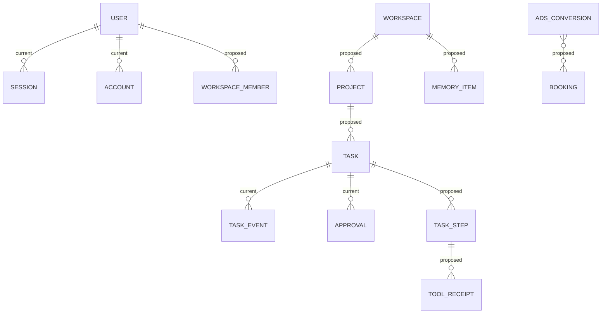

# نموذج بيانات Mohassan AI — الحالي والتصميم المرحلي

تاريخ المطابقة مع المصدر: 2026-11-04. ما يحمل وصف **مقترح** غير منفذ؛ لا توجد له جداول أو ترحيلات أو سياسات حذف تعمل حاليًا. لا يُعد تصميم الجدول دليلًا على تفعيل القدرة التي يخدمها.

## 1. حدود النموذج

الحالي ينفذ هوية مالك واحد ومهام تشخيص وتخطيط نصي وبرمجة معزولة وأحداثًا وموافقات ونسخ مراجعة للاستوديو الثابت. الملاحق 13–15 تحدد إضافات المراحل الثالثة والرابعة وشريحة الخامسة المنفذة وتفصلها عن التصميم المستقبلي. مصدر الحقيقة هو SQL في `packages/database/src/index.ts` و`apps/server/src/auth.ts` وDDL صحة المزود في `apps/server/src/ai.ts`؛ العقود العامة في `packages/contracts/src/index.ts`. الأوقات `timestamptz`، والمعرفات الحالية `text`؛ معرفات runtime تولد كـUUID، ولا نفترض أن معرفات Better Auth تحمل الصيغة نفسها.

الخط بين المستخدم والمهمة غير مرسوم عمدًا: `tasks.owner_id` **لا يملك FK إلى جدول `user` حاليًا**. الخادم يستخرج الهوية من الجلسة، وكل قراءة أو تعديل مرئي يتقيد بالمالك. هذا عزل تطبيقي؛ لا توجد RLS أو عضويات مساحات متعددة أو حذف متسلسل لمهام مستخدم محذوف.

## 2. الجداول المنفذة فعلًا

يعرض الجدول جداول التأسيس؛ جداول التخطيط والبرمجة وصحة المزود الفعلية مكملة له في الملحقين 13 و14. المخطط نفسه يستخدم في PostgreSQL/Neon أو مخزن التطوير؛ لا تنشأ جداول مختلفة لمجرد تغيير المزود.

| الجدول | PK والحقول المهمة | القيود والفهارس الموجودة |
|---|---|---|
| `schema_migrations` | `version text`؛ `applied_at` | PK(version)؛ `001_runtime` و`002_approval_attempt` و`003_cognitive_planning` و`004_coding_engine` |
| `auth_schema_migrations` | `version text`؛ `applied_at` | PK(version)؛ النسخة `001_auth` |
| `user` | `id text`؛ name/email/emailVerified/image/createdAt/updatedAt | email غير فارغ وUNIQUE؛ لا فهرس مستقل إضافي |
| `session` | `id text`؛ token/expiresAt/userId؛ معلومات اتصال اختيارية | token UNIQUE؛ FK(userId)→user(id) CASCADE؛ `session_user_idx(userId)` |
| `account` | `id text`؛ providerId/accountId/userId؛ password وحقول tokens اختيارية | UNIQUE(providerId,accountId)؛ FK(userId)→user(id) CASCADE؛ لا فهرس userId إضافي حاليًا |
| `verification` | `id text`؛ identifier/value/expiresAt | `verification_identifier_idx(identifier)`؛ لا UNIQUE(identifier) ولا فهرس expiry حاليًا |
| `rateLimit` | `id text`؛ key/count/lastRequest bigint | key UNIQUE؛ مكتبة المصادقة تدير قيم العداد؛ لا CHECK(count>=0) في SQL الحالي |
| `workspace_owner` | `id integer`؛ owner_id nullable؛ claimed_at | PK(id)، CHECK(id=1)؛ FK(owner_id)→user(id) دون CASCADE؛ صف حجز إعداد واحد |
| `tasks` | `id text`؛ owner/title/goal/capability/version/autonomy/status؛ hash/key؛ attempts/lease/cancel/events/result/error | التفاصيل أدناه؛ المالك نص غير فارغ دون FK للمستخدم |
| `task_events` | `id text`؛ task_id/sequence/type/message/data jsonb/created_at | FK(task_id)→tasks(id) CASCADE؛ UNIQUE(task_id,sequence)؛ data NOT NULL DEFAULT `{}` |
| `approvals` | `id text`؛ task_id/owner_id/capability/version/input_hash/scope؛ expiry/consumption/revocation | FK(task_id,owner_id)→tasks(id,owner_id) CASCADE؛ `approvals_task_idx(task_id,expires_at)` |

`tasks` يملك UNIQUE(owner_id,idempotency_key) لمنع تكرار الطلب وUNIQUE(id,owner_id) لتثبيت ملكية الموافقة. الفهارس الصريحة `tasks_owner_created_idx(owner_id,created_at DESC)` و`tasks_queue_idx(status,available_at,lease_expires_at)`، إضافة إلى الفهارس التي ينشئها PK/UNIQUE تلقائيًا.

حقل account.password مخصص لتجزئة كلمة المرور التي تديرها Better Auth، لا لكلمة المرور الأصلية. أعمدة OAuth موجودة لتوافق المكتبة لكن لا مزود OAuth موصول حاليًا؛ تصميم credential_refs أدناه لا يعني أن هذه الأعمدة نُقلت إلى KMS أو شُفرت تلقائيًا.

SQL يقيد autonomy إلى assisted/scoped/shadow والحالة إلى queued/running/waiting_approval/verifying/completed/failed/cancelled/paused. `attempt>=0` و`max_attempts>0`؛ القيمة الافتراضية للمحاولات القصوى 3. لا CHECK يفرض attempt<=max_attempts؛ العامل يفرض الحد. `event_sequence` يبدأ من صفر، لكن لا CHECK غير سالب عليه حاليًا.

`lease_token` و`lease_expires_at` وresult/error قابلة لـNULL. لا CHECK يربط وجود lease بالحالة، ولا version column للتفاؤل حاليًا. `capability_id` وscope وevent type نصوص بلا FK أو enum SQL؛ تعريف القدرات في المصدر، وتفعيل التخطيط والبرمجة مشروط بموائماتهما. التحقق التنفيذي لا يسمح إلا بالتشخيص والتخطيط النصي والبرمجة المعزولة المعتمدة.

الموافقة تسجل `consumed_at` و`consumed_lease_token`؛ الترحيل 002 يضيف الحقل الثاني عند ترقية مخزن أقدم. لا UNIQUE يمنع موافقتين غير ملغيتين؛ قفل صف المهمة وإلغاء السابقة قبل إنشاء التالية يفرضان ذلك في التطبيق. الموافقة الحالية لمهمة ومحاولة واحدة ومدتها عشر دقائق.

الجداول غير مقسمة حاليًا، ولا يوجد job لحذف الأحداث أو الجلسات المنتهية أو عدادات المعدل. المصادقة ترفض الجلسة المنتهية عند التحقق؛ انتهاء صلاحية الاستخدام لا يعني إزالة الصف. Snapshot يعيد آخر 200 مهمة فقط، ولا يقدم pagination تاريخيًا بعد.

## 3. معاملات التنفيذ الحالية

| العملية | حد المعاملة وسلوك التعارض |
|---|---|
| إنشاء مهمة | INSERT مع ON CONFLICT(owner_id,idempotency_key)، مقارنة input_hash، ثم أحداث الإنشاء في المعاملة نفسها؛ اختلاف المدخلات يعيد 409 |
| الموافقة | FOR UPDATE على المهمة مع شرط المالك؛ إلغاء grants السابقة، إنشاء grant جديدة، تغيير queued وحدثها في معاملة واحدة |
| المطالبة | FOR UPDATE SKIP LOCKED على مهمة مستحقة؛ فحص registry والموافقة؛ زيادة attempt وتوليد lease واستهلاك grant وربطها بالtoken وإضافة الحدث |
| التحقق والإنهاء | قفل المهمة بشرط token وexpiry صالحين؛ التحقق منفصل؛ يعاد فحص الموافقة تحت FOR SHARE قبل حفظ النتيجة وحدث النجاح |
| الإلغاء | قفل المهمة، تسجيل طلب الإلغاء وإلغاء grants؛ المهام غير الجارية تتحول cancelled فورًا، والجارية تتوقف تعاونيًا |
| التعافي | قفل المهام ذات lease المنتهية؛ إعادة التشخيص الآمن فقط؛ assisted تعود waiting_approval؛ استنفاد المحاولات يفشل المهمة |
| ترتيب الأحداث | زيادة event_sequence ثم INSERT الحدث داخل معاملة الانتقال؛ UNIQUE(task_id,sequence) يمنع التكرار |
| قراءة التفاصيل | FOR SHARE على المهمة أثناء قراءة أحداثها، مع ترشيح المالك؛ لا تظهر أحداث مهمة غير مملوكة |

معرف lease يمنع العامل القديم من اعتماد نتيجة بعد استعادة المحاولة. هذا لا يمنح ضمان تنفيذ أثر خارجي مرة واحدة؛ لا توجد آثار خارجية فعالة في أداة التشخيص الحالية. لا heartbeat لتجديد lease؛ الأداة محدودة الزمن، وإضافة أداة طويلة تتطلب heartbeat وعقد تعافٍ مناسبين أولًا.

حجز `workspace_owner` ذري بصف id=1، لكن إنشاء المستخدم عبر Better Auth ثم ربط الحجز ليسا معاملة واحدة شاملة. استعادة الحجز المحلي تعمل قبل خدمة الطلبات وبملكية منفردة للمخزن إذا لم يوجد مستخدم. لا تطبق هذه الاستعادة تلقائيًا في PostgreSQL متعدد العمليات؛ يلزم فحص المستخدم والحساب والجلسة والحجز قبل إصلاح إداري موثق.

## 4. قواعد التصميم المقترح

كل ما يلي تصميم للترحيلات القادمة. نحتفظ بمعرفات text الحالية؛ الجداول الجديدة تستعمل UUID مولدًا في التطبيق أو قاعدة البيانات دون إعادة كتابة معرفات المستخدمين. كل سجل تابع لمساحة يحمل workspace_id وUNIQUE(workspace_id,id)، وتستخدم المراجع المركبة لمنع الربط بمورد من مساحة أخرى.

الحقول القياسية: created_at/updated_at، schema_version للـJSON، وversion bigint للتحديثات المتفائلة حيث تتغير البيانات. JSONB للحمولات المتغيرة محدود الحجم؛ المفاتيح والعلاقات والأموال والحالات والفهارس أعمدة صريحة. لا نضع binary artifacts أو screenshots أو أسرارًا خامًا في JSON.

تطبق الصلاحيات في الخدمة وفي SQL، ثم تضاف RLS بعد اختبار `SET LOCAL` لهوية الطلب داخل كل معاملة، مع دور runtime بلا BYPASSRLS. العامل لا يستعمل سياق مستخدم متبقيًا في connection pool. دور migration مستقل؛ لا تمنح خدمة الويب حق CREATE/DROP في الإنتاج.

## 5. المساحات والمشروعات وتزامن الملفات — مقترح

| الكيان | PK/FK وUNIQUE | الفهارس والحدود |
|---|---|---|
| `workspaces` | PK(id)، FK(owner_user_id)→user؛ slug UNIQUE | فهرس(owner_user_id,created_at)؛ حذف المساحة عملية مُدارة بعد إيقاف المهام، لا CASCADE غير محدود |
| `workspace_members` | PK(workspace_id,user_id)؛ FK للطرفين؛ role مقيد | فهرس(user_id,workspace_id)؛ تعديل العضوية وإبطال grants التابعة في معاملة |
| `projects` | PK(id)، FK(workspace_id)؛ UNIQUE(workspace_id,slug) و(workspace_id,id) | فهرس(workspace_id,updated_at)؛ repo URL مرجع لا credential؛ حذف soft ثم purge artifacts المصرح بها |
| `environments` | PK(id)، FK(workspace_id,project_id)؛ UNIQUE(project_id,name) | فهرس(project_id,status)؛ حالة provisioning/ready/stopped/failed؛ موارد الاستضافة بمعرف خارجي ثابت |
| `file_versions` | PK(id)، FK إلى project؛ UNIQUE(project_id,path,revision) | فهرس(project_id,path,revision DESC)؛ hash المحتوى وموقع artifact؛ path مطبع ويمنع traversal واختلاف case على Windows |
| `file_locks` | PK(project_id,canonical_path)؛ FK إلى task_step والمالك؛ token/expiry | فهرس(expires_at)؛ لا lock بلا expiry؛ التجديد/الكتابة يشترطان fencing token وbase_revision |
| `artifacts/checkpoints` | PK لكل سجل، FK إلى project/task؛ UNIQUE(project_id,checkpoint_key) | فهرس(task_id,created_at)؛ manifest hashes وparent checkpoint؛ الكتل في object storage محمي |

الكتابة تقفل الموارد بترتيب ثابت project/path، وتطبق compare-and-swap على revision؛ لا يُحتفظ بمعاملة SQL مفتوحة أثناء build أو Git أو رفع ملف. تحفظ النتيجة في artifact مؤقت ثم يثبت manifest بمعاملة؛ تنظف الملفات غير المرتبطة بعد فترة سماح.

## 6. الخطوات وDAG والإيصالات — مقترح

| الكيان | PK/FK وUNIQUE | فهرسة وضمانات |
|---|---|---|
| `task_steps` | PK(id)، FK(workspace_id,task_id)؛ UNIQUE(task_id,step_key) | فهرس(status,available_at,lease_expires_at)؛ tool_id/version/input_hash/replay_policy/attempt/lease/version |
| `step_dependencies` | PK(task_id,step_id,depends_on_step_id)؛ FK مركبة لخطوتين من المهمة نفسها؛ CHECK(step_id<>depends_on_step_id) | فهرس(depends_on_step_id,step_id)؛ منع الدورات يحتاج فحص graph تحت قفل المهمة، لا CHECK منفردًا |
| `tool_receipts` | PK(id)، FK إلى step؛ UNIQUE(workspace_id,tool_id,operation_key) | فهرس(step_id,created_at)؛ request_hash/provider_request_id/effect_status/result_hash؛ input مختلف لنفس key يُرفض |
| `step_attempts` | PK(step_id,attempt)؛ FK إلى step؛ token UNIQUE | فهرس(worker_id,started_at)؛ حالة observed/unknown/committed؛ الأثر المجهول ينتظر reconciliation |
| `resource_leases` | PK(workspace_id,resource_type,resource_key)؛ holder_step_id FK | expiry index؛ token monotonic أو جيل متزايد تتحقق منه جهة الكتابة أيضًا |

نشر graph وخطواته ومعايير القبول transaction واحدة بعد validation، وتثبيت graph_version يمنع تبديل التبعيات أثناء التنفيذ. اكتمال خطوة وخفض dependency counters وأحداثها وoutbox في معاملة؛ يلتقط scheduler الخطوات الجاهزة فقط. تعويض الأثر الخارجي إجراء مستقل بإيصال وصلاحية، ولا يمحى الإيصال الأصلي.

## 7. الأجهزة والجلسات والسياسات — مقترح

| الكيان | PK/FK وUNIQUE | فهرس/صلاحية/احتفاظ |
|---|---|---|
| `devices` | PK(id)، FK(workspace_id,owner_user_id)؛ public_key_fingerprint UNIQUE | فهرس(workspace_id,status)؛ trusted/revoked؛ لا تخزن private key الجهاز |
| `pairing_challenges` | PK(id)، device_id FK اختياري؛ challenge_hash UNIQUE | فهرس(expires_at)؛ استخدام واحد وTTL دقائق؛ حذف بعد انتهاء نافذة التدقيق |
| `device_sessions` | PK(id)، FK إلى device والمستخدم؛ token_hash UNIQUE | فهرس(device_id,revoked_at,expires_at)؛ view/control منفصلتان؛ لا تستبدل جدول جلسات Better Auth |
| `permission_grants` | PK(id)، FK workspace/task/step/device وفق النطاق | فهرس(subject_id,capability_id,expires_at)؛ scope/resource/input_hash/tool_version/expiry/revocation؛ الرفض الافتراضي |
| `approval_requests` | PK(id)، FK إلى grant/task؛ UNIQUE(task_id,request_key) | فهرس(owner_user_id,status,expires_at)؛ signer/session_id وpolicy_version؛ لا موافقة على حمولة متغيرة |
| `policy_versions` | PK(workspace_id,version)؛ content_hash UNIQUE ضمن المساحة | سجل غير قابل للتعديل؛ كل قرار صلاحية يسجل النسخة والمدخلات المنقحة والسبب |

إلغاء جهاز يثبت revoked_at وزيادة generation وإبطال جلساته وgrants وإصدار outbox في معاملة؛ الـgateway يرفض الأوامر فور فحص الجيل ويقطع البث. لا يمس ذلك مهام السحابة غير المرتبطة بالجهاز. يجري تنظيف جلسات auth وفق المكتبة، وجلسات الجهاز حسب TTL وسياسة تدقيق منفصلة.

## 8. السياق والذاكرة والأدلة والمهارات — مقترح

| الكيان | PK/FK وUNIQUE | فهرس/قواعد |
|---|---|---|
| `conversations/messages` | PK لكل سجل؛ FK(workspace_id,conversation_id) للرسائل؛ UNIQUE(conversation_id,sequence) | فهرس(conversation_id,sequence)؛ role/source/trust_level؛ محتوى المستخدم الخارجي لا يصبح تعليمات تنفيذ |
| `context_snapshots` | PK(id)، FK task/step؛ UNIQUE(step_id,context_version) | فهرس(task_id,created_at)؛ token_budget/model/summary_hash وmessage_refs؛ لا نسخ للأسرار |
| `world_facts` | PK(id)، FK workspace/evidence؛ UNIQUE(workspace_id,fact_key,version) | فهرس(workspace_id,fact_key,expires_at)؛ observed_at/confidence/expiry؛ الاسترجاع يرشح البيانات المنتهية |
| `memory_items` | PK(id)، FK workspace؛ kind من الطبقات الست؛ supersedes_id FK اختياري | فهرس(workspace_id,kind,expires_at)؛ source/confidence/visibility؛ embeddings اختيارية مع owner filter قبل التشابه |
| `evidence_sources` | PK(id)، FK workspace؛ UNIQUE(workspace_id,content_hash,source_uri) | فهرس(workspace_id,observed_at)؛ URI/hash/author/retrieved_at/trust؛ نسخة منقحة من المحتوى عند الحاجة |
| `memory_provenance` | PK(memory_id,evidence_id,relation)؛ FK للطرفين من المساحة نفسها | فهرس(evidence_id,memory_id)؛ يدعم asserted/contradicted/verified؛ لا حذف دليل مع إبقاء ادعاء مثبت بلا سند |
| `skills/skill_versions` | PK skill؛ PK(skill_id,version) للنسخ؛ content_hash | UNIQUE(workspace_id,slug)؛ الفهرس(skill_id,status)؛ artifacts immutable؛ active_version يتغير فقط بعد approval |
| `eval_suites/eval_cases` | PK لكل سجل؛ suite_version مثبت؛ UNIQUE(suite_id,version,case_key) | فصل training عن holdout؛ لا تسرب بيانات حساب حي إلى fixtures |
| `eval_runs/eval_results` | PK run؛ PK(run_id,case_id)؛ FK skill_version/model/config | فهرس(skill_id,finished_at)؛ success/error/cost/latency وbaseline_run_id؛ لا ترقية بلا مقارنة قابلة لإعادة الإنتاج |
| `feedback` | PK(id)، FK user/task/result؛ UNIQUE(user_id,submission_key) | فهرس(workspace_id,classification,created_at)؛ preference/task_correction/general_evidence؛ consent ومراجعة قبل التعميم |

ترقية مهارة تقفل سجلها، وتتحقق من تقييم النسخة نفسها وموافقتها ثم تغير active_version وتصدر حدثًا في معاملة. expiry يوقف استعمال الذاكرة فورًا ولو لم يعمل purge؛ حذف المصدر يبطل الادعاءات التابعة أو يخفض ثقتها، ويحتفظ بمرجع تدقيق منقح وفق السياسة.

## 9. الإعلانات والحجوزات والإسناد — مقترح

| الكيان | PK/FK وUNIQUE | فهرس/ضبط البيانات |
|---|---|---|
| `ads_accounts` | PK(id)، FK workspace/integration؛ UNIQUE(workspace_id,customer_id) | currency/timezone/manager_id؛ فهرس(workspace_id,status)؛ صلاحيات القراءة والتفعيل والميزانية منفصلة |
| `ads_sync_runs/watermarks` | PK run؛ PK(account_id,stream) للـwatermark | فهرس(account_id,started_at)؛ لا تقدم watermark قبل تثبيت كامل الدفعة؛ إعادة نافذة تصحيح للتأخر |
| `campaign_daily` | PK(account_id,campaign_id,report_date,attribution_version) | فهرس(account_id,report_date)؛ cost_micros bigint، العملة صريحة؛ لا استخدام float للأموال |
| `ads_conversions` | PK(id)، FK account؛ UNIQUE(account_id,conversion_action_id,source_event_key) | فهرس(account_id,occurred_at)؛ observed_at/adjustment_version/consent؛ معرفات النقر مشفرة أو محدودة الوصول |
| `bookings` | PK(id)، FK workspace؛ UNIQUE(workspace_id,source_system,external_booking_id) | فهرس(workspace_id,completed_at,status)؛ qualified/completed/cancelled/refunded منفصلة؛ الإيراد بوحدات صحيحة وعملة |
| `conversion_booking_links` | PK(conversion_id,booking_id,model_version)؛ FK للطرفين ومساحة واحدة | فهرس(booking_id,model_version)؛ وزن إسناد numeric مقيد 0..1؛ منع جمع وزن>1 بمعاملة على booking/model |
| `ads_proposals/experiments` | PK لكل سجل؛ FK account/task؛ UNIQUE(account_id,operation_key) | فهرس(account_id,status,created_at)؛ before/after/input_hash وapproval؛ shadow منفصل عن applied |

الـingestion يستخدم upsert حسب المفتاح الطبيعي ويحتفظ بالتعديلات، مع outbox وتحديث watermark في المعاملة نفسها. لا تُعدّل ميزانية بناءً على تقرير غير مكتمل؛ يحفظ conversion_quality_gate وحالة freshness ونسخة الإسناد. تكلفة الحجز المؤهل المكتمل تحسب على نافذة وعملة معلنتين مع معالجة refunds وconversion lag.

## 10. الميزانيات والاستخدام وoutbox ومراجع الأسرار — مقترح

| الكيان | PK/FK وUNIQUE | فهرس/ضمان |
|---|---|---|
| `budgets` | PK(workspace_id,scope_type,scope_id,period_start,currency) | فهرس(period_end)؛ limit/reserved/spent بوحدات صحيحة؛ CHECK غير سالب؛ منع overspend بتحديث شرطي مقفل |
| `budget_reservations` | PK(id)، FK budget/task/step؛ operation_key UNIQUE ضمن المساحة | فهرس(status,expires_at)؛ حجز قبل الاستدعاء ثم settle/release مرة واحدة؛ التعافي يراجع receipt قبل الإفراج |
| `usage_ledger` | PK(id)، FK task/provider/request؛ UNIQUE(provider,provider_account_id,request_id,charge_kind) | فهرس(workspace_id,occurred_at)؛ tokens/input/output/cached؛ price_version/currency؛ تصحيحات بإدخالات تعويضية |
| `outbox_events` | PK(id)، aggregate_type/id/version؛ UNIQUE(aggregate_type,aggregate_id,version,event_type) | فهرس(published_at,available_at) أو partial unpublished؛ payload منقح؛ publish at-least-once وconsumer dedup |
| `consumer_inbox` | PK(consumer_id,event_id)؛ event_id مرجع/معرف ثابت | معالجة الرسالة وتحديث العمل وinbox transaction واحدة؛ الاحتفاظ أطول من أقصى replay window |
| `credential_refs` | PK(id)، FK workspace/integration؛ UNIQUE(workspace_id,provider,external_ref,version) | فهرس(integration_id,status)؛ vault/KMS reference وscope وexpiry وrotation فقط؛ لا plaintext secret |

تسوية budget والاستخدام والإيصال وoutbox transaction واحدة بعد تلقي نتيجة provider. قد تصل تكلفة متأخرة أو غير محسومة؛ تحفظ provisional/confirmed بدل إسقاطها. التدوير ينشئ credential version جديدة، يتحقق من صحتها، يحول المرجع النشط ثم يلغي القديمة؛ قراءات الأسرار المدققة لا تسجل قيمتها.

## 11. الاحتفاظ والتقسيم الآمن — مقترح

المدة النهائية تعتمد على متطلبات المالك والبلد ومصدر البيانات؛ نقطة بدء هندسية: أحداث تشغيل 90 يومًا، آثار منقحة 30 يومًا، تحديات pairing دقائق مع تدقيق منقح، جلسات حسب expires_at، usage وإيصالات مالية حسب سياسة الحساب. الذاكرة والمهارات لا تُحتفظ أبديًا افتراضيًا؛ لها expiry وحذف/إبطال حسب provenance. لا يوجد أي cleanup job منفذ الآن.

تقسيم شهري محتمل لـtask_events/usage_ledger/campaign_daily/conversions بعد قياس الحجم، وليس لكل جدول. PostgreSQL يتطلب أن تشمل القيود الفريدة على الجدول المقسم مفتاح التقسيم؛ لذلك لا ننقل UNIQUE(task_id,sequence) أو مفاتيح dedup إلى partitions زمنية ونفقد التفرد العالمي. نحتفظ بسجل dedup عالمي غير مقسم، أو نضيف partition key إلى PK/FK وكل المستهلكين مع توثيق دلالة جديدة قبل النقل.

حذف partition يحتاج فحص legal hold والمراجع وإمكانية replay أولًا؛ لا يوضع CASCADE على إسقاط partition. يبدأ purge بنسخة manifest/count/checksum وأرشيف مشفر عند الحاجة، ثم حذف دفعات صغيرة؛ لا تعطل صيانة retention صف المهام الساخن أو فهارس المطالبة. مفاتيح idempotency/receipts لا تحذف قبل نهاية نافذة إعادة الطلب القصوى.

## 12. ترحيل دون انقطاع واستعادة الإنتاج

1. قارن المصدر وschema الفعلية وسجل migrations؛ اختبر على نسخة معزولة بحجم قريب من الإنتاج، وخذ restore point وتحقق من إمكان العودة قبل تغيير البيانات.
2. نفذ expand: جداول/أعمدة nullable جديدة وdefaults لا تعيد كتابة جدول ضخم، مع lock_timeout/statement_timeout. ترحيلات الإنتاج عملية إصدار مستقلة؛ لا تعتمد على تشغيل عدة نسخ API للـDDL.
3. أضف الفهارس الكبيرة بـCREATE INDEX CONCURRENTLY خارج transaction، وافحص فهارس INVALID بعد الانقطاع. لا تضع هذا الأمر داخل migrator الحالي الذي يغلف الخطوات بمعاملة.
4. عند إضافة FK user للمهام، افحص orphan owner_ids أولًا؛ أصلحها أو اعزلها بمعرفة المالك، ثم ADD CONSTRAINT NOT VALID وVALIDATE CONSTRAINT لاحقًا. لا تولد مستخدمين وهميين لتجاوز القيود.
5. انشر readers متوافقة مع القديم والجديد، ثم backfill دفعات بمفتاح ثابت وwatermark قابل للاستئناف؛ راقب counts/hash والملكية وlag، ولا تحجز قفلًا طوال النسخ.
6. فعّل dual-write بمعاملة واحدة عندما يكون الطرفان في SQL؛ للخدمة الخارجية استخدم outbox/reconciliation. قارن النتائج قبل تحويل reads. لا تسمح لنسختين بتحويل نفس صف مرتين دون version/checkpoint.
7. بعد ترقية كل API/worker/iPhone/companion وانتفاء القراء القديمة، فرض NOT NULL/UNIQUE/CHECK والتحقق، ثم contract في إصدار لاحق مستقل؛ لا تحذف عمودًا ما زال worker مؤجل يقرأه.
8. العودة التطبيقية تقبل schema الموسعة؛ تغيير البيانات غير القابل للعكس يحتاج forward repair أو restore مدروس. تحذف الترميزات القديمة بعد فترة توافق وموافقة تشغيلية، وليس بمجرد نجاح build.

المخزن المحلي PGlite مخصص لعملية واحدة؛ قفل Windows named pipe يحرر عند انهيار العملية. اختبار إغلاق/إعادة فتح الملفات يثبت الديمومة المحلية فقط، ولا يثبت failover أو تزامن اتصالات PostgreSQL أو سلامة نسخة حية مأخوذة بنسخ المجلد أثناء الكتابة.

الإنتاج يحتاج Neon/PostgreSQL فعليًا واتصال TLS ودور migrations منفصل وpool محدود. الميزات المتاحة مثل PITR وحدود الاحتفاظ تتأكد من خطة الحساب قبل اعتماد RPO/RTO؛ لا يُدّعى توفرها من اسم المزود أو نجاح الاتصال. لا يوثق هذا المستودع نسخة خارجية مستقلة أو restore drill إنتاجيًا مكتملًا.

تمرين الاستعادة يعزل البيئة ويوقف consumers والآثار الخارجية، يستعيد SQL ومراجع artifacts ونسخ المفاتيح، ويفحص FK/counts/hashes والملكية وإصدارات schema. ثم يسوي receipts والعمليات ذات الأثر المجهول قبل إعادة العامل؛ استعادة قاعدة أقدم لا تجيز إعادة إرسال حملة أو دفعة أو رسالة نُفذت خارجها. يعاد outbox بعد consumer dedup، وتلغى sessions/grants عند الشك في التسرب، ويُوثق زمن الاستعادة والفجوة الفعلية.

## 13. ملحق منفذ: المرحلة الثالثة والترحيل 003

هذا القسم **منفذ فعلًا** ويستثنى من الأقسام المقترحة أعلاه. الترحيل `003_cognitive_planning` يضيف الجداول التالية و`tasks.approval_required boolean NOT NULL DEFAULT false`؛ يضبط الحقل إلى true للمهام assisted الموجودة. لا يضيف FK للمالك إلى `user`، ولا يحول خطوات الخطة إلى أعمال منفذة.

| الكيان المنفذ | المفاتيح والقيود الفعلية | الفهارس/الدلالة |
|---|---|---|
| `task_plan_steps` | PK(task_id,step_id)؛ FK(task_id)→tasks(id) CASCADE؛ UNIQUE(task_id,position)؛ position>=0؛ status مقيد إلى planned | عنوان/وصف/capability_id nullable/scopes/acceptance_criteria/availability؛ آخرها بيانات تحقق وليست إذن تنفيذ؛ PK وUNIQUE يوفران الفهرسة |
| `task_plan_dependencies` | PK(task_id,step_id,depends_on_step_id)؛ FK مركبة لكل طرف إلى خطوات المهمة نفسها CASCADE؛ منع الاعتماد الذاتي CHECK | `task_plan_dependencies_reverse_idx(task_id,depends_on_step_id)`؛ منع الدورات والتحقق من المراجع يتمان أيضًا في verifier قبل الكتابة |
| `model_runs` | PK(id)؛ FK(task_id)→tasks CASCADE؛ UNIQUE(task_id,attempt)؛ lease_token UNIQUE؛ attempt>0؛ tokens>=0 إن وجدت | `model_runs_task_started_idx(task_id,started_at)`؛ status من started/succeeded/failed/unknown؛ model/tokens قد تكون NULL |

`model_runs` يحفظ provider/model وstarted_at/finished_at وusage_known وresult_committed وoutput_hash وerror_code منقحًا. CHECK يمنع usage_known=true مع token counts مفقودة. لا يخزن الرد الخام أو المفتاح أو سعرًا مختلقًا. القيد الحالي للأعداد integer؛ تُرفض بيانات الاستخدام غير الصالحة بدل استبدالها بصفر.

صف model_runs يمثل محاولة توليد منطقية واحدة؛ قد تشمل بديلًا واحدًا محدودًا داخل المحرك بعد رفض HTTP مؤكد 429/503. لا يدعي أنه صف مستقل لكل اتصال HTTP، ولا يضمن أن توكنات الرد الناجح تحصي استهلاك أي طلب رفضه المزود.

قبل الاستدعاء يسجل العامل started في معاملة تفحص lease والتفويض مجددًا. عند عودة المحرك تحفظ إيصالات الاستخدام الفعلية فورًا حتى إذا أُلغي اعتماد المهمة لاحقًا. `succeeded` يعني رجوع المحرك بنتيجة؛ `failed` مع usage_known=true يعني أن ردًا مدفوعًا رُفض أثناء معالجة المحرك، ولا يعني أن التكلفة صفر. `unknown` وtokens=NULL تعني أن النتيجة أو الاستخدام غير محسومين.

`result_committed=true` لا يثبت إلا في معاملة واحدة مع حفظ النتيجة الموثقة وخطوات الخطة واعتمادياتها وحالة completed وحدث النجاح. رد يصل بنجاح ثم يرفضه verifier المستقل قد يبقى succeeded مع result_committed=false؛ خطواته لا تعتمد. فشل تخزين خطوة يتراجع عن كل الخطوات وعلامة النجاح، مع إبقاء إيصال الاستخدام المحفوظ.

بعد فشل طلب التخطيط أو انتهاء lease لا يعاد إرسال الهدف تلقائيًا، حتى في scoped. تعود المهمة إلى waiting_approval مع approval_required=true وتحذير بخصوص النتيجة/التكلفة غير المحسومة، أو failed عند نفاد المحاولات. الموافقة التالية مرتبطة بنطاق model:generate والمدخلات والإصدار ومحاولة lease جديدة. مهلة التخطيط الافتراضية 90 ثانية؛ caller يستطيع فرض حد أصغر.

رد عامل قديم يستطيع فقط تسوية إيصال model_runs الخاص بـlease الأصلية؛ لا يستطيع اعتماد المهمة أو كتابة خطوات بعد fencing. إعادة فحص التفويض عند نهاية التحقق تمنع اعتماد نتيجة سُحبت موافقتها. shadow لا يستدعي المحرك أو المزود مطلقًا ولا ينشئ model_runs؛ الناتج وصف محاكاة محلية واضح.

اختبارات الترحيل والمحرك تستخدم PostgreSQL مضمنًا مع مزود محاكاة، وتشمل rollback لإدراج graph جزئي ورفض scopes وسحب الموافقة والإلغاء والتعافي دون طلب مدفوع مكرر. لا يثبت ذلك تزامن اتصالات PostgreSQL الإنتاجية أو فاتورة مزود حي؛ يلزم التحقق منهما في بيئة الإنتاج المجهزة.

## 14. ملحق منفذ: المرحلة الرابعة والترحيل 004 وصحة المزود

الترحيل `004_coding_engine` يضيف الجداول التالية و`tasks.project_id text NULL REFERENCES coding_projects(id)`؛ لا CASCADE على هذا المرجع، ولا FK مركبة تفرض تطابق مالك المهمة والمشروع في SQL. الخدمة تتحقق من المالك عند إنشاء المهمة وتشغيلها والتحقق من نتيجتها؛ RLS وعزل المساحات الموسع ما زالا مقترحين.

| الكيان المنفذ | PK/FK وUNIQUE الفعلية | الفهارس والدلالة |
|---|---|---|
| `coding_projects` | PK(id)؛ owner_id بلا FK للمستخدم؛ UNIQUE(owner_id,scope_hash)؛ CHECK(test_profile='node-test') | `coding_projects_owner_idx(owner_id,created_at)`؛ name/repo_path/base_commit/allowed_paths JSONB/created_at |
| `coding_project_locks` | PK(resource_key)؛ FK(project_id)→coding_projects وFK(task_id)→tasks؛ token وexpires_at غير فارغين | لا فهرس expiry إضافي؛ المطالبة lookup/upsert بمفتاح المورد؛ token مولد عشوائيًا ولا يملك UNIQUE منفصلة |
| `coding_runs` | PK(id)؛ FK(task_id)→tasks CASCADE وFK(project_id)→coding_projects؛ UNIQUE(task_id,attempt) وUNIQUE(lease_token) | `coding_runs_task_idx(task_id,started_at)`؛ status مقيد started/succeeded/failed/unknown؛ result JSONB/result_committed/error_code/finished_at |
| `ai_provider_health` | PK(id)، والحالة verified/error؛ لا FK للمالك | لا فهرس إضافي؛ config_fingerprint/model/verified_at/checked_at/error_code/input_tokens/output_tokens؛ أنشأه AI Control بDDL idempotent تحت advisory lock مستقل، لا بنسخة 004 |

بصمة تسجيل المشروع SHA-256 لمساره canonical، وHEAD المثبت، وallowedPaths المرتبة؛ يطبع Windows حالة الأحرف للمسار قبل الحساب. التسجيل المتكرر للنطاق نفسه يعيد السجل الموجود، بينما تغيير HEAD أو النطاق ينشئ سجلًا جديدًا. projectId يدخل بصمة idempotency للمهمة؛ لا يُقبل تمرير مشروع إلى مهمة غير coding.change.

repo_path مسار محلي خاص للمالك، لا Git URL أو credential. العقد يحدد من ملف إلى خمسة ملفات تنفيذ موجودة، مع استثناء الاختبارات والإعدادات. البيانات الحالية لا تدعم تعديل التسجيل أو حذفه عبر API. فحص المصدر يمنع ملفات الاعتماد والروابط وhardlinks وإعدادات Git الخطرة؛ لا يقرأ `.env` ولا ينسخ محتوى المصادر المرفوضة بسبب صيغ اعتماد معروفة إلى جداول البرمجة أو سياق النموذج أو نسخة الاختبار. هذا فحص دفاعي محدود، وليس ضمان اكتشاف كل سر محتمل في نص حر.

كل coding.change غير shadow يتطلب موافقة محددة للمحاولة حتى في scoped، بنطاق مركب coding:change يجيز قراءة سياق النطاق وإرساله للنموذج وكتابة worktree واختبار نسخة معزولة؛ لا يشمل الدمج أو الرفع أو النشر. الموافقة مرتبطة بالمهمة وإصدار القدرة والمدخلات، ويشير projectId إلى تسجيل ثابت لـHEAD وallowedPaths.

resource_key هو hash للمسار canonical؛ يملك كل مسار قفل SQL واحدًا حتى مع تعدد تسجيلاته. INSERT/ON CONFLICT تستبدل قفلًا منتهيًا فقط، ومدته الحالية 240 ثانية، مقابل lease افتراضية للبرمجة 180 ثانية. التحرير يشترط token الأصلية، فلا يزيل عامل قديم قفلًا جديدًا. لا heartbeat لهذا القفل حاليًا؛ رفع زمن المهمة فوق هذه المدة يحتاج تجديدًا مع fencing أولًا. قفل عملية Windows مستقل يحمي بيانات Git المحلية أيضًا.

يبدأ coding_runs بعد فحص lease/الموافقة وقبل خطوات البرمجة، بينما يبدأ model_runs عند edits_requested فقط؛ قد توجد محاولة برمجة فاشلة قبل الاتصال بالنموذج دون صف استخدام مدفوع. الربط بين السجلين يكون عبر task_id/attempt/lease_token، وليس FK مباشرة بينهما.

عند وصول رد النموذج، يرسل generateEdits إيصال model/usage إلى onModelReceipt فورًا، قبل تحليل المقترح وتطبيقه واختباراته. يثبت الخادم expectedHash من سياق الملف الملتقط؛ النموذج لا يُطلب منه حساب hash. أي فشل لاحق يحافظ على counts وusage_known المحفوظة بدل تحويلها إلى NULL أو صفر. رد مزود لم يكتمل يبقى غير محسوم حتى وصول إيصال صالح أو تسوية خارجية.

يحفظ coding_runs نتيجة المراجعة وأدلة الاختبارات والفرق/checkpoint حتى لو كانت النتيجة tests_failed أو review_failed. اعتماد هذه النتيجة في tasks، وتثبيت result_committed في سجلاتها، وحدث التحقق معاملة واحدة مشروطة بالـlease والتفويض. المهام الفاشلة لا تتحول completed. في البرمجة تعني result_committed=true أن نتيجة المراجعة حُفظت، وقد تكون نتيجة فشل موثقة؛ ليست ادعاء نجاح الاختبارات.

استجابة متأخرة تقتصر على سجل coding_runs/model_runs المطابق لـlease القديمة، ولا تمنح حق تعديل المهمة. العمل الفعلي يحتفظ بفرع وworktree وmanifest خاصين بمعرف المهمة داخل مجلد الخدمة؛ لا يخزن المسار المطلق للـworktree في CodingResult العام. verifier يعيد قراءة HEAD وملفات المصدر والفرع والشجرة والفرق والبصمات، ويطابق إيصال العزل ببصمة النسخة المختبرة قبل اعتماد النتيجة.

عند إعادة تشغيل مهمة سبق أن أنشأت worktree، يرفض RUN_ALREADY_EXISTS الكتابة فوقها؛ تتحول هذه الحالة إلى فشل صريح مع الاحتفاظ بالأثر وطلب مهمة جديدة. الاستئناف والتراجع عبر API ليسا منفذين بعد. لا cleanup تلقائي للـworktrees أو coding_runs؛ يلزم retention/quota وسياسة جمع ملفات مرتبطة بسجلاتها قبل التشغيل الإنتاجي طويل الأمد.

ai_provider_health يحتفظ بآخر حالة فقط، وليس ledger تاريخيًا للفوترة. config_fingerprint مشتق من إعداد المزود وأسماء النماذج دون حفظ المفتاح الخام، ولا يُرجع في DTO. الاستخدامات فيه قد تكون NULL، ولا توجد CHECK تمنع tokens سالبة في SQL؛ طبقة الموائم تتحقق منها. الحالة verified الظاهرة تتطلب بصمة إعداد مطابقة وتاريخ نجاح لا يتجاوز 24 ساعة؛ GET لا يشغل فحصًا مدفوعًا تلقائيًا.

هذه الجداول والترحيلات صالحة على PostgreSQL/Neon بالمخطط نفسه؛ لا يحتوي المستند قيم اتصال أو معرفات حساب أو أسرارًا. نجاح طلب حي أو ربط قاعدة لا يثبت وحده النسخ الاحتياطي أو التزامن بين عدة اتصالات أو جاهزية الإنتاج؛ نتائج التجميع والتجارب الحية موثقة منفصلًا في سجلات حالة المشروع.

## 15. ملحق منفذ: الاستوديو الثابت والترحيل 005

الترحيل `005_visual_studio` يضيف `studio_sessions` لنسخ مراجعة HTML/CSS مستقلة عن `coding_projects` و`tasks`. لا ينشئ worktree أو مهمة عامل أو موافقة أو سجل استخدام نموذج.

| الحقل أو القيد | الدلالة الفعلية |
|---|---|
| `id text PRIMARY KEY`, `owner_id text NOT NULL`, `UNIQUE(id,owner_id)` | UUID للجلسة؛ المالك مفحوص على كل قراءة وتعديل. لا FK إلى جدول auth حتى يبقى ترحيل runtime صالحًا دون مخطط الهوية في اختبارات النواة؛ إنشاء الجلسة يتطلب وجود المالك فعليًا في الخدمة |
| `name`, `source_path text NULL` | اسم محدود 2–100 في SQL؛ API الاستيراد يقبل3–100. المسار الخاص للمالك للمجلد المستورد، وNULL للتجربة؛ ليس URL ولا أمر تشغيل |
| `revision text` | 64 خانة hex مع CHECK؛ SHA-256 من بصمة المحتوى وجيل عشوائي جديد. استعادة محتوى سابق لا تعيد revision سابقة |
| `base_snapshot jsonb`, `current_snapshot jsonb` | `{entryPath,files:[{path,content}]}`؛ الأصل ثابت والنسخة الحالية قابلة للتعديل. حتى40 ملفًا و128,000 بايت للمحتوى، يتحقق منها محرك الاستوديو عند الاستيراد والحفظ والعرض |
| `undo_history jsonb` | مصفوفة آخر20 snapshot؛ CHECK على نوع array وطول<=20. عند الحفظ تضاف النسخة الحالية وتزال الأقدم عند الحاجة؛ undo يزيل الأخيرة ويستعيدها. الأصل لا يزول عند امتلاء السجل |
| `created_at`, `updated_at` | `timestamptz`؛ وقت الإنشاء ثابت ووقت التعديل يتغير بالحفظ/التراجع. يملك كل رد DTO الأوقات بصيغة ISO |
| `studio_sessions_owner_updated_idx(owner_id,updated_at DESC,id)` | ترتيب قائمة المالك بوقت التعديل ثم id؛ لا تحمل القائمة محتوى الملفات أو سجل التراجع |

إنشاء جلسة يقفل صف المستخدم `FOR UPDATE` داخل معاملة للتحقق من حد20 جلسة للمالك. التجربة idempotent: تستعاد جلسة المالك ذات المصدر NULL والاسم الثابت، بما فيها تعديلاته. قراءة ملفات مجلد الاستيراد والتحقق من المعاينة تتم قبل معاملة الإدراج، ولا يوجد تنفيذ مشروع أو طلب نموذج داخلها.

الحفظ والتراجع يقفلان صف الجلسة المملوك `FOR UPDATE` ويقارنان revision القادمة بالإصدار الحالي. التعديل يعيد اشتقاق معرف العنصر وموقعه من HTML الحالي، ولا يقبل مسار كتابة أو offset من العميل. تحديث المصدر الحالي والسجل وrevision وupdated_at معاملة واحدة؛ اختلاف النسخة يعيد409 دون أثر جزئي. كل مسار كتابة يعمل على صف SQL فقط؛ لا يكتب إلى المجلد أو Git. تحفظ الجلسات بتخزين التطبيق المعتاد سواء PostgreSQL أو PGlite؛ لا نسخ خارجية أو سياسة purge/استعادة إنتاجية جديدة في هذه المرحلة.

nonce المعاينة عشوائي لكل استجابة، لا يحفظ في SQL، وليس سر جلسة أو إذن كتابة. preview وbaseline تحملان revision الحالية نفسها وnonce مختلفًا؛ baseline يرسم `base_snapshot`. النسخ الحالية تحتفظ بالنص الأصلي حتى إن حجب العرض سكربتًا أو سمة منه، ولا تعد artifact صالحًا لتشغيل كود غير موثوق خارج المعاينة. لا تُحفظ screenshots أو ملفات ثنائية أو بيانات نموذج ضمن هذا الجدول.

## الترحيل006 — أثر معاينة React

`006_react_studio` يضيف studio_builds بمفتاح مركب(session_id,source_hash)، وFK إلى studio_sessions مع CASCADE، وartifact JSONB وcreated_at. الأثر HTML وCSS وخريطة عناصر وإيصال AppContainer، ويُعاد تنقيته عند العرض. يحمل current_snapshot/base_snapshot نوع framework عند React/Next؛ الصفوف القديمة تظل static دون تعديل رجعي.

يحتفظ الحفظ بآثار الأصل والنسخة الحالية وآخر20 حالة تراجع فقط؛ يحذف الآثار التي خرجت من هذه المجموعة داخل معاملة التعديل أو التراجع. الحد الأقصى22 أثرًا مختلفًا للجلسة. studio_build_locks يقفل عملية بناء واحدة لكل مالك بين العمليات بـresource_key وtoken وexpires_at، لمدة90 ثانية، دون إبقاء معاملة SQL مفتوحة أثناء التجميع أو التنفيذ. لا يكتب أثر بناء فاشل أو نتيجة فقدت مقارنة revision.

## توسعات المراحل5–8 المنفذة

- الاستوديو الذكي: `tasks.studio_input`، و`studio_images` للصورة المرجعية الخاصة24 ساعة، و`studio_ai_proposals` بإيصال canonical وبصمة ومهمة فريدة وحالات started/ready/failed/applied. تحديث المصدر وحالة التطبيق وسجل undo ذري في معاملة واحدة. `studio_review_images` تحفظ صور مقارنة فعلية وبصمات المصدر والمستند والصورة لمدة7 أيام وبحد80 صورة للمالك.
- Next الحي: `studio_live_sessions` تربط المالك والمشروع وrevision واسم VM والمدة وحالة البناء وبصمة capability فقط؛ القيمة الخام في ذاكرة العملية ولا تحفظ في SQL. `studio_live_requests` تمنع إعادة تنفيذ POST عند فقد الرد. إعادة تشغيل خدمة المعاينة تلغي القدرات القديمة دون استئناف حساب مدفوع.
- المتصفح: `browser_sessions` و`browser_observations` و`browser_events` و`browser_approvals` و`browser_locks`، و`research_runs` بحالة وlease وتقرير بمصادره. النطاق والمدة والمالك ومعرف المشاهدة وبصمة طلب الموافقة تتحقق عند كل فعل. المرجع PHASE-6.
- الذاكرة: `memory_evidence/items/provenance/feedback/audit` و`memory_skill_families/versions/evaluations`. الإصدارات والمصادر والانتهاء والترقية المقاسة والموافقة والإلغاء منفذة؛ لا embeddings أو تعديل أوزان نموذج. المرجع PHASE-7.
- Windows: `windows_pairings/devices/grants/commands/poll_nonces/audit`. تحفظ بصمات الرموز والمفاتيح، وإذنًا مرتبطًا بجلسة المتصفح وموافقة الجهاز المحلية، وآخر صورة فقط. ينقح payload الإدخال بعد النتيجة/الإلغاء؛ لا يحمل التدقيق النصوص المكتوبة أو مفتاح الجهاز. المرجع PHASE-8.

تسجل الترحيلات بمعرفات مستقلة في schema_migrations. لا يعني اشتراك مقدمة رقمية بين وحدة الذاكرة والاستوديو مشاركة سجل ترحيل. سياسات الاحتفاظ والنسخ والاستعادة الإنتاجية الشاملة ضمن المرحلة11.
