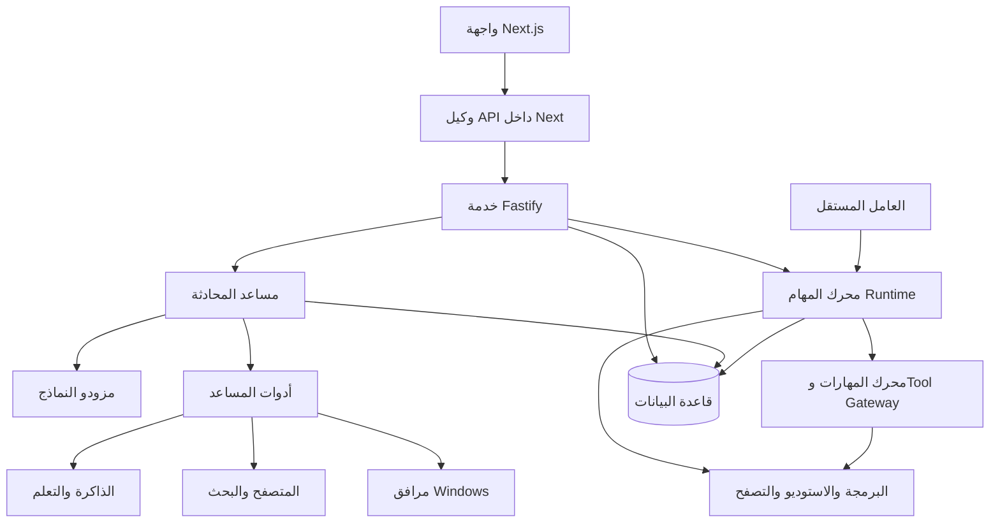

# بنية مشروع Mohassan AI

المشروع مستودع واحد بنظام npm workspaces، يجمع واجهة ويب وخدمة خلفية وعامل مهام وحزماً مشتركة. اللغة الأساسية TypeScript، مع مكوّن Windows مكتوب بلغة C#.

## المجلدات الرئيسية

```text
Mohassan AI/
├── apps/             التطبيقات ونقاط التشغيل
├── packages/         المنطق المشترك ومحركات النظام
├── scripts/          التشغيل والإعداد والفحوص والنشر
├── tests/            اختبارات التكامل ورحلات الواجهة
├── docs/             توثيق المشروع
├── artifacts/        تقارير ولقطات وأدلة تنفيذ
├── .data/            بيانات محلية وحالات محفوظة
├── .env              إعدادات البيئة والأسرار المحلية
├── package.json      تعريف workspaces وأوامر المشروع
└── package-lock.json تثبيت إصدارات الاعتماديات
```

## التطبيقات

| المسار | المسؤولية |
|---|---|
| `apps/web` | واجهة Next.js وReact: المحادثة والمهام والبرمجة والاستوديو والذاكرة والمهارات والاتصالات والإعلانات |
| `apps/server` | خدمة Fastify: تستقبل الطلبات وتدير المصادقة والمحادثة والمهام وتربط محركات النظام |
| `apps/worker` | عامل مستقل لتنفيذ مهام Runtime المحفوظة في قاعدة البيانات |
| `apps/sandbox-gateway` | جسر اختياري لتشغيل معاينات Next داخل Vercel Sandbox |
| `apps/windows` | مرافق Windows لالتقاط الشاشة وقراءة عناصر الواجهة وتنفيذ الإدخال المصرح |

أول أربعة تطبيقات لديها ملفات `package.json`. مرافق Windows يتكون أساساً من `Companion.cs` ويعمل عبر سكربت PowerShell.

## الحزم المشتركة

| الحزمة داخل `packages/` | المسؤولية |
|---|---|
| `contracts` | أنواع البيانات ومخططات Zod المشتركة بين الواجهة والخدمة والمحركات |
| `database` | الاتصال بقاعدة البيانات ومخطط المهام وسجلاتها، باستخدام Kysely وPostgreSQL أو PGlite |
| `runtime` | طابور المهام والموافقات والمحاولات والإلغاء وأحداث التنفيذ |
| `cognitive` | تحويل الطلب إلى خطة منظمة وفحص بنيتها وصلاحياتها |
| `providers` | الاتصال بـGroq وFreeLLMAPI وOllama، وتوجيه الطلبات ومتابعة الاستخدام |
| `skills` | سجل المهارات واستيرادها وفحصها وتفعيلها ومنحها وجدولتها وTool Gateway وForge |
| `coding` | تسجيل مشاريع البرمجة وإنشاء Git worktrees وتطبيق تعديلات محدودة وتشغيل اختبارات ومراجعة النتائج |
| `sandbox` | عزل تنفيذ الكود على Windows باستخدام AppContainer وLPAC وحدود الموارد |
| `browser` | محركات التصفح والشبكة ونقل الملفات والبحث والفهرس المحلي |
| `memory` | تخزين الذاكرة واسترجاعها مع المصدر والملكية والصلاحية، ومهارات الذاكرة القديمة |
| `learning` | تجارب التنفيذ والدروس والمعرفة وتقييمها وتجهيز بيانات التدريب |
| `studio` | معاينة وتعديل صفحات HTML وCSS |
| `studio-react` | عرض React الأولي المعزول وربط العناصر بالمصدر |
| `studio-ai` | اقتراح تعديلات بالذكاء الاصطناعي والصور ومراجعتها |
| `windows` | واجهات ربط مرافق Windows ومنح المشاهدة والتحكم |
| `google-ads` | ربط حساب الإعلانات والتحليل والمسودات والتحقق والنشر المصرح |

## ارتباط المكونات



واجهة المستخدم ترسل الطلب إلى وكيل Next، الذي يمرره إلى Fastify مع معلومات الجلسة. الخدمة تختار متحكم المحادثة أو مسار المهمة أو الميزة المطلوبة، ثم تستخدم الحزم المشتركة وتحفظ الحالة في قاعدة البيانات.

يوجد مساران رئيسيان للعمل: **حلقة المحادثة** لاتخاذ الخطوات أثناء الحوار، و**Runtime** لتنفيذ أنواع مهام مسجلة. حزمة `cognitive` تنتج خطة محفوظة؛ الخطة وحدها لا تنفذ جميع خطواتها تلقائياً. Tool Gateway يخص تنفيذ أدوات المهارات، وللمحادثة adapters مستقلة.

## الملفات المركزية

| الملف | دوره |
|---|---|
| `scripts/dev.mjs` | تشغيل الخدمة والويب محلياً؛ الافتراضي 4000 للخدمة و3000 للويب |
| `apps/server/src/index.ts` | نقطة بدء الخدمة |
| `apps/server/src/app.ts` | تجميع المحركات وتسجيل واجهات API وربطها ببعضها |
| `apps/server/src/config.ts` | قراءة إعدادات البيئة وتكوين الخدمات |
| `apps/server/src/command-chat.ts` | إدارة المحادثات وحلقة اتخاذ القرار والتنفيذ والاستعادة |
| `apps/server/src/assistant/brain.ts` | القواعد المباشرة وبناء سياق النموذج وتعليمات القرار |
| `apps/server/src/assistant/tools.ts` | ربط قرارات المساعد بالأدوات الفعلية |
| `apps/server/src/inference.ts` | إعداد وتوجيه مزودي المحادثة |
| `apps/server/src/skill-runtime.ts` | ربط المهارات وTool Gateway بمحرك المهام |
| `apps/worker/src/index.ts` | نقطة بدء العامل المستقل |
| `apps/web/app/api/[...path]/route.ts` | وكيل الاتصال بين الواجهة والخدمة |
| `apps/web/components/assistant-app.tsx` | واجهة المحادثة |
| `apps/web/components/workspace.tsx` | تجميع أقسام مساحة العمل |

## موقع النماذج والبيانات في البنية

الاستدلال اللغوي يأتي من النماذج المتصلة عبر `providers`؛ الشيفرة المحيطة تبني السياق وتفسر القرارات وتنفذ الأدوات وتتحقق من النتائج.

- **Groq:** تستخدمه المحادثة والتخطيط والبرمجة والاستوديو وبعض توليد المهارات.
- **FreeLLMAPI:** بوابة إضافية لتوجيه نماذج المحادثة.
- **Ollama:** موائم للنماذج المحلية، مستخدم في التقييم ومختبر التجارب؛ ليس ضمن اختيار مزود المحادثة الاعتيادي حالياً.
- **الذاكرة والتعلم:** يخزنان الخبرات والمعرفة ويسترجعانها للسياق؛ لا توجد ضمن هذا الربط عملية تدريب أوزان مفعلة.

تُحفظ المهام والمحادثات والموافقات والمهارات والذاكرة وسجلات التنفيذ في SQL. تُحفظ بعض الملفات وprofiles المتصفح ونسخ العمل محلياً. الترحيلات موزعة بين `database` ووحدات الميزات. أكثر نقاط الاشتراك بين المكونات هي `contracts` وقاعدة البيانات و`app.ts` و`config.ts` و`command-chat.ts` و`runtime` وملفا الحزم والقفل.
