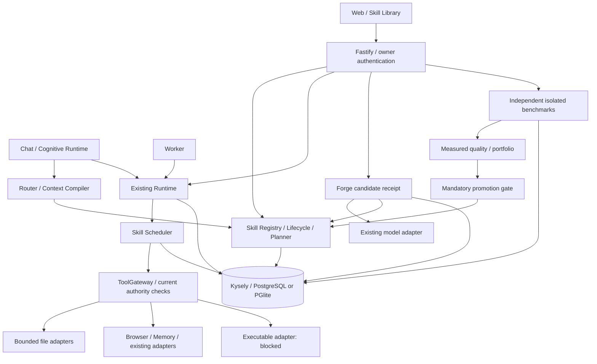

# Mohassan AI — تقرير الإصلاح والتنفيذ والتحقق المحلي

تاريخ العمل: 5 نوفمبر 2026. المصدر المرجعي هو المستودع المحلي وخطة `docs/SKILL-ENGINE-PLAN.md`، وليس أرقام الجلسات السابقة. هذا التقرير لا يعلن جاهزية إنتاجية أو القدرة على إنشاء مشروع برمجي كامل بأمر واحد.

**تحديث لاحق:** قُبل M0 بعد إصلاح فحص الشبكة، والمحجوب الآن M7 وM8 فقط؛ التفاصيل في `ISOLATION.md` و`IMPLEMENTATION-STATUS.md`. الأقسام أدناه تسجل الحالة وقت كتابتها.

**الحالة:** قُبلت M1–M6 وM9–M13 ضمن النطاقات والأدلة الموضحة أدناه. M0 وM7 وM8 محجوبة لأسباب أمنية موثقة، ولم تُتجاوز البوابات لإكمال المراحل. الانحدار العام الأخير: 1180 نجاحًا، صفر إخفاق، 15 تجاوزًا في 89 ملفًا؛ نتيجة الواجهة النهائية 9/9. تُفصّل حالات التجاوز والتحقق التكميلي أدناه.

## 1. نطاق العمل والبيئة

- العمل محلي داخل المشروع؛ لم يحصل اتصال GitHub أو مزامنة أو نشر أو تثبيت اعتماديات أو بناء إصدار إنتاجي أو commit للمستودع.
- لم تُقرأ بيانات اعتماد خارج آليات المشروع، ولم تُعدّل ملفات `.env` الفعلية أو صلاحيات الجهاز أو قواعد جدار الحماية. اختبارات المزود تستخدم `fetch` محاكى؛ المواقع الاختبارية محلية ومضبوطة.
- لم تُطبّق الترحيلات الجديدة على قاعدة البيانات المضبوطة في إعدادات التشغيل. الترحيلات والتعافي وعمليات البيانات اختُبرت في PGlite قابلة للتخلص منها.
- توجد نسخة من 213 ملفًا كما كانت قبل تعديلات هذه المهمة، مع بصماتها، في `artifacts/skill-engine-completion/baseline/manifest.json`. تحفظ هذه النسخة التغييرات السابقة للمستخدم أيضًا؛ لا تحتوي `.env` أو مفاتيح حقيقية.
- الأدوات الموجودة: Node 24.22.1، TypeScript 5.9.3، Vitest 5.1، Next 16.4.5، React 19.3.1، Chakra 3.38.0، Zod 4.6.7، Kysely 0.29.8، PGlite 0.5.15. لم تُحدّث هذه الاعتماديات.

الفحص الابتدائي المستقل: **455 نجاحًا، 15 تجاوزًا، صفر إخفاق في 44 ملفًا**، ونجاح TypeScript للخادم والويب. تختلف هذه النتيجة عن الرقم التاريخي 456/14؛ لا يُستبدل القياس الجديد به. أوامر كل جولة وإخفاقات التطوير محفوظة في `artifacts/skill-engine-completion/verification-log.md`.

## 2. المعمارية بعد الإصلاح

المسارات الموجودة هي `apps/web`, `apps/server`, `apps/worker`, `apps/windows`, `apps/sandbox-gateway` وحزم `browser`, `coding`, `cognitive`, `contracts`, `database`, `memory`, `providers`, `runtime`, `sandbox`, `skills`, `studio`, `studio-ai`, `studio-react`, `windows`. لم يُنشأ محرك تنفيذ موازٍ.



**دورة المهارة:** مصدر محلي أو مرشح Forge ← تحقق عقد ومسارات وحدود ← نسخة ثابتة وبصمة ومصدر ← حجر ← فحص ثابت حالي ← موافقة صريحة ← نسخة نشطة. المنح منفصلة ومثبتة ببصمة ومدة ونطاق. تغيير النص لا يورث المنحة. التراجع يمر عبر دورة الحياة نفسها؛ مرشح Forge يحتاج تقييمه المستقل أيضًا.

**دورة التنفيذ:** خطة ذات مدخلات وأنواع واعتمادات ← تحقق صلاحيات وتوافر ← مهمة `skill.run` في Runtime ← مهام فرعية بموافقات مستقلة ← ملكية وفencing ← إيصال قبل الأثر ← Gateway يعيد فحص البصمة والمنحة ← تنفيذ الأداة الموجودة ← دليل وبصمة ← تحقق مستقل ← نتيجة محفوظة. الرمز `skill.node` داخلي، ولا يسمح العميل بتجاوز المجدول.

**السياق والنماذج:** تحميل metadata محدود ثم تعليمات نشطة بحسب الصلة والميزانية؛ النص غير موثوق ولا يضيف أدوات. المصدر والبصمة يرافقان النص. Model Router يستخدم النماذج المضبوطة فقط، وسياسة fallback مشتركة مع المزود. لا retry تلقائي لرد مدفوع أو أثر مجهول.

**العمليات الخلفية:** العامل يستعمل تركيب Skill Runtime نفسه المستعمل في الخادم. استعادة المهام والإيصالات وقواطع الدائرة محفوظة. تجارب القياس وForge لها leases وملكية مستقلة؛ انتهاء الملكية لا يعيد تلقائيًا الاتصال بالنموذج. إغلاق التطبيق ينتظر المتحكمات قبل إغلاق قاعدة البيانات.

## 3. إصلاحات R1–R8

| الإصلاح | التغيير المثبت | الدليل والحدود |
|---|---|---|
| R1 Inspector | فصل شدة الحكم عن أول 200 نتيجة معروضة؛ الفحص المقتطع/غير المكتمل لا يُقبل؛ `static-v2` وفحص حالي إلزامي للتفعيل والتراجع | `packages/skills/src/inspector.ts`, `lifecycle.ts`, `planner.ts`; اختبارات بعد أكثر من 200 تحذير، وحجر/تفعيل وفحص قديم. الفحص الثابت ليس برهان سلامة شيفرة عامة |
| R2 Composer | اعتماد موجّه، رفض الترتيب العكسي والاعتماد المفقود والدورات، والتحقق من الأنواع والصلاحيات والتوازي الصحيح | `composer.ts`, `planner.ts`, `conflicts.ts`; اختبارات وحدة و`tests/skills-compose.test.ts` وتنفيذ مركب فعلي |
| R3 Browser | فحص الطلب عند حد الأثر، وموافقة واحدة مثبتة بالصفحة والوجهة والطريقة والجسم والمدة؛ تغطية click/Enter/type-submit/forms/iframes/submission البرمجي المرصود والredirect | `packages/browser/src/agent-browser.ts`, `apps/server/src/command-chat.ts`; مواقع محلية ومجموعة سلامة المتصفح. الإرسال الذي لا يمكن ربطه بالموافقة يُرفض؛ بعض تطبيقات JavaScript/CSRF قد تحتاج تكاملًا خاصًا |
| R4 Groq | تحليل ms/s/m/h والمركبات والكسور؛ القيم المفقودة أو غير الصالحة تصبح صفرًا في metadata، والمدة الصحيحة الكبيرة تُحد عند 24 ساعة | `packages/providers/src/index.ts`, `groq-safety.test.ts`; اختبارات حتمية تشمل overflow. هذا مختلف عن Retry-After الأصلي المحفوظ لسياسة الإعادة؛ لا يُرفض رد المزود لمجرد غياب header |
| R5 Fallback | تصنيف ProviderError موحد، احتفاظ metadata وRetry-After، نموذج بديل مضبوط فقط، محاولتان كحد أقصى وإثبات استخدام صفري | `packages/providers/src/retry.ts`, `packages/cognitive/src/index.ts`; الرد المبهم أو المدفوع لا يُعاد؛ تأخير أكبر من 60 ثانية لا ينتج fallback فوريًا |
| R6 Chat | ملكية دائمة، انتقالات ذرية، fencing، مفاتيح تكرار وإيصالات قبل الأثر؛ إبطال الموافقة القديمة وعدم إعادة الأثر المجهول | `apps/server/src/command-chat.ts`, migration `022_chat_execution_safety`; اختبارات موافقة متزامنة واستئناف وتوقف. لا ادعاء exactly-once خارجي |
| R7 الحدود المشتركة | تشغيل المهارات من Chat عبر Runtime الحالي، وفحص الصلاحيات الحالي في Gateway وموافقات المهام الفرعية | `skill-runtime.ts`, `skill-tools.ts`, `execution-authority.ts`, `packages/runtime/src/index.ts`; لم تُنشأ منظومة تنفيذ مستقلة |
| R8 التوثيق | حالة حديثة تتقدم على السجل التاريخي، وأوامر/إخفاقات/تجاوزات موثقة، وتصحيح شرط G5 وتعليمات التراجع الخطرة | `docs/IMPLEMENTATION-STATUS.md`, `docs/SKILL-ENGINE-PLAN.md`, `docs/ISOLATION.md`, هذا التقرير وسجل التحقق |

إصلاحات إضافية كشفتها الاختبارات: ثبات بصمة المحتوى عبر ترتيب مفاتيح JSONB مع توافق قراءة النسخ القديمة؛ تسلسل حصة الاستيراد وForge المشتركة؛ منع تجاوز ترقيم النسخ؛ إعادة حساب بصمات نتائج الرسم بدل الثقة في حقول منسوخة؛ منع توصيات رسم ناقص؛ فصل أدلة المركب عن حدود كل خطوة؛ منع نشر مرشح بعد انتهاء lease أثناء المعاملة؛ احترام حدود مدخلات ومخرجات محول النموذج الحقيقي.

## 4. مصفوفة M0–M13

| المرحلة وفق الخطة | الحالة الحالية | الملفات الداعمة والاختبارات | ما لم يُثبت أو بقي محجوبًا |
|---|---|---|---|
| M0 خط الأساس | **محجوب** | `packages/sandbox/native/Runner.cs`, `run.ps1`, `src/index.ts`, `network-probe.ts`; قبول أصلي 16 نجاحًا / 3 إخفاقات / 9 تجاوزات | لم يعد `coding.available`؛ قبول الشبكة الأصلي غير مثبت على جميع واجهات الجهاز |
| M1 العقود والسجل | مقبول في نطاقه | `packages/contracts/src/skills.ts`, `registry.ts`, `legacy.ts`, `builtin/*`, `tests/skills-api.test.ts`, `registry.test.ts` | لا يثبت السجل وحده التنفيذ |
| M2 الأمان والاستيراد | مقبول في نطاقه | `importer.ts`, `import-store.ts`, `inspector.ts`, `grants.ts`, `lifecycle.ts`, `tests/skills-security.test.ts` | لا تشغيل للسكربت المستورد؛ الفحص الثابت ليس sandbox |
| M3 التركيب والصلاحية والتعارض | مقبول في نطاقه | `composer.ts`, `planner.ts`, `permissions.ts`, `conflicts.ts`; خطط عكسية/دائرية/ناقصة وصحيحة | التزامن متعدد اتصالات PostgreSQL غير متحقق |
| M4 التوجيه والسياق | مقبول في نطاقه | `router.ts`, `compiler.ts`, `preload.ts`, Chat/brain/worker؛ 70 اختبارًا مستهدفًا | `SKILL_ENGINE_ENABLED=false` افتراضيًا؛ جودة اتباع النموذج للتعليمات غير مقاسة |
| M5 الجدولة وToolGateway | مقبول للأدوات المهيأة | `scheduler.ts`, `gateway.ts`, `execution-authority.ts`, `file-tools.ts`, server `skill-runtime.ts`, `skill-runs.ts`; موقع محلي ← تقرير فعلي | Windows غير مسجل في Gateway؛ coding/studio التنفيذيان محجوبان بالعزل |
| M6 التعافي | مقبول ضمن نقاط الانقطاع المختبرة | `fallback.ts`, `circuit.ts`, `rollback.ts`, Runtime؛ خمس حالات قتل عامل فعلية | لا ضمان exactly-once خارجي أو OS CAS أو كل حالات انقطاع الطاقة |
| M7 تقوية العزل | **جزئي ومحجوب** | `Runner.cs`, `gates.ts`, `script.ts`, `side-channel-probe.ts`; 27 اختبارًا محليًا ناجحًا | G2 بلا quota قرص صلبة؛ G5/G8 غير مثبتتين بسبب فشل LPAC قبل التنفيذ |
| M8 المهارات التنفيذية | **محجوب باعتماد M7** | `tests/skills-executable.test.ts` والمجدول؛ 29 حالة رفض/انحدار ناجحة | لا نجاح تنفيذي ولا قبول السيناريو B؛ لا تمكين سكربتات مستوردة |
| M9 كشف الفجوات | مقبول في نطاقه | `gaps.ts`, `skill-gaps.ts`, `skill-run-gaps.ts`, Chat؛ 45 أساسيًا / 76 Chat / 9 API | النص الحر لا يُحوّل إلى حقيقة؛ السبب غير المحسوم يبقى غير محسوم |
| M10 رسم المعرفة | مقبول في نطاقه | `graph.ts`, `graph-context.test.ts`, server `skill-graph.ts`; تحقق نهائي 75/75 | توصيات محدودة بعمق 2، بلا منح ضمنية؛ البيانات التاريخية ليست ضمان الحالة الحالية |
| M11 التقييم والمحفظة | مقبول للنطاقات المقاسة | `benchmark.ts`, `benchmark-suites.ts`, `quality.ts`, `portfolio.ts`, runner/worker؛ 93/93 وCLI 30/30 | تعليمات وقراءة/كتابة ملف بعقود محددة؛ لا جودة دلالية أو أسعار مخترعة أو benchmark عام للمتصفح |
| M12 Skill Forge 2.0 | مقبول للمرشحين غير التنفيذيين | `forge.ts`, `forge-promotion.ts`, `lifecycle-lock.ts`, server `skill-forge.ts`; 133/133 | مزود محاكى عبر المحول الحقيقي؛ ترقية التنفيذيات محجوبة؛ لا تحسن دلالي مثبت |
| M13 اللوحة | مقبولة ضمن الرحلات المختبرة | `skill-library.tsx`, `skill-experiments.tsx`, `capability-evolution.tsx`, `tests/e2e/skills.spec.ts`; ثلاث رحلات M13 ضمن 9/9 E2E | فحوص وصول عملية وليست شهادة WCAG شاملة؛ الواجهة تصرّح بحجب التنفيذيات ولا تفعّلها |

المجموع 14 مرحلة: **11 مقبولة ضمن نطاقها، و3 غير مكتملة ومحجوبة** (M0 وM7 وM8). من المحجوبة M7 منفذة جزئيًا؛ ليست فئة إضافية تُجمع مع الثلاث. لا مراحل مستقلة مؤجلة دون تنفيذ، والمتبقي للقبول الكامل ثلاث مراحل. لا نسبة جاهزية إنتاجية محسوبة من العدد. استمر M9–M13 بموجب الفرع المستقل في §11 من الخطة؛ لم يُتجاوز اعتماد M8 على M7.

## 5. التنفيذ الممكن فعليًا

| القدرة | النتيجة المثبتة محليًا |
|---|---|
| تعليمات فقط | اختيار وتحميل نص نشط مثبت البصمة ضمن ميزانية، دون منح صلاحية. تسليم النص والمصدر مقاس؛ جودة التفكير الناتج غير مقاسة |
| مهارة أدوات | Runtime/Gateway فعلي، مدخلات وأنواع ومنح وموافقات وأدلة؛ قراءة وكتابة UTF-8 مقيدتان، وموقع محلي حقيقي |
| مهارة مركبة | ترتيب اعتمادات وأنواع ونقل نواتج وأدلة، ومهارتان لقراءة موقع ثم كتابة تقرير |
| مهارة Node تنفيذية | **غير متاحة**؛ رفض التفعيل والتخطيط والتنفيذ مثبت. النص المحجور قابل للمراجعة فقط |
| الملفات | جذور ومنح ومسارات معلنة، حد 64000 بايت لأدوات النص، حظر الروابط ورفض المسارات الحساسة وأنماط الاعتماد المعروفة والأنواع غير المقبولة، بصمة متوقعة وصورة سابقة للكتابة؛ ليست آلية كشف شاملة لكل سر |
| المتصفح | Chromium محلي حقيقي للفتح والقراءة والتفاعل المحكوم؛ authorization عند طلب الإرسال. الدخول وOTP محميان من وصول الأسرار للنموذج/SQL في الاختبارات |
| التحكم بالكمبيوتر | واجهات Windows القائمة محفوظة؛ لا توريث تلقائي لمنحة الجهاز/الجلسة/المشاهدة إلى العامل؛ التحقق المادي الجديد غير مثبت |
| توليد الشيفرة وتشغيلها | المحول وCoding Lab موجودان؛ اختبارات محاكية للأداة تمر. التشغيل الآمن الأصلي محجوب بـM0/M7 |
| الاستوديو الثابت | تحقق E2E من صورة وطلب تعديل بمحاكي النموذج، ومراجعة بصرية حقيقية وتطبيق صريح وتراجع محفوظ على HTML/CSS داخل موارد مؤقتة. لا يثبت ذلك تشغيل React/Next أو شيفرة عامة |
| قاعدة البيانات | ملكية وعقود ومخططات محلية مختبرة في PGlite؛ لم تُختبر قاعدة التشغيل أو عدة اتصالات PostgreSQL مستقلة |
| API نموذج | المحول الفعلي مختبر بردود محاكية، بما فيها rate limit/fallback/Forge؛ لا اتصال حي أو جودة نموذج مثبتة |
| عمل طويل وتعافٍ | ملكية محفوظة وheartbeat وfencing وحد محاولات؛ الإيصال المؤكد يُستأنف للتحقق فقط؛ المجهول يتوقف للمراجعة |
| تعلم/Forge | تحليل أكواد فشل موثوقة، مرشح محجور، مقارنة مستقلة، ترقية صريحة وتراجع؛ لا تعلم ذاتي غير مراقب أو ترقية آلية |
| إنشاء مشروع كامل بأمر واحد | **غير مثبت وغير معلن**؛ يتطلب حل العزل وتوسيع الأدوات والقياسات والتحقق المستقل من دورة التسليم كاملة |

## 6. الأمن والعزل

**ضوابط مثبتة في نطاق الاختبارات:** Zod صارم، ملكية لكل مورد، تجزئة عقود ومحتويات وإيصالات، فحص ثقة ومصدر وحجر، منح محددة البصمة والمدة والجذر، موافقات مستمرة على المهام والآثار، حدود سياق وJSON وخرج، عدم تنفيذ الشيفرة أثناء الاستيراد أو توليد المرشح، رفض التنفيذ عند فقدان أي بوابة، وإبطال كتابة مالك عملية قديم.

**تفصيل G1–G8:**

| البوابة | النتيجة |
|---|---|
| G1 مضيف native ثابت غير محزّم | ثبت token AppContainer وقدرات صفرية وJob ببرامج اختبار ثابتة موثوقة؛ ليس إعلان اكتمال جميع أنواع العزل |
| G2 حصة قرص صلبة | **لا quota قرص صلبة**. حدود جمع الملفات والمراقبة الدورية وحدود Job I/O لا تُحسب quota |
| G3 قيود Windows UI | قيود Job UI مثبتة ببرنامج اختبار ثابت؛ لا تعني قبول شبكة M0 أو اكتمال منع IPC |
| G4 صلاحيات Node وnative/addons | قيود filesystem ورفض child processes/workers/addons ضمن البرامج الثابتة؛ لا تُستخدم بديلًا للعزل الأصلي |
| G5 LPAC والموارد العامة | سمة العملية أضيفت، لكن GetTokenInformation بالصف 46 عاد Win32 87 قبل ResumeThread؛ **غير متحقق**. يلزم إثبات token ومنع الوصول إلى الموارد العامة معًا |
| G6 وضع السكربت الثابت | مدخل ثابت بلا shell أو argv أو env يختارها المرشح؛ مهلة وإلغاء ومراقبة عملية فعلية ضمن fixtures موثوقة |
| G7 جمع ملفات المخرجات | stdout/stderr محدودان، جمع آمن بعد الخروج وUTF-8 وبصمات وحدود ملفات/عمق؛ لا يثبت quota أثناء التنفيذ |
| G8 القنوات الجانبية | تحكم مضيف إيجابي لثلاث واجهات UDP وpipe فريد قبل/بعد؛ الطفل LPAC لم يبدأ، لذا صفر رسائل ليس برهان منع؛ **غير متحقق** |

جميع البوابات إلزامية، بما فيها G5؛ صُحح التعارض القديم الذي أوحى بأنها اختيارية. لم يُنفذ اختبار امتلاء قرص أو استغلال جهاز أو probe شبكة خارجي. لم تُشغّل شيفرة مستوردة غير موثوقة على المضيف.

**حدود معلنة:** prompt injection لا يُحل بالفحص النصي وحده؛ الصلاحيات عند حد الأثر هي الحماية الأساسية. بصمات SQL والأحداث تكشف عدم الاتساق في التطبيق لكنها ليست سجلًا غير قابل للعبث لمن يملك قاعدة البيانات. أقفال الملفات تحمي العمال المتعاونين، ولا تمنح OS-level CAS ضد عملية مضيف عدائية تغيّر المسار بين الفحوص. بعض الإرسال البرمجي غير القابل للربط بالموافقة يُرفض. طلبات التنقل والموارد GET أثناء العملية المصرح بها مسموحة وفق سياسة الوجهة؛ طريقة HTTP GET لا تثبت خلو الخادم البعيد من أثر جانبي. لا ضمان سلامة عامة لكل موقع أو نموذج أو برنامج.

**حدود تشغيلية مقصودة:** الاستيراد وForge يشتركان في حصة 200 نسخة لكل مالك؛ الحزمة حتى 40 ملفًا، 64000 بايت للملف و256000 بايت إجمالًا. سياق التعليمات 4000 محرف افتراضيًا وبسقف 12000 وحتى 6 مهارات مختارة. الرسم حتى 200 نسخة و80 نتيجة و400 عقدة و1200 حافة، ولا يوصي عند الاقتطاع. لكل من benchmark وForge عملية واحدة جارية و500 سجل لكل مالك، دون حذف تاريخ آلي. توجد ثلاث suites فقط، والترقية مقيدة بالعقود التي تغطيها هذه القياسات.

## 7. الموثوقية والتزامن

1. قفل المالك قبل قفل دورة الحياة ثم العائلة يمنع سباق حصة الاستيراد/Forge وسباق التفعيل بين العائلات. expectedRevision يرفض قرارًا مبنيًا على حالة قديمة.
2. كل عقدة لها محاولة وlease/fencing token. كل إيصال مرتبط بالمالك والنسخة والبصمة والمدخلات والمهمة والمحاولة؛ لا يكفي وجود API أو حالة ناجحة.
3. بعد انقطاع العامل، الإيصال المؤكد لا يُنفذ ثانية؛ يعاد التحقق من النتيجة. اختُبر الانقطاع مرة ثانية أثناء التحقق أيضًا.
4. الأثر المجهول يحتفظ بقفل المورد ويتوقف. لا يُعاد إرسال نموذج مدفوع أو browser submission مجهول تلقائيًا.
5. حد التنفيذ ثلاث محاولات إجمالية: المحاولة الأولى ثم إعادتان كحد أقصى، للأفعال المؤكدة بلا أثر فقط وضمن العقد والسياسة، مع احترام موعد المحاولة المحفوظ وقاطع دائرة SQL. fallback النموذج أشد تقييدًا.
6. تراجع الملف يتطلب كتابة سابقة مؤكدة ومنحة حالية وبصمة حالية مطابقة وموافقة Runtime. تغيير الملف لاحقًا يمنع الكتابة فوقه.
7. Forge يحفظ usage/responseHash المتأخرين بمعرّف الاتصال الأصلي، لكنه لا ينشر مرشحًا بعد انتهاء الملكية. لا تُمحى تكلفة اتصال لمجرد إلغاء انتظار الرد.

الاختبارات تستخدم معاملات PGlite وعمليات متعاقبة تعيد فتحها. **لم يُثبت تزامن PostgreSQL متعدد الاتصالات، ولا جميع أعطال الطاقة أو ضمان exactly-once لدى مزود خارجي.**

## 8. القبول من طرف إلى طرف

| السيناريو | الدليل الحالي |
|---|---|
| A استيراد ← موقع محلي ← تقرير ← قتل عامل ← استعادة | `tests/skills-execution.test.ts`, `tests/skills-recovery.test.ts` وعامل browser crash؛ تشغيل فعلي وملف مؤقت وبصمة وإيصال وحيد وعدم تكرار الأثر المؤكد |
| B Node داخل sandbox كامل | **محجوب**. اختبارات الرفض فقط؛ لا نجاح صوري باستبدال العزل بعملية Node أو مجلد مؤقت |
| C تركيب ذو أنواع واعتمادات | خطط خاطئة وصحيحة، نقل الأدلة، ومهارتان فعليتان عبر المتصفح والملف؛ انقطاع وتعافٍ ضمن النقاط المختبرة |
| D الواجهة | نجاح 3 رحلات M13 داخل الجولة النهائية 9/9: استيراد ومصدر وفحص وتفعيل وتراجع، grants وتركيب وقراءة ملف بإيصال، ثم Forge وقياس وترقية؛ desktop و360px |
| E الانحدار | 6 رحلات متصفح قديمة نجحت: Assistant ودخول/OTP/موافقة، browser/research، نموذج مهمة المتصفح، memory/checklists، Windows consent transport، والاستوديو الثابت. فحوص Coding وRuntime وغيرها ضمن Vitest؛ الأصلي المحجوب منفصل |

ملف `artifacts/skill-engine-completion/m11-cli-results.json` يحتوي **30/30** حالة مقاسة محليًا (8 تعليمات، 8 قراءة، 14 كتابة)، بينها تعافٍ مؤكد للأساس والمرشح وتنظيف الموارد. بصمة الملف: `C53611086CD5A4B1E23875B771C4EF6D6372ED991A6505E19D23D6D01576D7CD`. الخيار `--live` في هذا السكربت يعني تنفيذ fixtures محلية فعلية، وليس خدمة المزود أو قاعدة التشغيل.

## 9. أوامر التحقق والنتائج

السجل التفصيلي في `artifacts/skill-engine-completion/verification-log.md` هو المرجع لكل جولة. الأعداد أدناه متداخلة ولا تُجمع:

| المجموعة | النتيجة |
|---|---|
| البداية | 455 نجاحًا، 15 تجاوزًا، 44 ملفًا، 168.57 ثانية |
| M4 انحدار عام | 689 نجاحًا، 15 تجاوزًا، 53 ملفًا، 333.58 ثانية |
| M6 انحدار عام | 862 نجاحًا، 15 تجاوزًا، 68 ملفًا، 548.57 ثانية |
| M7 ضوابط ثابتة موثوقة | 27/27، 33.77 ثانية؛ إعادة مستقلة 27/27، 30.83 ثانية |
| قبول العزل الأصلي | **16 نجاحًا / 3 إخفاقات / 9 تجاوزات**، 58.48 ثانية؛ القيود لم تُخفف |
| M8 الرفض وانحدار المجدول | 29/29، 32.74 ثانية |
| M10 النهائي | 75/75، 7 ملفات، 39.82 ثانية |
| M11 النهائي | 93/93، 8 ملفات، 103.10 ثانية |
| M12 النهائي | 133/133، 6 ملفات، 38.73 ثانية |
| TypeScript بعد M12 | الخادم والويب خرجا برمز 0، دون emission أو incremental files |
| الجولة العامة قبل إصلاح تحويل الدخول الأخير | 1170 نجاحًا / 15 تجاوزًا، صفر إخفاق، 88 ملفًا، 773.63 ثانية |
| تحويل الدخول المصحح | 43/43 في مجموعتي safety/flow، 109.94 ثانية؛ تحقق مستقل 10/10، و33 غير مختارة بالفلتر |
| M13 وانحدار E2E النهائي | **9/9، صفر إخفاق/تجاوز/حالة flaky، 200.61 ثانية**؛ بداية 09:14:32.446 UTC |
| البنية المعزولة وAPI بعد تصحيح الاستيرادات | 25/25، 4 ملفات، 25.30 ثانية |
| إعادة Vitest العامة بعد آخر إصلاح | **1180 نجاحًا، صفر إخفاق، 15 تجاوزًا، 89 ملفًا، 795.79 ثانية**؛ 09:14:32.114–09:27:47.902 UTC |
| تكميلي دون فلتر للاستوديو وInspector | **45/45، صفر إخفاق أو تجاوز، ملفان، 17.61 ثانية**؛ يغطي الحالات الأربع التي استبعدها الفلتر، و41 إعادة تحقق |
| TypeScript النهائي | الخادم والحزم والويب: رمزا خروج 0، دون إخراج ملفات |

الأمر العام الحالي:

```powershell
node node_modules/vitest/vitest.mjs run --exclude=packages/coding/src/appcontainer.integration.test.ts --exclude=tests/sandbox-control-plane.test.ts --cache=false --fsModuleCache=false --configLoader=runner --reporter=json --outputFile=artifacts/skill-engine-completion/final-vitest-results.json --testNamePattern='^(?!.*(?:real Windows AppContainer|captures UIA and JPEG|renders real React with hooks|atomically applies one verified proposal|rejects another owner, malformed snapshot|refuses a previously verified proposal)).*$' *> artifacts/skill-engine-completion/final-vitest.log
node node_modules/vitest/vitest.mjs run tests/studio-candidate.test.ts packages/skills/src/inspector.test.ts --cache=false --fsModuleCache=false --configLoader=runner --reporter=json --outputFile=artifacts/skill-engine-completion/final-supplemental-results.json *> artifacts/skill-engine-completion/final-supplemental.log
node node_modules/typescript/bin/tsc --noEmit --incremental false -p tsconfig.json
node node_modules/typescript/bin/tsc --noEmit --incremental false -p apps/web/tsconfig.json
```

تفصيل الاستثناءات: استُبعد ملفا `packages/coding/src/appcontainer.integration.test.ts` و`tests/sandbox-control-plane.test.ts` من الجولة العامة بسبب القبول الأصلي المحجوب، وقد شُغلا في جولة القبول المنفصلة الفاشلة أعلاه. داخل الملفات الـ89، استبعد الفلتر تسع حالات `real Windows AppContainer`، وحالة React/Next داخل AppContainer، وحالة Windows الفيزيائية. كذلك ورث ثلاث حالات للاستوديو من قيود جلسة التدقيق القديمة على Git المؤقت، واستبعد عرضيًا حالة تعليق مخفي لأن اسمها متعدد الأسطر. **نجحت هذه الأربع في التحقق التكميلي دون الفلتر**؛ لا تُنسب إلى حجب العزل. نجح ملف الاستوديو 5/5 وInspector ‏40/40، دون تعديل المصدر أو fixtures. بقيت 11 حالة متجاوزة دون إثبات نجاحها، إضافة إلى ملفي القبول الأصلي المستبعدين. أسماء الحالات الخمس عشرة محفوظة حرفيًا في JSON الجولة العامة؛ لم تُعدّل النتيجة التاريخية بعد التحقق التكميلي، ولا تُجمع الـ45 مع الـ1180 بسبب التداخل.

لا يوجد script lint جذري مستقل، ولم يُثبت أو يُشغّل formatter/auto-fix. لم تُجرَ اختبارات مزود حي أو قاعدة إنتاج أو جهاز iPhone.

## 10. الواجهة والوصول والدليل القابل للمراجعة

بُنيت المكتبة بـChakra 3.38 الموجود، وربطت بالتنقل الحالي وبصفحة الذاكرة مع إبقاء قوائم الفحص القديمة. تعرض مستويات المهارات ومصادرها وبصماتها وفحوصها ونسخها ومنحها والأدلة والمقاييس الفعلية، وتعرض النقص والتعثر والحجر وعدم التوافق وانقطاع الاتصال صراحة. لا تُعرض قيمة نقدية أو جودة دلالية مفترضة.

جولة Chromium النهائية أثبتت: استيراد حقيقي من مجلد مصرح، قراءة المصدر كنص، فحص، تفعيل وإلغاء وتراجع بموافقة، منحة دقيقة وإلغاؤها، تركيب صحيح وغير صحيح ثم تصحيحه، تشغيل file.read عبر Runtime بموافقة الأب من UI والخطوة عبر API الاختبار الصريح، ثم عرض الإيصال الفعلي. اختبرت Forge من توليد محاكى عبر المحول الحالي إلى الحجر والمراجعة والقياس المستقل والترقية، مع بقاء المنح فارغة حتى طلب مستقل. طابقت لوحة التطور أعداد الرسم والقياسات والتشغيل وحجب العزل مع API.

عرض الهاتف **360×800** بلا تمرير أفقي في الحالات المختبرة، والحوار يلف الجذور الطويلة داخل العرض. أسماء عناصر التحكم والموافقة والتركيز بلوحة المفاتيح وحالات offline/error/empty/incompatible اختُبرت. قيس تباين **64 عينة نص مكتبية (أدنى 5.15:1)** و**67 عينة هاتف (أدنى 5.92:1)** دون إخفاق للحدود المطبقة. حدود حقول الإدخال ومؤشرات التركيز أغمقت أيضًا. هذه فحوص AA محددة، لا تدقيق شامل لقارئ شاشة أو كل تركيبة متصفح/تقنية مساعدة.

فشل webpack الأول كشف استيرادات `.js` غير مُنتجة؛ صُححت إلى أسلوب العقود الموجود. وأُصلحت نتائج تركيب قديمة، ونطاق مراجعة مركب ناقص، وسباق معرّف سجل التشغيل، وتباين نصوص صغيرة. كشف الانحدار عيب POST→303→GET على العنوان نفسه؛ أُصلح دون السماح بإعادة POST أو تحويل 307/308. فُصلت أخطاء fixtures (اختيار عنصر/انتظار قراءة/رسم خالٍ مشروع) عن هذه العيوب الفعلية في سجل التحقق.

ملفات الدليل:

- `artifacts/skill-engine-completion/final-e2e-results.json`: تسع حالات ناجحة، SHA256 `5132c20c89b98890a4c35306467a53a32571f9a87a11b2899a0cb14e95607695`.
- `artifacts/skill-engine-completion/final-e2e.log`: أمر الجولة وطلبات النسخة المعزولة وملخصها.
- `artifacts/skill-engine-completion/m13-acceptance/`: صور الكمبيوتر والهاتف والمنح والترقية والتطور، وملفات JSON لقياسات التباين.
- `artifacts/skill-engine-completion/final-vitest-results.json` و`final-vitest.log`: الجولة العامة الأخيرة، SHA256 للـJSON: `9f339154c8bb7a57e86709fa342ac00351172249dfd221f529b21f7ab460b734`.
- `artifacts/skill-engine-completion/final-supplemental-results.json` و`final-supplemental.log`: التكميلي 45/45، SHA256 للـJSON: `9893e9e5adf50d161533d991750fc57b7a4c215381b0c743fd3f9efa2e79728e`.
- `docs/SKILL-ENGINE-FILES.md` و`artifacts/skill-engine-completion/changed-files.json`: الجرد الدقيق وبصمات الملفات ومصدر كل نسخة رجوع. ملفا الجرد مستثنيان من البصمات الذاتية.
- `artifacts/skill-engine-completion/verification-log.md`: الأوامر والنتائج والإخفاقات المفسرة قبل الوصول إلى القبول.

النسخة الاختبارية لا تحمل `.env` الحقيقي أو credentials/DB URLs موروثة. Next يعمل من نسخة مصدر داخل TEMP، والخادم والعامل والملفات والصور وقاعدة الاختبار تحته. تأكد خروج العمليات قبل حذف المجلد؛ تحققت يدويًا من زوال مجلد الجولة النهائية `mohassan-e2e-owned-82I3Qw`. القتل القسري بواسطة OS قد يمنع cleanup في JavaScript؛ لا يُدّعى ضمان التنظيف في تلك الحالة.

## 11. الترحيلات والرجوع المحلي

الترحيلات الجديدة: `017_skill_execution`, `018_skill_gaps`, `019_skill_graph`, `020_skill_eval`, `021_skill_forge`, `022_chat_execution_safety`, `023_runtime_skills`, `024_skill_recovery`, `025_runtime_recovery`. المخطط يتضمن تشغيلات وعقدًا وأدلة وصورًا سابقة وأقفال موارد وقواطع دائرة وتراجعات وفجوات ورسمًا وقياسات ومرشحي Forge. `015_skill_registry` و`016_skill_security` موجودتان من الأساس. أسماء الجداول والحقول الفعلية في `packages/skills/src/migration.ts`, `packages/database/src/index.ts`, `apps/server/src/command-chat.ts`.

**الحالة:** طُبّقت فقط على موارد الاختبار القابلة للتخلص منها. تشغيل التطبيق الجديد على قاعدة مضبوطة يطبق مسار الترحيل الحالي للتطبيق؛ لذلك لم يُعد تشغيله على قاعدة العمل الحقيقية ضمن هذا التحقق.

إرشادات الرجوع، دون تنفيذ حذف أو استعادة في هذه الجلسة:

1. أوقف عمليات التطوير/الاختبار التي تملكها هذه المهمة، وانتظر خروجها. لا توقف جميع عمليات Node أو المتصفحات على الجهاز.
2. قارن الجرد النهائي مع `baseline/manifest.json`، ثم استعد **الملفات المحددة فقط** من النسخة السابقة بعد حفظ أي تعديل أحدث للمستخدم. لا تستخدم `git reset --hard` أو `git clean`.
3. الملفات الجديدة تُراجع منفردة قبل إزالتها؛ لا حذف آلي للمجلدات أو الأدلة. احتفظ بتقرير النتائج ونسخة ما قبل العمل.
4. تعطيل الميزة عبر الإعداد الموجود `SKILL_ENGINE_ENABLED=false` يمنع إنشاء تشغيلات جديدة ويعيد سياق المهارات إلى التعطيل؛ لا يمحو التاريخ أو يسوّي أثرًا مجهولًا، ولا يوقف تلقائيًا عملية خارجية بدأت بالفعل. يجب مراجعة العمليات الجارية أولًا. لم يُعدّل هذا الإعداد في `.env` الفعلي.
5. لا تراجع قاعدة حقيقية بحذف جداول `skill_*`. إذا طُبّقت الترحيلات مستقبلًا، يلزم backup وخطة استعادة/ترحيل عكسي مدروسة وموافقة صريحة على أي حذف. لا توجد قاعدة عمل حقيقية غُيرت هنا لتحتاج استعادة.

## 12. الأعمال المتبقية للوصول إلى الهدف الكامل

- حل quota القرص وLPAC وقنوات G8 وقبول M0 بأدلة أصلية، ثم إعادة جميع اختبارات العزل دون تخفيفها، وبعد ذلك فقط تنفيذ وقبول M8 والسيناريو B.
- ربط Windows بالأدوات عبر تفويض صريح محدود بالجهاز والجلسة والمشاهدة؛ المحافظة على واجهات Companion الحالية. تطوير iPhone مؤجل.
- توسيع suites المستقلة إلى المتصفح والتركيب والنموذج والبرمجة، وقياس الدقة الدلالية والتكاليف بأسعار موثقة عند تهيئتها، دون تسريب holdout إلى المولد.
- قبول متزامن على PostgreSQL متعدد الاتصالات، واختبارات أعطال وتوقف أشمل، وآلية تشغيلية لمراجعة الآثار المجهولة والاحتفاظ بالأدلة.
- بعد توفر العزل: تحقق مستقل من توليد مشروع، واختباراته وتصحيحه وتسليمه من أمر طبيعي واحد؛ لا تُستنتج هذه القدرة من نجاح وظائف Skill Engine المنفردة.
- قبل الإنتاج: نطاق نشر محدد، سياسة أسرار ونسخ واستعادة ومراقبة وحدود موارد، ومراجعة أمنية مستقلة. لم يُنفذ نشر أو إعداد إنتاج ضمن هذه المهمة.

## 13. الحكم

المحرك قادر محليًا على تعليمات مثبتة المصدر وتشغيل أدوات مصرح بها وتركيب وتعافٍ ضمن الحالات المختبرة، مع مكتبة ومقارنات وForge محكومة بالأدلة. لا تزال المنصة **جزئية التشغيل** بسبب العزل الأصلي والمهارات التنفيذية والتكاملات غير المتاحة. أُنجز المسار المستقل المصرح به، لكن هدف اكتمال جميع M0–M13 **لم يتحقق بالكامل**. العدد الكبير من الاختبارات لا يحولها إلى منصة إنتاجية أو وكيل عام لإنجاز مشروعات كاملة، ونجاح الواجهة لا يغيّر حجب M0/M7/M8.
