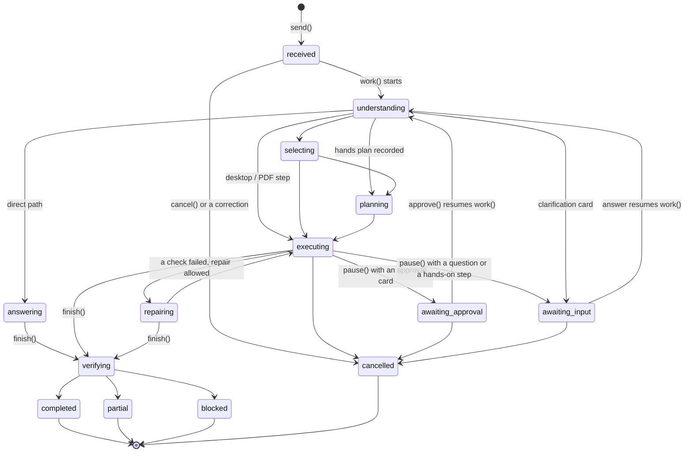
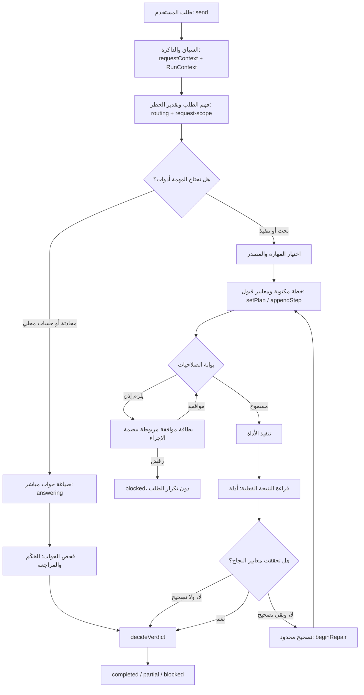

# دورة الفهم والتنفيذ والتحقق في محادثة موحسن

كُتبت هذه الوثيقة في 2026-11-23 على الفرع `feat/skill-engine`، وتصف الكود الموجود فعلًا في شجرة العمل. المرجع المعماري هو صورة «دورة الفهم والتنفيذ والتحقق» التي أرسلها المالك. يذكر القسم الأخير ما تختلف فيه هذه النسخة عن الصورة وسببه.

**الحدّ الأهم:** لا يتصل بالمحادثة اليوم نموذج لغوي، لا في الإنتاج ولا في هذا الفرع (`hasChatModel()` = false منذ 2026-11-12، ونموذج المحادثة الخاص متوقف عند البوابة 3). لذلك فكل فهم وتخطيط في هذه الدورة قواعد محددة في الخادم، ويقول عرض التشغيل ذلك صراحة («دون نموذج لغوي»). إذا اتصل نموذج لاحقًا، فإن عدّاد استدعاءاته الناجحة في سجل التشغيل هو وحده ما يجعل العرض يقول «شارك نموذج لغوي». هذا العمل لا يغيّر أوزان أي نموذج ولا يدرّب شيئًا.

## نقاط الدخول الحقيقية

كل طلب يمر بمتحكم واحد: `createCommandChatControl` في `apps/server/src/command-chat.ts`، عبر مسارات `registerCommandChatRoutes`.

| المدخل | المسار | ما يفعله في الدورة |
| --- | --- | --- |
| إرسال طلب (زر الإرسال ومفتاح Enter في `apps/web/components/assistant-app.tsx`) | `POST /api/chat/conversations` و`POST /api/chat/conversations/:id/messages` → `send()` | ينشئ صف التشغيل وسجلّه في الطور `received`. إذا كانت المهمة تعمل أو تنتظر، فالرسالة **توجيه** (انظر أدناه) |
| الموافقة أو الرفض | `POST …/approve` → `approve()` → `resume()` | تسجّل بوابة الصلاحيات الجواب على الإجراء المحدد، ثم يُستأنف العامل |
| جواب بطاقة | `POST …/respond` أو `messages` مع `answers` → `resume()` | يستأنف التشغيل نفسه |
| الإيقاف | `POST …/cancel` → `cancel()` | ينهي التشغيل `cancelled` ويُسقط ما كان معلقًا |
| العرض وإعادة الاتصال | `GET …/:id` → `detail()` | قراءة فقط: يعرض `run` من الصف المحفوظ، ولا يشغّل شيئًا |
| العامل | `dispatch()` → `work()` | المسار الوحيد الذي ينفّذ الأدوات. يمر كل إجراء معلق ببوابة الصلاحيات قبل تنفيذه |

العامل المستقل `apps/worker` لا يشغّل المحادثة؛ «عامل» المحادثة هو `work()` داخل خادم API، ويحميه عقد الإيجار (`lease_token`).

## سجل التشغيل

سجل التشغيل (`RunLedger`) هو سجل وقت التشغيل لكل تشغيل محادثة. يُحفظ في `chat_runs.state.agentRun` في المعاملات نفسها التي تحفظ حالة التشغيل، ويعرّفه الملف `apps/server/src/assistant/agent-run.ts`. يحتوي على:

- `phase` و`history`: الطور الحالي وتاريخ الانتقالات، حتى 48 انتقالًا.
- `path`: المسار `direct` أو `action`.
- `context`: سياق المهمة المحدود. يضم الهدف، وعدد الأدوار السابقة، وما يمنعه الطلب نفسه، والطلبات التي صحّحها المالك، وقدرات الجلسة وحدودها، ومنها `chatModel` حين لا يكون هناك نموذج.
- `plan`: خطة مكتوبة من 16 خطوة على الأكثر.
- `evidence`: الأدلة، وحدها الأقصى 24 دليلًا.
- `permissions`: قرارات الصلاحية، وحدها الأقصى 12 قرارًا.
- `verification`، و`verdict`، و`repairs`، و`failures`، و`modelCalls`، و`sequence`.

لا يكتب السجل إلا كود الخادم، وفي لحظات محددة: الإرسال، والتوقف للانتظار، والموافقة، وبدء الخطوات، والإنهاء، والإلغاء. لا يُمرَّر إليه نص النموذج ولا نص الصفحات ولا ملفات المهارات ولا مقتطفات الذاكرة ولا حقول العميل بوصفها سلطة.

**صف التشغيل هو المرجع.** إذا فات السجلَّ آخر كتابة، كما في توقف العامل أو انقطاع الإيجار أو تشغيل سُجّل قبل وجود السجلات، يأخذ العرض الحكم من `chat_runs.status`: `failed` يظهر `blocked` بالسبب `error`، و`interrupted` يظهر `blocked` بالسبب `interrupted`. هذا يحدث في `projectRunView()`.

العقود المشتركة في `packages/contracts/src/agent-run.ts`، وهي: `ChatRunView` و`ExecutionPlan` و`PlanStep` و`EvidenceRecord` و`PermissionDecision` و`VerificationResult` و`RunVerdict` و`RunContext`. يضيف `ChatConversationSchema` الحقل الاختياري `run`، ويضيف `ChatApprovalSchema` الحقول `target` و`consequence` و`reversible`. كلها إضافات، فالعملاء الأقدم لا يتأثرون: تطبيق أندرويد يقرأ بـ`ignoreUnknownKeys = true`.

## الأطوار والانتقالات

يتحقق `enterPhase()` من كل انتقال، ويرفض كل انتقال غير مسموح بالخطأ `RUN_PHASE_TRANSITION`. لا يتغير الطور النهائي بعد بلوغه (`RUN_PHASE_TERMINAL`)، ولا يُبلغ `completed` ولا `partial` إلا من `verifying`. أي طور عامل يمكن أن ينتهي `blocked` أو `cancelled`. الانتظار (`awaiting_input` و`awaiting_approval`) تعليق للمهمة، لا إكمال لها: يعود العامل منه إلى `understanding` حين يُستأنف. الخطافات داخل `command-chat.ts` تمر بـ`ledgerSafe()`: إذا رُفض انتقال لم يُتوقع، سُجّل تحذير `run_ledger_rejected` في السجل، وبقي صف التشغيل هو المرجع، ولم يتوقف رد المالك.

## المساران

**المسار المباشر:** التحية، وأسئلة الهوية والقدرات، والحساب المحلي، وتسلسل الأجوبة المحلية. يمر بـ`understanding` ثم `answering` ثم `verifying`، بلا خطة ولا أدوات ولا موافقات، ويكون حكمه `answered`. يُحدَّد المسار من `routing.handler` عند الإرسال (الدالة `pathOfHandler`). إذا بدأ التشغيل خطوة أداة صار `action`، وإن لم يستعمل أي أداة حتى الإنهاء صار `direct` (التعبير `TOOL_ACTION`).

**مسار البحث والتنفيذ:** خطة الأيدي في المتصفح (`recordHandsPlan`)، وأمر سطح المكتب (`desktopPlanStep`)، وملف PDF (`documentPlanStep`)، وخطوات قرار النموذج حين يتصل نموذج (`recordModelStep`، وهي للاطلاع فقط). تتقدم الخطوة الواحدة إلى التالية عبر `advanceHandsStep`، ولا يُعلن إكمال المهمة بنجاح خطوة واحدة. أي خطوة مطلوبة لم تُنفَّذ تجعل الحكم `steps_outstanding`.

## الخطة المكتوبة

لكل خطوة (`PlanStep`) الحقول التالية:

- `id`: معرّف ثابت.
- `outcome`: النتيجة المقصودة بلغة الطلب.
- `dependsOn`: الخطوات التي تعتمد عليها.
- `capability`: قدرة مسجلة في `RUN_CAPABILITIES`.
- `input`: المدخل بعد التحقق منه.
- `acceptance`: معايير قبول قابلة للملاحظة.
- `verification`: طريقة التحقق، وهي `deterministic` أو `observation` أو `readback` أو `source_check` أو `adapter_report` أو `owner_review`.
- `required`: هل الخطوة مطلوبة لإكمال المهمة.
- `risk`: الخطر.
- `authorization`: الإذن.
- `state` و`attempts`: الحالة وعدد المحاولات.

يرفض `validatePlan()` الخطة كلها قبل أي خطوة في الحالات التالية: معرّف مكرر، أو اعتماد على خطوة غير موجودة أو على الخطوة نفسها، أو دورة اعتماد (تُكشف بخوارزمية Kahn)، أو قدرة غير مسجلة، أو خطوة لا رجعة فيها بلا شرط إذن. لا تبدأ خطوة قبل تحقق ما تعتمد عليه (`RUN_STEP_DEPENDENCY`). ولكل حالة خطوة انتقالاتها الخاصة.

## بوابة الصلاحيات

البوابة في `apps/server/src/assistant/permission-gate.ts`، ولها موضعان في `command-chat.ts`، وكل مستدعٍ يمر بهما:

1. **عند طلب الموافقة:** تستدعي `pause()` الدالة `gateApprovalCard()`. هذه تقرأ الإجراء المعلق المخزن في الخادم وحده (`pendingActionMaterial`): طلب متصفح، أو طلب أوقفته الصفحة، أو مهمة Runtime، أو إدخال كمبيوتر، أو أمر سطح مكتب. ثم تسجل `requestPermission` مربوطًا بالحساب والمحادثة والتشغيل ومعرّف البطاقة، وبـ**بصمة SHA-256 لتفاصيل الإجراء المادية**: القدرة والهدف وكل المعاملات. تُضاف إلى البطاقة الحقول `target` و`consequence` و`reversible`. والإجراء الذي رفضه المالك في هذا التشغيل لا يُطلب مرة أخرى، بل ينتهي التشغيل `blocked`.
2. **عند التنفيذ:** تستدعي `work()` الدالة `admitPending()` قبل تنفيذ أي إجراء معلق، مهما كان سبب الاستئناف: مسار الموافقة، أو إعادة محاولة، أو إعادة اتصال. تجيب البوابة عن خمسة أسئلة بالترتيب:
   1. هل القدرة مسجلة؟
   2. هل المعاملات صالحة؟
   3. هل يحق لهذا الحساب استعمالها الآن؟ أدوات المالك (سطح المكتب والكمبيوتر وRuntime) تُعاد قراءتها من `fullAccess`.
   4. هل تسمح بها كلمات الطلب نفسه وقيود المنصة؟
   5. هل تغطي موافقة قائمة **هذا الإجراء بعينه**؟

الموافقة تغطي تنفيذًا واحدًا (`consumed`)، وتصلح عشر دقائق، وهي مدة إيجار التشغيل المعلق. وإذا تغيّرت تفاصيل الإجراء بعد الموافقة، يُرفض التنفيذ (`approval_mismatch`) ولا يُنفَّذ شيء. يسجل `approve()` جواب المالك على البطاقة نفسها فقط (`recordDecision`)، ولا يقبله إلا من الحساب الذي سُئل، وفي المحادثة نفسها. أما المعرّف المزوّر، وجواب حساب آخر، والموافقة القديمة بعد التصحيح، فكلها تُرفض بـ`CHAT_APPROVAL_CHANGED` أو `CHAT_NOT_FOUND`.

## التوجيه أثناء المهمة

قبل هذا التغيير كانت الرسالة أثناء العمل تُرفض بالخطأ `CHAT_BUSY`. الآن تُعامل الرسالة المرسلة أثناء عمل المهمة، أو انتظارها موافقة، أو انتظارها خطوة يدوية على الصفحة، **تصحيحًا** للمهمة. ينفّذ `send()` ذلك في معاملة واحدة: يستدعي `supersedeRun()` لينهي التشغيل القديم `cancelled` بالسبب `superseded`، ويدوّر رمز إيجاره فلا يكتب عامله شيئًا بعد ذلك، ويجعل آثار المتصفح التي بدأت «غير محسومة» فلا تتكرر أبدًا. ثم يمسح الإجراءات المعلقة ويُسقط موافقاتها في السجل، ويبدأ التشغيل المصحّح. يحمل التشغيل المصحّح `steeredFrom` و`context.corrections`. أما «توقف» وحدها فإيقاف (`classifySteering`)، و«توقف عند الصفحة الثانية» توجيه لا إيقاف. ولا توجيه أثناء بطاقة تسجيل دخول أو رمز تحقق، لأن قيمها مكانها حقول البطاقة لا رسائل المحادثة.

## التحقق والحكم

يستدعي `finish()` الدالة `decideVerdict()` داخل المعاملة نفسها التي تحفظ الرد. الحكم يمكن أن **يخفض** الحالة التي خلص إليها المسار، ولا يرفعها أبدًا. لا يكون الحكم `completed` إذا تحقق أحد الشروط التالية:

- فشلت خطوة مطلوبة، أو أُلغيت (`step_failed`). وإن كان السبب رفض المالك فالسبب `owner_refused`.
- بقيت خطوة مطلوبة نتيجتها غير محسومة (`step_unverified`) أو لم تُنفَّذ (`steps_outstanding`).
- لم يُستوفَ معيار مهمة معلن في عقد إلزامي (`criteria_unmet`).

وتُحسم الخطوات المفتوحة عند الإنهاء (`settleOpenSteps`): عند النجاح يتحقق ما كان يعمل، وعند غيره يفشل ما كان يعمل ويُتخطى ما لم يبدأ. أما الأثر «غير المحسوم» فلا تحوّله أي حالة نهائية إلى متحقق.

**الأدلة** تُقرأ من حالة كتبها الخادم نفسه (`collectStateEvidence`): ملاحظات مشرف المهمة (`task-supervisor.ts`)، والصفحة التي قُرئ منها الجواب (`handsFound`)، والحساب المحلي (`computed`)، وقراءة PDF الراجعة، وتقرير محرك سطح المكتب. الدليل المستقل هو فقط فحص حتمي أو ملاحظة رصدها الخادم بنفسه. تقرير الأداة عن نفسها، وقول المستخدم، ونص النموذج، لا تُعدّ مستقلة أبدًا، ويفرض ذلك `addEvidence` مهما طلب المستدعي.

أمثلة من التنفيذ:

| النوع | ما يُفحص |
| --- | --- |
| إنشاء ملف PDF أو تعديله | يُقرأ الملف من التخزين بعد حفظه (`readBackDocument` و`verifyStoredPdf`): بادئة `%PDF-`، والنهاية `%%EOF`، والحجم، وبصمة SHA-256، وعدد الصفحات، وهوية السجل. أي اختلاف يجعل الرد جزئيًا مع جملة صريحة |
| الجواب من الويب | الحَكَم (`judge.ts`) يطابق جمل الجواب مع الصفحات المقروءة، ويحجب الجواب أو يصححه. الحجب يجعل الحالة `partial` |
| الحساب | حاسبة محلية حتمية، ويظهر سطر الحساب دليلًا مستقلًا |
| أمر سطح المكتب | تقرير المحرك وحده (`adapter_report`). يُعرض في الواجهة «تقرير الأداة نفسها، دون فحص مستقل» |

## التصحيح المحدود والحدود

| الحد | القيمة | المصدر |
| --- | --- | --- |
| تصحيحات كل تشغيل | 1 افتراضيًا، والحد الأقصى 20 | `CommandChatConfig.limits.repairsPerRun` (`DEFAULT_REPAIRS_PER_RUN`) |
| تكرار الفشل نفسه على خطوة واحدة | يتوقف عند المرة الثانية | `REPEATED_FAILURE_LIMIT` في `beginRepair()` |
| زمن التشغيل | 15 دقيقة | `RUN_LIMIT_MS` |
| قرارات حلقة النموذج | 40 في النافذة، و60 طوال العمر، ومحاولتا إعادة | `progress-recovery.ts` |
| حفظ الذاكرة في الطلب الواحد | 3 | `MAX_MEMORY_SAVES` |
| صلاحية الموافقة | 10 دقائق، تنفيذ واحد | `APPROVAL_TTL_MS` |

التصحيح الموصول اليوم هو خطوة الحَكَم في مسار الأيدي: يُرفض الجواب، فتُقرأ صفحة أخرى. أي محاولة كتابة انتهت بأثر غير محسوم لا تُعاد. يمنع ذلك `accountedAction()` وإيصالات `chat_effect_receipts` (`started` ثم `unknown`)، ويسوّي حفظ الذاكرة الدقيق بالقراءة (`reconcileExact`) قبل أي محاولة جديدة.

## الواجهة

يعرض `assistant-app.tsx` ثلاثة أشياء من `run` الذي يرسله الخادم فقط، دون أي استنتاج من جهة العميل:

- **شارة الحكم الحقيقي** (`RunVerdict`): كانت علامة ✓ تُرسم لكل تشغيل انتهى، حتى المحجوب والجزئي.
- **«تفاصيل التنفيذ»** (`RunDetails`): المرحلة، ومن قرّر الخطوات، والمسار، والتصحيحات، والخطة، والأدلة مع روابط http(s) فقط، والشروط، والموافقات. تُفتح بلوحة المفاتيح.
- **بطاقة الموافقة** بالهدف وما سيحدث وإمكان التراجع.

الصندوق يبقى مفتوحًا أثناء العمل للتوجيه. ولا تستبدل استجابةٌ متأخرة لقطةً أحدث منها (`isNewerSnapshot`، بمقارنة `run.sequence` و`updatedAt`). كل المكونات بلا مؤقتات خاصة بها، وتعمل بعرض 360 بكسل.

## الاختبارات

| الملف | ما يغطيه | النوع |
| --- | --- | --- |
| `tests/agent-run-ledger.test.ts` | الانتقالات، ورفض الخطط الخاطئة، والاعتمادات، والحكم، والتصحيح والتكرار، والأدلة، والإلغاء، والتوجيه، والعرض | وحدة، بساعة ثابتة |
| `tests/permission-gate.test.ts` | البصمة، والسؤال والموافقة والاستهلاك، وتغيّر التفاصيل، والرفض، والممثل والمحادثة والتشغيل، والانتهاء، والإسقاط | وحدة |
| `tests/agent-execution-chat.test.ts` | المسار المباشر، والمراجع بالعربية والإنجليزية، والتصحيح أثناء الموافقة، والموافقة المعاد استعمالها، وتغيّر التفاصيل، والرفض، ومسارات HTTP، والتحقق من PDF، والتصحيح المحدود، وحقن التعليمات، والعزل، والإلغاء، وتطابق العرض مع صف التشغيل | تكامل عبر المتحكم الحقيقي وقاعدة مؤقتة، بمنافذ وهمية لسطح المكتب والمستندات والبحث والصفحات |
| `tests/run-view.test.ts` | كلمات العرض وترتيب اللقطات وشرط التوجيه | وحدة (الواجهة) |
| `tests/e2e/agent-execution.spec.ts` (`playwright.agent-execution.config.ts`) | من الصندوق حتى الحكم في الشاشة على الخادم والواجهة الحقيقيين المعزولين، بلا نموذج، ومحرك سطح المكتب محصور في مجلد منزل وهمي، ولا يُوافَق فيه على أي حذف | طرفي |

## ما يختلف عن الصورة، وما لم يُتحقق منه

- **الفهم والتخطيط قواعد لا نموذج.** لا نموذج متصل، والوثيقة لا تدّعي غير ذلك. أُضيفت قواعد النقاش إلى تعليمات النموذج في `systemPrompt` (`brain.ts`): الإجابة المباشرة، وحل المراجع، والمفاضلات، وتصحيح المقدمات الخاطئة، وعدم الموافقة التلقائية، والتصريح بعدم اليقين. لكنها لا تعمل إلا حين يتصل نموذج، ولم تُقَس على نموذج. وهذا التعديل يغيّر بصمة التعليمات التي تقارن بها مختبرات سابقة.
- **أمر سطح المكتب** يُحكم عليه بتقرير محركه. لا يوجد في منفذ سطح المكتب فحص قراءة مستقل بعد التنفيذ.
- **خطوات قرار النموذج** للاطلاع فقط (`required: false`)، وحكم الرد هو فحوصه الخاصة.
- **الخطة محدودة بـ16 خطوة.** الأجزاء التالية من رسالة طويلة متعددة الأسئلة تُنفَّذ دون أن تُسجَّل خطواتها.
- **تطبيق الهاتف** (`apps/android`) لا يعرض `run` ولا الحقول الجديدة في بطاقة الموافقة. القرارات كلها في الخادم، فلا يتجاوز الهاتف البوابة. وهو لا يرسل رسائل أثناء العمل، فلا يتأثر بالتوجيه.
