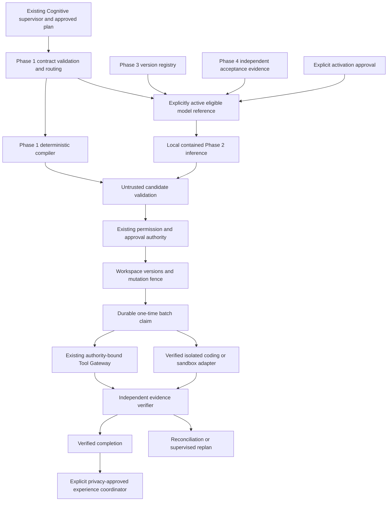

# Architecture and adapter contract

## Authority flow

All arrows into existing repository packages are **ADAPTER_REQUIRED / INTEGRATION_PENDING**. The diagram is the proposed final composition, not a running deployment. The source uses no unfinished cross-phase imports and calls no Groq, FreeLLMAPI or Ollama provider. Reasoning requests are returned as `EscalationRequest` records.

## State machine

`src/state.ts:TRANSITIONS` is the authoritative frozen graph. A valid path still requires semantic guards; inclusion in this table alone grants no permission.

| From | Allowed successors |
| --- | --- |
| CREATED | VALIDATING, CANCELLED, FAILED |
| VALIDATING | WAITING_FOR_CONTEXT, WAITING_FOR_APPROVAL, ROUTING, ESCALATED, FAILED, CANCELLED |
| WAITING_FOR_CONTEXT | VALIDATING, ESCALATED, FAILED, CANCELLED |
| WAITING_FOR_APPROVAL | VALIDATING, ESCALATED, FAILED, CANCELLED |
| ROUTING | GENERATING, CANDIDATE_VALIDATION (retained approved proposal), WAITING_FOR_CONTEXT, ESCALATED, FAILED, CANCELLED |
| GENERATING | CANDIDATE_VALIDATION, WAITING_FOR_CONTEXT, REPAIR_REQUIRED, ESCALATED, FAILED, CANCELLED |
| CANDIDATE_VALIDATION | READY_FOR_EXECUTION, WAITING_FOR_APPROVAL, REPAIR_REQUIRED, ESCALATED, FAILED, CANCELLED |
| READY_FOR_EXECUTION | EXECUTING, WAITING_FOR_APPROVAL, ESCALATED, FAILED, CANCELLED |
| EXECUTING | VERIFYING, ESCALATED, FAILED, CANCELLED |
| VERIFYING | COMPLETED, REPAIR_REQUIRED, ESCALATED, FAILED, CANCELLED |
| REPAIR_REQUIRED | GENERATING (only before any execution), ESCALATED, FAILED, CANCELLED |
| ESCALATED / COMPLETED / FAILED / CANCELLED | None |

Revision CAS and exclusive claims serialize each task. `beginExecution` alone changes `executionStarted` to true and persists the candidate-bound manifest. It is never reset. Verification requires an execution claim; completion requires `verified` independent evidence. Cancellation and execution/completion CAS must be serialized in storage so a cancellation request cannot race through an effect or final acceptance commit. Terminal tasks cannot resume.

`ExecutionOrchestrator.create(taskId, correlationId, totalMs)` creates a local record. `run(taskId, signal)` reads the supervisor assignment and progresses until waiting, escalation, failure, cancellation or verified completion. `cancel(taskId)` writes a durable cancellation flag and aborts an in-process controller when present. If another process owns the claim, the returned snapshot can still be nonterminal until its cancellation poll/effect-boundary checks observe the flag. UI must not label that result as confirmed external rollback.

Waiting for a concrete approval stores `PreparedExecution` under the injected state store. Resumption reads fresh authority, checks the identical supervisor assignment and selected full model reference, and revalidates the retained candidate. No candidate is regenerated solely because its approval was pending. Changed context/plan requires supervised replan. Storage must scope/encrypt sensitive proposal context and apply retention; audit events never contain it.

## Typed boundaries

| Interface | Responsibility and refusal behavior |
| --- | --- |
| `CognitiveSupervisorAdapter` | Read already supervised goal/approved plan/context/immutable decisions/allowed operations/permissions/verification/budget/escalation policy. `repairEvidence` may provide new evidence, never independently replan or call a global model. |
| `PhaseOneAdapter` | `validate`, `select`, `supports`, `compile` preserve Phase 1 semantics and versions. Explicit missing-context/unsupported/stale/invalid/escalate responses stay failures or waiting states. |
| `PermissionAdapter` | Recheck the existing live authority for the exact task, owner, plan, workspace, operation, targets, permissions and full action/candidate binding. Approval reference is not approval by itself. Missing adapter is `permission_unavailable`. |
| `WorkspaceAdapter` / `WorkspaceLease` | Canonical paths, links, snapshot identity, expected preimages including absent files, all required consumers, enforceable cross-process fence and per-write compare-and-swap. No blind overwrite. |
| `ToolGatewayAdapter` | Validate semantic tool arguments, derive exact targets/capability/kind/action digest, translate into existing runtime-issued gateway binding, enforce cancellation/idempotency and return durable evidence. Missing adapter is `capability_unavailable`. |
| `IsolatedExecutionAdapter` | Provide trusted policy and current attestation; resolve immutable artifacts; verify artifact digest at validation and launch; execute only through existing verified isolation infrastructure. Missing/insufficient guarantees reject execution. |
| `IndependentVerifierAdapter` | Resolve real state/receipts independently; cover requirements and exact affected consumer versions; cannot be the generator/executor identity. Missing/malformed evidence is `unavailable`, never success. |
| `LearnedExecutorAdapter` | Discover an explicitly activated version; recheck lifecycle eligibility and scope at generation/effect/acceptance boundaries. `LifecycleBoundModelAdapter` implements this using lifecycle plus transport/codec adapters. |
| `StructuredModelCodec` | Explicit Phase 1/2 format conversion and task-scope authorization. No inferred language grammar, raw model text dispatch or hidden inference fallback. |
| `ApprovedModelTransportFactory` | Resolve approved local bytes, verify all digests and supply a pinned `ModelTransport`. No download or implicit checkpoint discovery. |
| `LocalModelContainmentAdapter` | Establish CPU/memory/process/filesystem/network limits before child instructions run; own/fence/terminate the entire process tree and pending launches. Native spawn alone cannot implement it. |
| `StateStore` | Durable create/read/claim/revision-CAS/one-time dispatch, cancellation and release, with fenced crash recovery. Reference store is isolated and nondurable. |
| `AuditSink` | Append bounded structured events without goals, arguments, paths, raw errors, stdout or stderr; honor deadline signal. Durable delivery remains host work. |
| `ReconciliationAdapter` | Read real external state under exact operation/idempotency identity; provide observations newer than dispatch within a bounded freshness window. Cannot dispatch. |
| Lifecycle and experience interfaces | Separate transactional activation/rollback and permission-compatible memory storage; see `lifecycle-memory.md`. |

## Candidate and tool security

The Phase 5 candidate is exactly `{version:'execution-integration.v1', taskId, actions}`. Each action names an already allowed operation/tool and structured arguments. Sandbox actions additionally carry `artifactRef` and `artifactSha256`. Extra top-level approval, permission or verified claims are rejected. Bounded dense JSON excludes nonfinite values, accessors, unsafe prototype keys, cycles, oversized data and excess depth/node counts.

The trusted adapter must independently derive all resources affected by the arguments; copying the model's target list into `ArgumentValidation` is not sufficient. Returned targets, operation kind, tool, capability, argument hash and full action hash must match the supervisor assignment. File targets must be present with expected versions in the workspace snapshot. Full-action approval binds generated artifact content as well as arguments. Raw code is never evaluated/imported/spawned by these coordinators.

Read capabilities do not imply write permission. File changes/deletion, database mutation, browser submission, external API mutation, Google Ads publication, finance, remote control and sandbox code all require independent sensitive-action approval. `PermissionAdapter` must preserve existing Runtime/chat distinctions, lease consumption, expiry and revocation. A generic true/false wrapper without those checks does not implement the interface.

Every effect adapter must call `context.assertActive()` immediately before its irreversible operation and after internal awaits, and must perform its own atomic authoritative authorization check at that boundary. The callback checks task claim, cancellation, deadline, current model activation, workspace lease and exact action grants. It supplements existing gateway authorization; it cannot make a multi-resource external effect atomic on its own.

## Workspace and sandbox requirements

Workspace IDs and snapshot IDs are opaque identifiers from trusted storage. They are not the dashboard's `WorkspaceSnapshotSchema`. Expected file versions include creation preconditions (`version:null`). A stale or conflicting snapshot rejects and requests replan. Snapshot reads and effect execution are fenced; checking once and later writing without a lease does not satisfy the contract.

The sandbox policy explicitly carries sandbox ID, denied network, read-only/writable roots, CPU time, memory, disk, process count, output and wall-time limits. Current host attestation must bind the policy hash and prove every control plus process-tree termination. Artifacts and output receipts stay separate from independent acceptance evidence. Adapter output truncation must never masquerade as successful verification. Cleanup must not release a workspace for reuse while children can still mutate it.

## Verification, recovery and cancellation

Verifier decisions are `verified`, `rejected`, `inconclusive` or `unavailable`. Evidence includes a distinct verifier, task/candidate binding, requirement kind and independently resolved receipt references. Every required requirement and receipt needs coverage. Consumer evidence is `{contractId, version, consumerId, evidenceRef}` tied to passed workspace-consistency evidence. A list of consumer names alone is insufficient.

All requested failure categories are represented, plus adapter/isolation/audit/budget/state failures. A failure after the batch claim is conservatively classified as possibly effective. Verification failure moves through `REPAIR_REQUIRED` to supervised reconciliation, not automatic repeated execution. Pre-dispatch candidate repair is bounded by `maxCandidates`/`maxRecoveries`, requires fresh evidence and revalidates Phase 1 context without changing approved operations or architecture.

`reconcileEffect` can return `verification_only`, `supervisor_may_authorize_new_task` or escalation. It checks exact operation/idempotency identity and freshness. It does not clear the old claim or reset cancellation. Cancelled tasks never gain retry authority from a reconciliation result. Confirmed applied effects require independent verification; unknown effects remain unresolved.

Total wall time includes waiting for approval/context. Generation, execution and verification each have separate ceilings. Inputs, candidate bytes, actions and tokens are bounded. Abort is propagated to model/process, gateway, sandbox and verifier boundaries. Outer promise timeouts only stop orchestration waiting; adapters must actually fence and tear down work. Late workspace acquisition has explicit cleanup ownership. Storage, lease release and effect cleanup must be bounded by the host and quarantine failures.

## Audit and future UI

Events cover task creation, validation, routing, model selection, candidate generation, approval requests/decisions, sandbox dispatch, verification, failure classification, recovery, escalation, cancellation, completion, promotion and rollback. Task events hash correlation/task/reference identifiers and never log raw model text or tool errors. Lifecycle events contain only whitelisted identifiers/hashes under transactional storage.

`integrationDiagnostics` reports adapter presence independently of verified compatibility. `taskDiagnostic` exposes safe task progress after the caller has enforced owner access. Future UI needs strategy, explicit model version/checkpoint/tokenizer, progress state, missing context, approval pending, unsupported/failure reason, cancellation request versus settlement, independent verification status and lifecycle rollback status. Exact existing component symbols and read endpoints are in `repository-integration.md`. No UI change is required or installed now.
